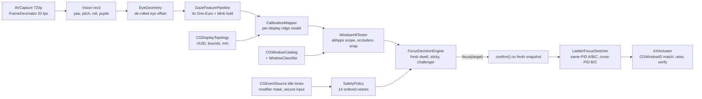
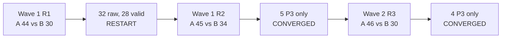

<!-- Repository link policy: use repo-relative links only (invariant I8 rejects absolute home paths and local file URLs). -->
# iFocus: Final Engineering Report and Release Readiness

> **TL;DR:** iFocus is converged at `778bf7d` after three closed review rounds in two waves. The reporter's own re-run passes all 93 tests with zero warnings, and no P0, P1 or P2 findings remain open. Gaze now focuses any standard desktop window across three displays, but only after 2.5 s without input followed by 1.2 to 1.5 s of steady fresh gaze, so typing while you read another window can never steal focus. The repository is ready for GitHub (Apache-2.0, SHA-pinned CI, `pr-guardian`). Next: commit the untracked Round 3 documents, push, and let the first CI run prove `swift build` and `swift test`. Then run the 18-step on-desk checklist ([README.md:111-134](../README.md#L111-L134)).

---

## 1. State of Work

| Dimension | Measured value | Evidence |
| :--- | :--- | :--- |
| Final commit | `778bf7d` on `main` (parents `ddc3550`, `fb078be`); nothing pushed | `git log --oneline` (3 commits) |
| Tests | **93 / 93 passed in 17 suites, 0.833 s** | Reporter re-run, clean cold build: `IFOCUS_SBX_OUT=/tmp/ifocus-rep-r3-501 ./scripts/sbx.sh test` (exit 0) |
| Compiler warnings | **0** `warning:` lines | Same run |
| Static gates | `check-invariants.sh` (I1 to I9, including I8 no host paths and I9 no networking API) and `check-scripts.sh` both pass | Reporter re-run |
| Simulation | `--simulate all --seed 7`: **8 / 8 PASS**, including `mixed-apps-tour`, `mixed-apps-typing-while-reading` and `dual-external-type-too-soon` | Reporter re-run |
| Open findings | P0 0, P1 0, P2 0; P3 5 (`TRG3-01` to `TRG3-04`, `TRG2-03`); 3 deferred to v2 (DEF-01 absorbed by Wave 2) | [triage-r3.md](reviews/triage-r3.md) |
| Supply chain | `gitleaks`, `actionlint`, `zizmor --offline` (default persona): 0 leads; `semgrep`, `osv-scanner`, `trivy` deferred to the first `pr-guardian` run | [sec-review-r3.md](reviews/sec-review-r3.md), [build-r3.md](build-r3.md) |
| Size | 55 source files (~9.3 K lines), 18 test files (~4.7 K lines), zero external dependencies | `wc -l` over `Sources`, `Tests` |

> [!NOTE]
> `swift build` and `swift test` cannot run inside the agent sandbox. Two operations are blocked: SwiftPM's nested `sandbox-exec`, and `xcrun` cache writes under `/var/folders`. Every count above therefore comes from `scripts/sbx.sh`, which compiles the same sources with `swiftc` and the Swift Testing runner. The canonical SwiftPM build is first proven by `.github/workflows/ci.yml` on the first pull request, so that run is the release gate.

### Commit history

| Commit | Round | Content |
| :--- | :---: | :--- |
| `fb078be` | 1 | Core engine, macOS services, CLI and menu-bar app, `T01` to `T54` |
| `ddc3550` | 2 | Remediates all 28 Round 1 findings, adds `T55` to `T78` |
| `778bf7d` | 3 | Wave 2 work: quiet-then-dwell timing, universal `allApps` focus, cross-PID ladder, public-repo files and CI, `T79` to `T93` |

### Build, calibrate and run on macOS (14+, Swift 6 toolchain)

```bash
swift build && swift test                 # or ./scripts/sbx.sh test in restricted shells
./scripts/bundle-app.sh                   # builds and ad-hoc signs dist/iFocus.app
open dist/iFocus.app                      # grant Camera + Accessibility to iFocus, not your terminal
dist/iFocus.app/Contents/MacOS/ifocus --doctor               # scope, blocklist, resolver, live input sample
dist/iFocus.app/Contents/MacOS/ifocus --doctor --focus-test  # cycle focus; expect rung B across apps, rung A within one
dist/iFocus.app/Contents/MacOS/ifocus --calibrate            # per-display wizard; target LOTO RMS <= 0.20
```

The pause shortcut is `ctrl+opt+cmd+f`. To keep switching on terminals only, set `"focusScope": "allowlist"` in `~/Library/Application Support/iFocus/config.json`. To opt individual apps out, list them in `excludedBundleIDs` ([README.md:78](../README.md#L78)).

---

## 2. Architecture and Multi-Monitor Window Switching Design

The code has three layers. `iFocusCore` is pure and reads no clock, so it is hermetically tested. `iFocusMac` holds the native adapters for AVFoundation, Vision, CoreGraphics and AX. `iFocusApp` is the `@main` CLI and menu-bar agent ([Package.swift:11-16](../Package.swift#L11-L16)). Every platform service sits behind a protocol, so the whole decision path, including the focus ladder, runs in virtual time under simulation. The full design and threat model are in [DESIGN.md](../DESIGN.md).



### 2.1 Stage-by-stage mechanics

| Stage | What it does | Where |
| :--- | :--- | :--- |
| Display topology | Enumerates active displays keyed by `CGDisplayCreateUUIDFromDisplayID`, with Quartz bounds, physical millimetres and main-display `primaryHeight`. Changes arrive through `didChangeScreenParametersNotification`. | [CGDisplayTopologyService.swift:13-72](../Sources/iFocusMac/Display/CGDisplayTopologyService.swift#L13-L72) |
| Coordinate flip | Converts Quartz to AppKit using the main display height only. This keeps the built-in-above and portrait-left panels consistent. | [CoordinateSpace.swift:8-18](../Sources/iFocusCore/Geometry/CoordinateSpace.swift#L8-L18) |
| Face and pose | Runs Vision revision 3 rectangle and landmark requests on the largest face, giving yaw, pitch, roll and pupils plus a face count for the multiple-faces veto. Frames never leave memory, and I9 bans networking APIs in `Sources/`. | [FrameProcessor.swift:53-120](../Sources/iFocusMac/Gaze/FrameProcessor.swift#L53-L120) |
| Eye feature | De-rolls the pupil offset against the inter-ocular line so that head tilt does not register as a gaze shift. | [EyeGeometry.swift:5-43](../Sources/iFocusCore/Filter/EyeGeometry.swift#L5-L43) |
| Smoothing | Four One-Euro filters, tuned per signal: head at `minCutoff 1.2, beta 4.0`, eyes at `0.8, 5.0`. Fixations stay steady and saccades still pass. The eye term is held through a blink. | [GazeFeaturePipeline.swift:4-44](../Sources/iFocusCore/Filter/GazeFeaturePipeline.swift#L4-L44), [OneEuroFilter.swift:24-65](../Sources/iFocusCore/Filter/OneEuroFilter.swift#L24-L65) |
| Calibration | Fits one ridge model per display UUID, with MAD outlier rejection and a leave-one-target-out RMS ceiling of 0.20. A head-only fallback covers blinks. | [CalibrationSolver.swift:125-157](../Sources/iFocusCore/Calibration/CalibrationSolver.swift#L125-L157), [RidgeSolver.swift:6-17](../Sources/iFocusCore/Calibration/RidgeSolver.swift#L6-L17) |
| Display selection | Projects the gaze into normalised `(u, v)` on every calibrated display. It prefers the containing display (sticky to the previous one), otherwise the nearest in millimetres, and marks gaze beyond the margins as off-screen. | [CalibrationMapper.swift:47-162](../Sources/iFocusCore/Calibration/CalibrationMapper.swift#L47-L162) |
| Window census | Nine pure rules classify each window. Layer > 0 dialogs become occluders, and security prompts and the lock shield become global vetoes, matched by bundle ID or owner process name (now including `CoreAuthUI`). | [WindowClassifier.swift:22-89](../Sources/iFocusCore/Targeting/WindowClassifier.swift#L22-L89) |
| Scope | Under `allApps` (the default), any non-blocked bundle is eligible. A missing or empty bundle ID fails closed, and an unknown `focusScope` value decodes to `allowlist`. | [Config.swift:245-300](../Sources/iFocusCore/Model/Config.swift#L245-L300) |
| Hit test | Front-to-back z-order. Only eligible layer-0 windows of at least 120x80 can be targets. An 80 pt snap applies, refused when a nearer ineligible panel exists. | [WindowHitTester.swift:5-89](../Sources/iFocusCore/Targeting/WindowHitTester.swift#L5-L89) |
| Hysteresis | A 48 pt sticky margin, a fresh dwell of 1.2 s across displays or 1.5 s within one, and a challenger rule that never commits while a rival candidate is live, so a fly-over cannot commit the window it passes over. | [FocusDecisionEngine.swift:26-161](../Sources/iFocusCore/Engine/FocusDecisionEngine.swift#L26-L161), [:241-249](../Sources/iFocusCore/Engine/FocusDecisionEngine.swift#L241-L249), [:324-338](../Sources/iFocusCore/Engine/FocusDecisionEngine.swift#L324-L338) |
| Pre-commit re-check | Re-runs safety and target resolution on a fresh snapshot and a fresh input sample before any AX mutation. | [FocusCoordinator.swift:435-447](../Sources/iFocusCore/Engine/FocusCoordinator.swift#L435-L447) |

### 2.2 Quiet-then-dwell timing (Wave 2)

The v1 `.typing` veto had a `hold` disposition, so gaze charged a dwell during typing and could commit the moment typing paused. Wave 2 changes `.typing` and `.pointerActive` to `clear` ([FocusTypes.swift:65-75](../Sources/iFocusCore/Model/FocusTypes.swift#L65-L75)). Any input therefore resets candidate progress to zero, and a dwell can only start once input has gone quiet.

| Input class | Quiet period | Source signal ([SystemInputActivityProvider.swift:9-55](../Sources/iFocusMac/Input/SystemInputActivityProvider.swift#L9-L55)) |
| :--- | :---: | :--- |
| Keyboard | 2.5 s | `keyDown`, `keyUp`, `flagsChanged`, plus a held shift, control, option or command key (never fn or caps lock) |
| Click, drag, scroll | 2.5 s | Mouse down and up, drags, `scrollWheel` |
| Pointer move | 2.0 s | `mouseMoved` |
| Then a fresh gaze dwell | 1.2 s cross-display, 1.5 s same-display | Defaults at [Config.swift:107-116](../Sources/iFocusCore/Model/Config.swift#L107-L116) |

The practical result: when your hands are idle (glancing at Spotify to press Space), a switch takes about 1.2 s. Right after typing, it takes about 3.7 to 4.0 s. Typing for ten seconds while reading another window produces zero switches. Plan A measured 0 of 295 locked steps carrying a candidate across 10 seeds, and the `mixed-apps-typing-while-reading` scenario pins this behaviour. The trade-off is accepted and pinned by T91: if you look at a window and start typing within about 1.2 s, the keys still go to the old window. The v1 amber mismatch alert is retired, because no typing-time dwell can complete any more. Input is read only from idle-time counters, so there is no event tap and no Input Monitoring grant.

### 2.3 Same-PID and cross-PID window raising

Several windows can share one PID: 4 or 5 Ghostty windows, or two Chrome windows side by side. Planning measured 9 Ghostty windows with only 6 distinct frames, so identity resolves by `CGWindowID` and every switch is confirmed against the window server.

1. **Identity.** `_AXUIElementGetWindow` is resolved at runtime through a `dlopen`ed HIServices handle, with no link-time dependency and a public geometric fallback ([AXWindowID.swift:13-39](../Sources/iFocusMac/Focus/AXWindowID.swift#L13-L39), [AXWindowMatcher.swift:5-38](../Sources/iFocusCore/Targeting/AXWindowMatcher.swift#L5-L38)).
2. **Rung choice.** A same-PID switch starts at rung A (raise, `kAXMain`, `kAXFocused`). A cross-PID switch skips rung A, because a raise inside a background app cannot deliver keystrokes. It runs raise, bring forward, raise instead, using `kAXFrontmost` in rung B and `NSRunningApplication.activate` in rung C ([LadderFocusSwitcher.swift:29-45](../Sources/iFocusCore/Engine/LadderFocusSwitcher.swift#L29-L45)).
3. **Re-match on stale.** The AX window list reorders after activation, so each step gets one re-enumerate and re-match before it gives up ([LadderFocusSwitcher.swift:79-104](../Sources/iFocusCore/Engine/LadderFocusSwitcher.swift#L79-L104)).
4. **Verification.** A switch succeeds only when `frontmostPID == target.pid`, the focused `CGWindowID` matches, and the AX key window does not differ. Cross-PID gets 8 polls 50 ms apart, because activation is asynchronous; same-PID gets 3 ([LadderFocusSwitcher.swift:160-188](../Sources/iFocusCore/Engine/LadderFocusSwitcher.swift#L160-L188)).
5. **Bounded failure.** Each AX element has a 0.25 s timeout, enumeration has a 0.5 s budget and the ladder a 1.0 s deadline. Every failure path, now including `.staleCandidate`, rolls focus back within 0.35 s ([LadderFocusSwitcher.swift:133-142](../Sources/iFocusCore/Engine/LadderFocusSwitcher.swift#L133-L142), [:190-223](../Sources/iFocusCore/Engine/LadderFocusSwitcher.swift#L190-L223)).

### 2.4 Safety envelope

[SafetyPolicy.swift:6-75](../Sources/iFocusCore/Engine/SafetyPolicy.swift#L6-L75) checks its 14 veto cases in a fixed order on every frame.

| Disposition | Vetoes | Effect on dwell |
| :--- | :--- | :--- |
| `clear` | paused, sessionInactive (`CGSessionCopyCurrentDictionary`, fails closed), secureInput, sourceNotAllowed (prompt on screen, hard-blocked frontmost app), uncalibrated, pointerActive, failureBackoff, **typing** | Candidate discarded |
| `dropout` | noGaze, staleGaze, lowConfidence, multipleFaces, lookingDown | Candidate expires after 0.12 s |
| `hold` | cooldown | Dwell continues, and commits once the cooldown ends |

Some targets are excluded unconditionally, through exact IDs plus prefixes ([Config.swift:21-49](../Sources/iFocusCore/Model/Config.swift#L21-L49)):

- Authentication prompts.
- Password managers: 1Password 7 and 8, Apple Passwords, Bitwarden, Keychain Access.
- System Settings and Screen Sharing.
- Spotlight, which is kept as an occluder.
- Desktop chrome.
- iFocus itself, identified by `dev.ifocus.app` and by its runtime `Bundle.main.bundleIdentifier`.

---

## 3. Closed-Loop Swarm Audit Trail



### 3.1 Round-by-round ledger

| Stage | Round 1 (`fb078be`) | Round 2 (`ddc3550`) | Round 3, Wave 2 (`778bf7d`) |
| :--- | :--- | :--- | :--- |
| Scope | v1 core | Remediate 28 findings | Quiet-then-dwell, `allApps`, cross-PID, GitHub readiness |
| Arbiter merge | **A 44 / B 30.** 7 grafts, 14 amendments. B's title tie-break rejected because it needs Screen Recording. ([§0](plans/final-plan-r1.md)) | **A 45 / B 34.** 7 grafts, 8 amendments. B's `layer <= 1000` filter rejected because the lock shield sits at layers 2001 and 2004. ([§0](plans/final-plan-r2.md)) | **A 46 / B 30.** 5 grafts (RC1 stricter `alreadyFocused`, RC2 runtime self-exclusion, RC3 `CoreAuthUI`), 10 amendments (AW1 8-poll cross-PID verification, AW6 I9 no-networking invariant). B's hand re-timing of 15 tests and its invented licence holder rejected. ([§0](plans/final-plan-r3.md)) |
| Build | 54/54 tests ([build-r1](build-r1.md)) | 78/78, 0 warnings ([build-r2](build-r2.md)) | 93/93, 0 warnings; `Config.v1Mechanics` fixture keeps 11 mechanics tests unedited; assertion edits limited to 8 approved tests ([build-r3](build-r3.md)) |
| `code-reviewer` | 24 raw (P1 4, P2 10, P3 10) | 5 raw (P3) | 4 raw (P3) ([code-review-r3](reviews/code-review-r3.md)) |
| `sec-reviewer` | 8 raw (P1 3, P2 4, P3 1) | 0 | 0; SEC-001 to SEC-008 hold ([sec-review-r3](reviews/sec-review-r3.md)) |
| `triage` | 28 valid (P1 6, P2 12, P3 10), 0 rejected. Verdict **RESTART** | 28/28 closed, 3 P3. Verdict **CONVERGED** | 0 P0 to P2, 4 P3, TRG2-02 closed. Verdict **CONVERGED** ([triage-r3](reviews/triage-r3.md)) |

### 3.2 Round 1 P1 findings, with verified fixes

| ID | Defect | Fix | Proof |
| :--- | :--- | :--- | :--- |
| TRG-01 (CR-01) | Start/stop race leaves camera live; `stop()` can hang | Generation fence plus post-start liveness check | T55, T56; probes P3 to P5 |
| TRG-02 (CR-03) | Screen-saver-level calibration overlay traps the user on a dead camera | Immediate cancel, clickable Cancel button, 5 s watchdog, camera observers | T57 |
| TRG-03 (CR-04) | AX timeout set only on the app element (~6 s stalls) | Per-element 0.25 s timeout, circuit breaker, 0.5 s and 1.0 s budgets | T58 |
| TRG-04 (SEC-001) | Camera reactivated behind the lock screen | `CGSessionCopyCurrentDictionary` gating | T59, T78 |
| TRG-05 (SEC-002) | Layer > 0 dialogs invisible to occlusion | 9-rule `WindowClassifier` plus global prompt veto | T60 to T62, T77 |
| TRG-06 (SEC-003) | Hard blocklist skipped when `requireAllowedSource=false` | Unconditional blocklist (prefix-aware since Wave 2) | T63 |

The 12 P2 and 10 P3 items from Round 1 are mapped to `file:line` and test in [loop-summary.md](reviews/loop-summary.md) and [code-review-r2.md](reviews/code-review-r2.md).

### 3.3 Wave 2 acceptance scenarios requested in the brief

| Scenario | Result | Proof |
| :--- | :--- | :--- |
| Ghostty to Spotify, then Space reaches Spotify | Cross-PID rung B, frontmost PID and window verified | Simulation `mixed-apps-tour`; desk step 12 |
| Ghostty to the second of two side-by-side Chrome windows | Exact `CGWindowID` match within the shared PID | `mixed-apps-tour`; desk step 13 |
| Type in Ghostty for 10 s while staring at Chrome, pause 1.5 s, resume, stop | Zero steals, then a clean switch at 2.5 s quiet plus 1.2 s gaze | `mixed-apps-typing-while-reading`; desk step 14 |

### 3.4 What remains open

| ID | Severity | Item | Disposition |
| :--- | :---: | :--- | :--- |
| TRG3-01 | P3 | Timing tests T27, T35 and T37 assert lower bounds only | Polish |
| TRG3-02 | P3 | No "Waiting for input to go quiet" cue for `.pointerActive` | Polish (see v2 item 3) |
| TRG3-03 | P3 | All-or-nothing 0.5 s AX enumeration budget, wider exposure for many-window browsers under `allApps` ([AXActuator.swift:31-60](../Sources/iFocusMac/Focus/AXActuator.swift#L31-L60)) | Polish, **do first** |
| TRG3-04 | P3 | No `AXStandardWindow` subrole gate under `allApps` | Polish, after the desk `--doctor` census |
| TRG2-03 | P3 | ~4 Hz no-op `@MainActor` heartbeat | Polish |
| DEF-02 to DEF-04 | v2 | Native tabs, majority-share dwell, Dock and banner occlusion | Section 5 |

---

## 4. Release Readiness (GitHub and `pr-guardian`)

| Item | Status |
| :--- | :--- |
| `LICENSE` (canonical Apache-2.0, hash-gated), `SECURITY.md`, `CONTRIBUTING.md`, `DESIGN.md` | Committed in `778bf7d` |
| `.github/workflows/ci.yml` | `macos-15`, `permissions: contents: read`, checkout pinned to a 40-hex SHA with `persist-credentials: false`. Runs invariants, script checks, `swift build`, `swift test`, then `sbx.sh test`. `actionlint` and `zizmor` clean. |
| `.github/workflows/pr-guardian.yml` | Byte copy of the reference (SHA-256 match), `permissions: {}`, `/ai-review` limited to writers |
| I8 and I9 | Enforced locally and in CI over every tracked and untracked non-ignored file |
| **Uncommitted** | `docs/reviews/{code-review,sec-review}-r3.{md,json}`, `docs/reviews/triage-r3.md`, modified `docs/reviews/loop-summary.md`, and this rewritten report. All pass I8, and they need one docs commit before the push. |
| **First CI run must prove** | That `swift build` and `swift test` work on the runner, and that the runner's newest Xcode accepts Swift 6.4-era code (AW2 names the fallback). It must also confirm `semgrep`, `osv-scanner` and `trivy` inside `pr-guardian`. |

---

## 5. Prioritised Next-Wave Features (v3)

These are ranked for the stated layout: 1 or 2 windows side by side on each of three displays, mixed across terminals, a browser and media. Value is the expected cut in wrong-window keystrokes or manual focus actions, and complexity is engineer-days plus any new TCC grant.

| Rank | Feature | Value | Complexity | Rationale |
| :---: | :--- | :---: | :---: | :--- |
| 1 | **Gaze-commit hotkey**: a Carbon `RegisterEventHotKey` chord focuses the current gaze candidate at once, bypassing quiet and dwell | High | Low (2 d) | Removes the 3.7 to 4.0 s post-typing latency whenever you choose to. Reuses the pause-hotkey machinery and needs no new grant. |
| 2 | **Undo last switch** hotkey, plus local undo-rate telemetry to tune dwell per display | High | Low (2 d) | A wrong switch becomes a one-chord fix. The rate of undos within 2 s is a direct false-positive metric. |
| 3 | **Dwell progress and quiet cue**: a border that fills on the candidate window, and "waiting for quiet" for typing and pointer input (absorbs TRG3-02) | High | Low (2 d) | Makes a 1.2 to 1.5 s dwell legible, so you know whether to keep looking or press the hotkey. |
| 4 | **`allApps` hardening sweep**: ID-first partial AX enumeration (TRG3-03), `AXStandardWindow` gate (TRG3-04), TRG2-03, TRG3-01 | Medium-high | Low (2 d) | Chrome and VS Code with many windows are now default targets, and a lost enumeration costs a 2 s backoff. |
| 5 | **Per-app policy**: dwell and quiet overrides per bundle (shorter for media apps, longer for browsers) | Medium-high | Low-medium (2 to 3 d) | Spotify needs only a quick glance, whereas a browser next to a terminal needs more certainty. |
| 6 | **Implicit online recalibration**: each matched typing burst becomes a labelled sample for a damped ridge update | High | Medium (4 d) | Absorbs posture and lighting drift without re-running the wizard. |
| 7 | **Pane and tab integration** (DEF-02 superset): kitty `@ focus-window`, WezTerm `cli activate-pane`, iTerm2 API, Chrome tab strip | High | Medium-high (5 to 8 d) | Splits and tabs live inside one AX window, so v1 stops at the window. |
| 8 | **Majority-share dwell** (DEF-03) plus a trace-tuned fixation classifier | Medium | Medium (3 to 4 d) | Fixes starvation on shared edges when 1 in 3 samples lands on a neighbour. |
| 9 | **Background attention cue**: a bell or OSC 9 notification in an unfocused terminal flashes its border | Medium | Medium (3 d) | Suits long builds and agent runs spread across panels. |
| 10 | **Adaptive frame rate**, plus Dock and banner sub-rect occlusion (DEF-04) | Low-medium | Low (2 d) | Battery and thermal headroom, plus hygiene. |

Suggested sequencing is items 1 to 4 as a one-week wave. All four are pure-core or hotkey work with no new grants, and item 4 should land before wider public use under `allApps`.

---

## 6. Risks and Unverified Claims

| Risk | Status | Retired by |
| :--- | :--- | :--- |
| SwiftPM build and test on the runner toolchain | **Unverified in sandbox** | First CI run |
| Real cross-app activation latency against the 8-poll (350 ms) verification window | **Reasoned, not measured** (AW1) | Desk step 16 |
| Vision pose quality and same-display separation at 720p (~5 to 8 degrees) | **Unverified in sandbox** | Desk steps 4, 5, 10, 13 |
| Unlocked layer > 0 census and prompt-owner resolution | **Unverified**: the screen was locked during all rounds | Desk steps 6, 7, 17 |
| Bitwarden and 1Password 7 exact bundle IDs | Covered by prefix rules, not observed | Desk step 15 |
| `_AXUIElementGetWindow` removal in a future macOS | Mitigated by public fallback plus CG verification | Section 7 forecast |

---

## 7. 6 to 12 Month Horizon (forecast, not measurement)

| Forecast | Window | Effect on today's design | Ledger ID |
| :--- | :--- | :--- | :--- |
| The macOS 27 SDK keeps `_AXUIElementGetWindow` resolvable but adds no public AX-to-`CGWindowID` API | 2027-Q2 to Q3 | The resolver stays private. If the symbol is removed, same-PID windows with identical frames become ambiguous, and the pane adapters (v3 item 7) become the main way to tell them apart. | `ifocus-axgetwindow-macos27` |
| The Swift-native Vision API becomes the documented path, and VN-prefixed face requests are soft-deprecated | 2027-Q2 to Q3 | A small `FrameProcessor` port. The pure core is unaffected because it consumes `GazeFeatures` only. | `ifocus-vision-swift-api` |

> [!WARNING]
> Neither forecast is in `~/.gemini/horizons/` yet. `horizon.py record` failed with `PermissionError: Operation not permitted` because the agent sandbox blocks that directory. Re-run both `record` calls outside the sandbox with `http_digest` probes on the Apple macOS release notes page and the `VNDetectFaceLandmarksRequest` page.

---

## Further Reading

- Casiez, Roussel and Vogel, *1€ Filter* (CHI 2012): https://gery.casiez.net/1euro/ *(unverified URL)*
- Apple, `AXUIElement.h` reference: https://developer.apple.com/documentation/applicationservices/axuielement_h *(unverified URL)*
- Apple, `CGEventSource.secondsSinceLastEventType`: https://developer.apple.com/documentation/coregraphics/cgeventsource/secondssincelasteventtype(_:eventtype:) *(unverified URL)*
- GitHub, security hardening for GitHub Actions: https://docs.github.com/en/actions/security-for-github-actions/security-guides/security-hardening-for-github-actions *(unverified URL)*
