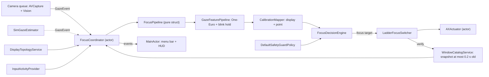
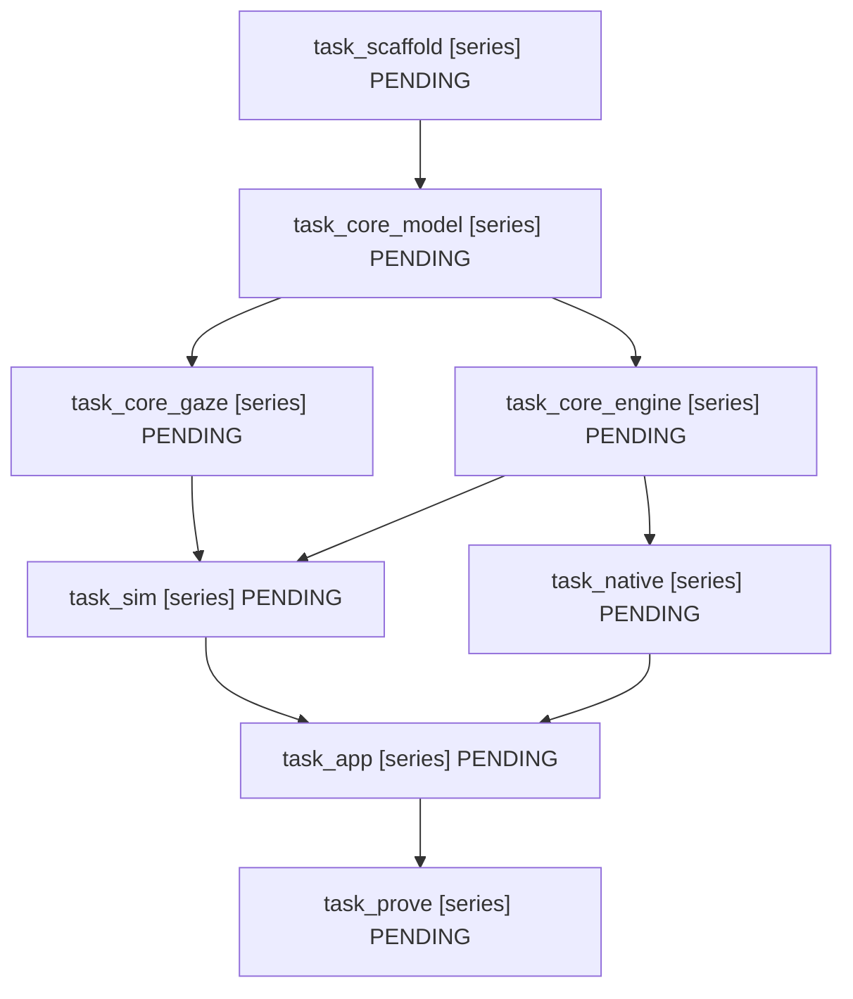

# iFocus Final Plan (Round 1)

Author: `arbiter` | Round: 1 | Inputs: `docs/plans/plan-a-r1.md` (board #12), `docs/plans/plan-b-r1.md` (board #11) | Status: ready for `builder`

This document is self-contained. The builder does not need either input plan. Where this plan and an input plan disagree, this plan wins.

## 0. Decision

**Plan A is the base. Seven mechanisms are grafted from Plan B (B1 to B7), and fourteen arbiter amendments (AM1 to AM14) close gaps found in A.**

Plan A wins because its three unusual positions rest on measurements that I reproduced (section 1), and because Plan B's answer to the hardest requirement, telling apart same-PID windows that have identical frames, depends on window titles that Plan B itself says it cannot read.

### 0.1 Scores (out of 10)

| Axis | A | B | Deciding evidence |
|---|---|---|---|
| 1. Multi-monitor geometry and calibration | 9 | 6 | A calibrates per display into normalised panel coordinates, which fits the measured desk (three panels, one portrait, 3.4 to 5.0 pt/mm). B's single global model over the display hull cannot fit that; its uncalibrated ray baseline switches focus on guessed gains; its 9-term basis needs nine targets that neither of its wizards collects; its fingerprint discards the profile on a resolution change. |
| 2. Same-PID `AXUIElement` focus accuracy | 9 | 5 | I counted 9 on-screen Ghostty windows under one PID with only 6 distinct frames (V6). A resolves by `CGWindowID` with a public fallback and verifies every switch through the window list. B's tie-break compares AX titles with CG titles, which need Screen Recording, and it never verifies the result. |
| 3. Anti-misclick guards | 8 | 7 | A has ordered pure vetoes, two dwell times, a sticky margin, a source allowlist and the mismatch alert. B adds three guards A lacks (pointer recency, modifier keys, look-down) but ships a 220 ms dwell, an all-windows mode, and a points-per-second saccade gate whose exit threshold sits inside realistic eye noise. |
| 4. Swift 6 concurrency, TCC, privacy | 9 | 6 | A's signatures are compile-proven and it never reads a window title. B calls `AVCaptureDeviceInput.videoMinFrameDurationOverride`, which is `API_UNAVAILABLE(macos)` (V8), reads AX titles, and places AppKit and Vision code inside `iFocusCore`. |
| 5. Testability and scope | 9 | 6 | A has a hermetic core, a simulation harness with an independent forward model, 38 identified tests and a build script that works in the sandbox. B's build instructions fail here (V2). |
| **Total** | **44** | **30** | |

### 0.2 Grafted from Plan B

| # | Plan B mechanism | How it lands here |
|---|---|---|
| B1 | `.flagsChanged` counts as typing | Keyboard idle time is the minimum of the key-down and flags-changed idle times (4.6). |
| B2 | Manual pointer lock | New veto `.pointerActive`: button held, or pointer moved or clicked recently (4.6). |
| B3 | Look-down lock | Kept, but calibration-relative instead of B's absolute `+0.30 rad`, which depends on camera height (4.4, 4.6). |
| B4 | Hold the eye term through a blink | The feature pipeline holds the last eye offset for `eyeHoldSeconds`, so a blink no longer resets dwell (4.3). |
| B5 | Pre-commit guard re-check | `FocusDecisionEngine.confirm` re-runs the policy on fresh input activity and a fresh snapshot immediately before any AX mutation (4.7). |
| B6 | Zero-mutation idempotency check | The ladder returns `.alreadyFocused` before touching AX when the target is already focused (4.8). |
| B7 | Secure-input override, "Open Privacy Settings" menu item, flyover acceptance test | Config `respectSecureInput`, menu item (5.2), test T44. |

### 0.3 Rejected from Plan B

| Plan B item | Reason |
|---|---|
| One global calibration model, uncalibrated 3D ray baseline, `CameraBezelAnchor` | No model means no switch. Guessed gains moving keyboard focus is the failure this product exists to prevent. Head-translation features are captured in v1 and used in v2. |
| AX title scoring, `--debug-titles` | Titles are unreadable on the CG side without Screen Recording, so the tie-break is inert exactly when frames are identical. Not reading titles at all is also the better privacy position. |
| Saccade gate in pt/s (enter 2000, exit 450) | With 4 degrees of raw eye noise the filtered point moves at 250 to 800 mm/s frame to frame, so the gate would latch and block all switching. Dwell on candidate identity already gives zero flyover switches (T44). A fixation classifier goes to v2, tuned on recorded traces. |
| `videoMinFrameDurationOverride`, adaptive 20 to 8 fps | Unavailable on macOS (V8). Adaptive power is v2. |
| `TopologyFingerprint` over bounds, `CryptoKit` | Per-display models keyed by display UUID survive rearrangement and resolution changes. |
| Platform code inside `iFocusCore` | Breaks the hermetic test target. |
| `.allStandardWindows` mode, IDE bundle IDs in the default allowlist | Wider hijack surface than the brief needs. Users can add bundle IDs in config. |
| Dwell 220 ms, cooldown 350 ms | Too aggressive for an eye term good to 5 to 8 degrees. |

### 0.4 Arbiter amendments to Plan A

| # | Amendment | Why |
|---|---|---|
| AM1 | Every veto has a disposition (`clear`, `dropout`, `hold`) and the policy runs on every step, not only at commit. Cooldown holds the candidate instead of clearing it. | In A, dwell could accumulate on low-confidence samples and commit on one good one; and a dwell that completed inside the cooldown was thrown away, costing a second full dwell. |
| AM2 | A failed switch starts `failureBackoffSeconds`; `lastSwitchAt` moves only on success. | A's 4.6 and 4.8 contradicted each other. Without backoff a failing target is retried about twice a second. |
| AM3 | The ladder re-enumerates and re-matches AX windows before every rung, and the actuator re-validates the window's identity before acting. | AX window order changes after a raise, so a cached index points at a different window on the next rung. |
| AM4 | `SecureFileStore`, config and profile stores live in `iFocusCore`; reads use `open(O_NOFOLLOW)` then `fstat` on the descriptor. | A's T34 could not reach a store placed in `iFocusMac`; `lstat` then `open` is a check-then-use race. |
| AM5 | The window-ID symbol is looked up through a `dlopen`ed HIServices handle, then `RTLD_DEFAULT`; config `usePrivateWindowIDResolver` can force the public path. | V5: a bare `RTLD_DEFAULT` lookup returned nil in a process that had not yet loaded ApplicationServices. |
| AM6 | Camera configuration is guarded (`canSetSessionPreset`, `canAddInput`, supported frame-rate ranges) and frame rate is enforced by decimation in the delegate. | Setting an unsupported frame duration raises an Objective-C exception, which Swift cannot catch. Many Mac cameras are fixed at 30 fps. |
| AM7 | An empty display topology is a normal state. | V7: `CGGetActiveDisplayList` returned zero displays while the screens slept. |
| AM8 | Camera modes refuse to start unless `Bundle.main` declares `NSCameraUsageDescription`; `scripts/sbx.sh` embeds `Resources/Info.plist` in the binary. | A missing usage string makes TCC kill the process. V10 proves the embed. |
| AM9 | Executable target is `iFocusApp`, product `ifocus`, entry point `@main` compiled `-parse-as-library` in both build paths. | Matches the builder brief's names and removes the `main.swift` ambiguity A flagged. V4 proves the shape. |
| AM10 | `displayFallback` is implemented and tested but defaults to `false`. | "Gaze on empty desktop focuses some terminal" is surprising; least surprise wins by default. |
| AM11 | `.noHeadMovement` is a warning on the model, not an error; standard deviations are floored at physical values. | People move only their eyes for a small panel. A's rule would reject a valid calibration. Fit quality is judged by cross-validation error. |
| AM12 | Off-screen margin is asymmetric: 60 mm at the sides and top, 20 mm below a panel. | A laptop keyboard starts about 30 mm below its panel, inside A's 60 mm margin, so a glance at the keys could select a terminal on that panel. |
| AM13 | One pure `FocusPipeline` value type is shared by the async coordinator and the synchronous scenario runner; wizard sequencing is a pure `CalibrationSession`. | No decision logic is duplicated, and the wizard becomes testable. |
| AM14 | Head pose is read from the `VNDetectFaceRectanglesRequest` observation, which is passed to the landmarks request as `inputFaceObservations`. | V9: the header documents yaw, pitch and roll as populated by the rectangles request. |

## 1. Verified environment facts

Rows V1 to V11 were re-run by the arbiter in `/tmp/ifocus-arb-spike` (nothing was written to the workspace).

| # | Fact | Evidence | Consequence |
|---|---|---|---|
| V1 | Swift 6.4, Command Line Tools only, macOS 26.7.2. No `XCTest.framework`. `Testing.framework` and `libTestingMacros.dylib` are present. | `swift --version`, `find`, `ls` | All tests use Swift Testing. No `import XCTest`. No `xcodebuild`. |
| V2 | SwiftPM cannot build inside the agent sandbox. The brief's command fails with `sandbox-exec: sandbox_apply: Operation not permitted`. With `--disable-sandbox` it fails with `unable to write manifest to .../manifest.json ... NSCocoaErrorDomain Code=513`. `--build-system native` fails on `output-file-map.json`. | Ran all three on a two-target package | `scripts/sbx.sh` (section 10) is the gate of record in the sandbox. |
| V3 | `swift package --disable-sandbox describe` succeeds inside the sandbox. | Ran it; full target listing printed | `Package.swift` can still be validated (gate G1b). |
| V4 | A direct `swiftc` pipeline works in the sandbox with two library modules, an `@main` executable compiled `-parse-as-library`, a Swift Testing runner, and `-target arm64-apple-macosx14.0`. | `Test run with 1 test in 0 suites passed`; executable ran | The script in section 10 is proven in the shape this plan uses. |
| V5 | `_AXUIElementGetWindow` resolves once HIServices is loaded and is callable without trust (returned `-25208`, no crash). A bare `dlsym(RTLD_DEFAULT, ...)` returned nil in a binary that referenced no AX function. | Two probes | AM5. |
| V6 | Ghostty (one PID) has 9 on-screen layer-0 windows with 6 distinct frames. | `CGWindowListCopyWindowInfo` probe | Geometry alone cannot identify the AX window. |
| V7 | `CGGetActiveDisplayList` returned 0 displays during my probe (screens asleep), where Plan A measured 3. | Probe | AM7. |
| V8 | `videoMinFrameDurationOverride` is `API_UNAVAILABLE(macos)`. | `AVCaptureInput.h:275` | Do not use it. |
| V9 | `VNFaceObservation.pitch`: "positive angle corresponds to nodding head down"; roll, yaw and pitch are "populated by VNDetectFaceRectanglesRequest". | `VNObservation.h:125-137` | AM14; the look-down guard can rely on the sign. |
| V10 | `-Xlinker -sectcreate -Xlinker __TEXT -Xlinker __info_plist -Xlinker <plist>` makes the plist readable through `Bundle.main`. `plutil -lint` and `codesign --force --sign -` work in the sandbox. | Probe | AM8; `scripts/bundle-app.sh` can run in the sandbox. |
| V11 | `CGEventSource.secondsSinceLastEventType(.combinedSessionState, ...)` returns values for `.keyDown`, `.flagsChanged` and `.mouseMoved` with no TCC grant. | Probe | B1 and B2 need no permission. |

Measured by Plan A and adopted as fixtures: the three-display topology (main `(0,0,2560,1440)` 699x389 mm; built-in `(1140,-1117,1728,1117)` 344x223 mm; portrait `(-1152,-188,1152,2048)` 340x598 mm), and the compile-proven list (AX calls inside an `actor`; `CGEventSource`; `IsSecureEventInputEnabled()`; Carbon `RegisterEventHotKey`; Vision requests inside an `AVCaptureVideoDataOutputSampleBufferDelegate`; click-through `NSPanel`; `["AXTrustedCheckOptionPrompt": true] as CFDictionary` instead of the non-Sendable global; capturing `AVCaptureSession` in a `@Sendable` closure is a hard error).

Not verifiable in the sandbox, so they need the on-desk checklist in section 14:

| # | Open question |
|---|---|
| NV1 | Quality of Vision pose and pupil landmarks at runtime. |
| NV2 | Whether the AX ladder moves keyboard focus on macOS 26 for each terminal app. |
| NV3 | Whether TCC accepts the embedded plist when the raw binary is started from a terminal. The supported launch path is the app bundle. |

## 2. Behaviour contract (v1)

| Situation | iFocus does |
|---|---|
| Focus is on terminal A; the user looks at terminal B (same app or not), holds gaze for the dwell time, keyboard and pointer idle | Raises and focuses B; flashes a border on B. |
| The user is typing in A and glances at B or at documentation | Nothing. The typing lock holds focus on A. |
| The user types in A while looking steadily at B (the wrong-terminal race) | No switch mid-burst. Flashes an amber border on A (optional beep). Switches to B when typing pauses and gaze is still on B. |
| The user has just clicked or is moving the pointer | Nothing until the pointer lock expires. Manual input outranks gaze. |
| The user looks at a non-allowlisted window, or the focused app is not allowlisted | Nothing. |
| The user looks down at the keyboard, away from all displays, or leaves | Nothing. Off-screen, low-confidence and looking-down gaze cannot cause a switch. |
| Second face in frame, secure input active, screen locked or asleep, paused, no calibration | Nothing. |
| A switch attempt fails verification | Backs off for `failureBackoffSeconds`; the menu shows the failure count. |

iFocus never moves the cursor, never posts synthetic input, never installs an event tap and never reads a window title.

Config (`config.json`; every numeric value is clamped to its range on load; unknown keys are ignored; missing keys take defaults):

| Key | Default | Range | Purpose |
|---|---|---|---|
| `dwellCrossDisplaySeconds` | 0.30 | 0.15 to 2.0 | Dwell when the candidate is on a different display from the focused window. |
| `dwellSameDisplaySeconds` | 0.45 | 0.15 to 2.0 | Dwell between windows on one display. |
| `stickyMarginPoints` | 48 | 0 to 200 | Gaze must leave the focused window's rect inflated by this margin before a neighbour can become a candidate. |
| `snapRadiusPoints` | 80 | 0 to 300 | Gaze just outside an eligible window still counts as that window. |
| `candidateDropoutSeconds` | 0.12 | 0.03 to 0.5 | A candidate survives this long without a supporting sample. |
| `switchCooldownSeconds` | 0.60 | 0.2 to 5.0 | Minimum gap between two successful switches. |
| `failureBackoffSeconds` | 2.0 | 0.5 to 30 | No attempts after a failed switch. |
| `typingLockSeconds` | 1.00 | 0.3 to 5.0 | No switch while the last key-down or modifier change is more recent than this. |
| `pointerMoveLockSeconds` | 0.8 | 0 to 5 | No switch this soon after pointer movement, drag or scroll. |
| `pointerClickLockSeconds` | 1.5 | 0 to 10 | No switch this soon after a mouse-down. |
| `minConfidence` | 0.50 | 0.1 to 0.95 | Vision face confidence gate. |
| `staleSampleSeconds` | 0.30 | 0.1 to 1.0 | Older gaze is ignored. |
| `eyeHoldSeconds` | 0.30 | 0 to 1.0 | The eye term is held this long through a blink, then the head-only model takes over. |
| `offscreenMarginMM` | 60 | 10 to 200 | Tolerance outside a panel at the sides and top. |
| `offscreenMarginBottomMM` | 20 | 0 to 200 | Tolerance below a panel (AM12). |
| `lookDownGuard` / `lookDownMarginRadians` | true / 0.14 | 0.03 to 0.6 | Head pitch beyond the lowest calibrated target plus this margin vetoes (B3). |
| `allowedBundleIDs` | `com.apple.Terminal`, `com.googlecode.iterm2`, `com.mitchellh.ghostty`, `net.kovidgoyal.kitty`, `org.alacritty`, `com.github.wez.wezterm`, `dev.warp.Warp-Stable` | at most 64 entries, each matching `^[A-Za-z0-9._-]{1,255}$` | Only these can be focus targets. Invalid entries are dropped. |
| `requireAllowedSource` | true | bool | Only switch when the focused app is also allowlisted. |
| `respectSecureInput` | true | bool | Secure input freezes switching (B7). |
| `displayFallback` | false | bool | Gaze on a display but on no window focuses that display's most recently used eligible window (AM10). |
| `mismatchAlert` / `mismatchBeep` / `mismatchAlertIntervalSeconds` | true / false / 2.0 | 0.5 to 10 | Wrong-terminal warning. |
| `switchFlash` | true | bool | Border flash on the newly focused window. |
| `cameraFPS` | 20 | 5 to 30 | Processing rate (by decimation, AM6). |
| `cameraUniqueID` | null | string | Explicit camera choice. |
| `usePrivateWindowIDResolver` | true | bool | AM5 switch. |
| `pauseHotKey` | `ctrl+opt+cmd+f` | key spec | Global pause toggle. |

Latency from "eyes land" to "focus moved": frame interval 50 ms, Vision about 10 ms, filter lag about 60 ms, dwell 300 to 450 ms, AX round trip about 30 ms: roughly 0.45 to 0.6 s.

## 3. Architecture

### 3.1 Targets

| Target | Kind | May import | Contents |
|---|---|---|---|
| `iFocusCore` | library | `Foundation` (and `CoreGraphics` for geometry types) only | Value types, protocols, coordinate math, feature pipeline, calibration, hit-tester, safety policy, decision engine, AX match logic, focus ladder, pipeline, coordinator, file store, config, simulation harness. |
| `iFocusMac` | library | AppKit, AVFoundation, Vision, ApplicationServices, Carbon.HIToolbox, `iFocusCore` | Native implementations of every protocol, HUD, calibration overlay, menu bar, hotkey, permissions, doctor. |
| `iFocusApp` | executable, product name `ifocus` | both libraries | Argument parsing and mode dispatch only. |
| `iFocusCoreTests` | test | `Testing`, `@testable import iFocusCore` | Section 9. Needs no permission, camera or display. |

```swift
// swift-tools-version: 6.0
import PackageDescription
let package = Package(
    name: "iFocus",
    platforms: [.macOS(.v14)],
    products: [
        .library(name: "iFocusCore", targets: ["iFocusCore"]),
        .executable(name: "ifocus", targets: ["iFocusApp"]),
    ],
    targets: [
        .target(name: "iFocusCore"),
        .target(name: "iFocusMac", dependencies: ["iFocusCore"]),
        .executableTarget(name: "iFocusApp", dependencies: ["iFocusCore", "iFocusMac"]),
        .testTarget(name: "iFocusCoreTests", dependencies: ["iFocusCore"]),
    ],
    swiftLanguageModes: [.v6]
)
```

No external dependencies and no `unsafeFlags`.

### 3.2 Data flow



### 3.3 Concurrency model

| Isolation domain | Owns | Rule |
|---|---|---|
| Camera serial `DispatchQueue` | `AVCaptureSession`, Vision requests, `CVPixelBuffer` | Frames never leave the delegate callback. Only a `Sendable` `GazeEvent` is yielded through `AsyncStream` with `.bufferingNewest(1)`. Start and stop go through the queue-confined wrapper with `[weak self]`; the session is never captured in a `@Sendable` closure. |
| `actor FocusCoordinator` | `FocusPipeline` state, cached snapshot, cached topology | Sole consumer of the gaze stream. It only sequences I/O around the pure pipeline. |
| `actor AXActuator` | Every `AXUIElement` | Elements are created, used and dropped inside one actor call. `AXUIElementSetMessagingTimeout(app, 0.25)` on every application element. |
| `@MainActor` | `NSStatusItem`, HUD panel, calibration overlay, hotkey, `NSRunningApplication.activate` | UI consumes an `AsyncStream<CoordinatorEvent>`; it never reads engine state. |

`@unchecked Sendable` is allowed in exactly two types, both queue-confined AVFoundation wrappers in `Sources/iFocusMac/Gaze/` (`CameraSession`, `FrameProcessor`), each with a comment naming the confining queue. No `Timer`, no global mutable state apart from the `@MainActor` Carbon hotkey trampoline. The main thread is never blocked on a semaphore while `@MainActor` work is pending. `--simulate` and `--doctor` exit with an explicit status code.

## 4. Core design (`iFocusCore`)

### 4.1 Coordinate spaces

All logic uses **global Quartz points** (origin at the top-left of the main display, y down). `CGDisplayBounds`, `kCGWindowBounds` and AX position and size all report in it.

AppKit's bottom-left space is needed only to place the HUD panel. One function does it and nothing else may flip y:

```swift
public enum CoordinateSpace {
    /// primaryHeight = CGDisplayBounds(CGMainDisplayID()).height, never the height of the display the rect is on.
    public static func cocoaRect(fromQuartz r: CGRect, primaryHeight: CGFloat) -> CGRect   // y = primaryHeight - r.maxY
    public static func quartzRect(fromCocoa r: CGRect, primaryHeight: CGFloat) -> CGRect
}
```

The calibration overlay places targets inside each `NSScreen.frame` directly (`x = frame.minX + u * width`, `y = frame.maxY - v * height`), mapping screens to displays through `deviceDescription["NSScreenNumber"]`.

### 4.2 Types and protocols

All types are `Sendable` and `Equatable`; persisted ones are `Codable`. Time is always an injected monotonic `TimeInterval`. Nothing in `iFocusCore` reads a clock, sleeps, or touches a global.

```swift
public struct GazeFeatures {
    public var timestamp: TimeInterval           // monotonic, stamped by the estimator
    public var yaw, pitch, roll: Double          // radians, Vision conventions (pitch > 0 = nodding down)
    public var eyeX, eyeY: Double?               // pupil offset in eye widths, de-rolled; nil when no eye is open
    public var faceCenter: CGPoint               // normalised image coordinates (captured for v2)
    public var faceScale: Double                 // face box height / image height (captured for v2)
    public var confidence: Double                // 0...1
    public var faceCount: Int
}
public enum GazeEvent { case features(GazeFeatures), noFace(TimeInterval), interrupted(String) }

public struct EyeOffset { public var x, y: Double }
public struct ConditionedFeatures {              // output of GazeFeaturePipeline
    public var timestamp: TimeInterval
    public var yaw, pitch: Double                // filtered
    public var eye: EyeOffset?                   // filtered; held through a blink, then nil
    public var confidence: Double
    public var faceCount: Int
}

public struct DisplayDescriptor { public var id: UInt32; public var uuid: String; public var bounds: CGRect
                                  public var physicalSizeMM: CGSize; public var isBuiltin, isMain: Bool }
public struct DisplayTopology {                  // displays may be empty (AM7)
    public var displays: [DisplayDescriptor]
    public var primaryHeight: CGFloat            // 0 when empty
    public func display(uuid: String) -> DisplayDescriptor?
    public func display(containing p: CGPoint) -> DisplayDescriptor?
    public func display(bestFor rect: CGRect) -> DisplayDescriptor?      // largest intersection area
}

public struct WindowDescriptor { public var windowID: UInt32; public var pid: Int32; public var bundleID: String?
                                 public var bounds: CGRect; public var zIndex: Int }      // 0 = frontmost
public struct WindowSnapshot {                   // every on-screen layer-0 window of every app, front to back
    public var windows: [WindowDescriptor]
    public var frontmostPID: Int32?
    public var frontmostBundleID: String?
    public var focusedWindowID: UInt32?          // frontmost layer-0 window of frontmostPID
    public var takenAt: TimeInterval
}

public struct GazePoint { public var point: CGPoint; public var displayUUID: String; public var confidence: Double
                          public var timestamp: TimeInterval; public var usedHeadOnlyModel: Bool }
public enum GazeObservation { case point(GazePoint), offScreen, noFace, uncalibrated }

public struct InputActivity {
    public var secondsSinceKeyboard: TimeInterval        // min(keyDown, flagsChanged)
    public var secondsSincePointerMove: TimeInterval     // min(mouseMoved, dragged, scrollWheel)
    public var secondsSincePointerClick: TimeInterval    // min(left, right, other mouse-down)
    public var isPointerButtonDown: Bool
    public var isSecureInputEnabled: Bool
}

public protocol GazeEstimator: Sendable {
    func start() async throws -> AsyncStream<GazeEvent>   // idempotent; the stream finishes on stop()
    func stop() async
}
public protocol DisplayTopologyService: Sendable {
    func current() async -> DisplayTopology
    func updates() -> AsyncStream<DisplayTopology>
}
public protocol WindowCatalogService: Sendable { func snapshot() async -> WindowSnapshot }
public protocol InputActivityProvider: Sendable { func sample() -> InputActivity }
public protocol SessionStateProvider: Sendable { func isSessionActive() -> Bool }   // false when locked, asleep or switched out
public protocol MonotonicClock: Sendable { func now() -> TimeInterval }
public protocol Sleeper: Sendable { func sleep(seconds: TimeInterval) async }
public protocol FocusSwitcher: Sendable { func focus(_ target: WindowDescriptor) async -> FocusOutcome }
public protocol FocusActuator: Sendable {                // seam under LadderFocusSwitcher
    func windows(of pid: Int32) async -> [AXWindowCandidate]     // fresh enumeration, AX order
    func perform(_ step: FocusStep, pid: Int32, window: AXWindowCandidate) async -> Bool
}
public protocol SafetyGuardPolicy: Sendable { func evaluate(_ context: SafetyContext) -> SafetyVerdict }

public enum FocusStep { case raiseAndMakeMain, setAppFrontmost, activateApp }
public enum FocusStrategy: String { case rungA, rungB, rungC }
public enum FocusFailure { case notTrusted, windowNotFound, staleCandidate, unverified }
public enum FocusOutcome { case switched(FocusStrategy), alreadyFocused, failed(FocusFailure) }
```

### 4.3 Feature pipeline (One-Euro filter and blink hold)

`GazeFeaturePipeline` is a value type with `mutating func process(_ f: GazeFeatures, config: Config) -> ConditionedFeatures`. It owns four One-Euro filters (Casiez et al., CHI 2012), one per channel, applied **before** calibration. Filtering in feature space keeps the signal continuous; filtering the mapped point would smear across display boundaries.

| Channel | `minCutoff` (Hz) | `beta` | `dCutoff` (Hz) |
|---|---|---|---|
| yaw, pitch (radians) | 1.2 | 4.0 | 1.0 |
| eyeX, eyeY (eye widths) | 0.8 | 5.0 | 1.0 |

`OneEuroFilter` is a separate public value type: `mutating func filter(_ x: Double, at t: TimeInterval) -> Double` with `alpha = 1 / (1 + (1 / (2π·cutoff)) / dt)`, `cutoff = minCutoff + beta·|dxHat|`.

Edge rules: a non-finite input is dropped and the previous output returned; `dt <= 0` returns the previous output; a gap longer than 0.5 s resets the filter to the new sample.

Blink hold (B4): when `eyeX` or `eyeY` is nil, the eye filters are not advanced and the last filtered eye offset is reused while the gap is at most `eyeHoldSeconds`. After that `eye` is nil and the mapper uses the head-only model. When the eye term returns after more than 0.5 s its filters reset.

These constants are starting values to tune on hardware. Tests assert behaviour, not constants.

### 4.4 Calibration

**Model.** For each display, a ridge regression from standardised features `[1, yaw, pitch, eyeX, eyeY]` to normalised panel coordinates `(u, v)` in the unit square, top-left origin. A second head-only model `[1, yaw, pitch]` is fitted from the same data.

Why per display and normalised: points per millimetre differ by 48 percent across the measured panels and logical arrangement only approximates physical placement, so no single smooth global function exists. Output normalised to the physical panel is unaffected by resolution changes and by rearranging displays in System Settings. The regression absorbs camera position, mirroring and sign conventions, so an external webcam needs no special case.

**Solver.** `RidgeSolver` solves `(ΦᵀΦ + λN·D)w = Φᵀy` with `D = diag(0,1,…,1)` (bias not penalised), `λ = 0.05`, by Cholesky on a 5x5 (3x3 head-only) matrix. With `λ > 0` on standardised features the matrix is positive definite. Standard deviations are floored at 0.01 rad for yaw and pitch and 0.005 eye widths for the eye channels, so a channel that carried only noise during calibration is not amplified (AM11).

**Rejection rules.** Each returns a typed `CalibrationError`; no rule can produce a non-finite model.

| Check | Threshold | Result |
|---|---|---|
| Distinct targets | at least 4 | `.tooFewTargets` |
| Target hull area in the unit square | at least 0.05 | `.collinearTargets` |
| Any non-finite sample or weight | none allowed | `.nonFinite` |
| Leave-one-target-out RMS error in `(u, v)` | at most 0.20 | `.poorFit(rms)` |
| Yaw and pitch range across target medians below 0.02 rad | not an error | `DisplayModel.headBarelyMoved = true`, shown in the wizard summary and `--doctor` |

Samples further than 3 MAD from their target's median are discarded before fitting. The fit uses all remaining samples; cross-validation leaves out one target at a time.

**Wizard sequence.** Pure, in `CalibrationSession` (AM13). `CalibrationPlan.standard(for: topology)` gives, per display, five targets looked at naturally (four corners inset 10 percent, then centre), then the four corners again with the instruction "keep your head facing the centre, move only your eyes". The second pass exists because people turn head and eyes together, which makes yaw and eyeX collinear; without it the eye weights are unidentifiable and an eyes-only glance at runtime maps wrongly. Each target: 0.6 s settle, 0.8 s capture, at least 8 valid samples or the target repeats (at most 3 repeats, then `.insufficientSamples`). Samples with `faceCount != 1` or confidence below `minConfidence` are not valid. About 13 s per display.

```swift
public struct CalibrationTarget { public var displayUUID: String; public var u, v: Double; public var pass: CalibrationPass }
public struct CalibrationSession {
    public init(plan: [CalibrationTarget], settle: TimeInterval = 0.6, capture: TimeInterval = 0.8, minSamples: Int = 8)
    public mutating func ingest(_ f: GazeFeatures) -> CalibrationProgress   // .settling(target), .capturing(target), .advanced(next), .finished
    public func solve(cameraUniqueID: String, createdAt: TimeInterval, config: Config) -> Result<CalibrationProfile, CalibrationError>
}
```

**Display selection at runtime** (`CalibrationMapper.map(_:topology:profile:previousDisplayUUID:config:) -> GazeObservation`):

1. Empty topology (checked first): `.offScreen`. Otherwise, no profile, or no display in the current topology has a model: `.uncalibrated`.
2. For each display with a model, compute `(u, v)` with the full model, or the head-only model when `eye` is nil.
3. Convert the amount by which `(u, v)` lies outside the unit square to millimetres with `physicalSizeMM` (if the OS reports a size below 1 mm, assume 0.25 mm per point). Call the horizontal and vertical parts `dx` and `dy`.
4. Choose the display with the smallest `hypot(dx, dy)`. If several displays have distance zero, keep `previousDisplayUUID` if it is among them, otherwise take the one whose calibration feature centroid is nearest in standardised units.
5. The chosen display is off-screen, giving `.offScreen`, if `dx > offscreenMarginMM`, or `(u, v)` is above the panel by more than `offscreenMarginMM`, or below it by more than `offscreenMarginBottomMM` (AM12).
6. Otherwise clamp `(u, v)` to the panel and convert to global Quartz points through the display's current bounds.

**Profile.** `CalibrationProfile { schemaVersion, cameraUniqueID, createdAt, models: [displayUUID: DisplayModel], pitchDownLimit }`. `DisplayModel` holds means, deviations, both weight sets, the feature centroid, the cross-validation error, the sample count and `headBarelyMoved`. `pitchDownLimit` is the largest median pitch over all natural-pass targets on all displays, which is the most downward head pose seen while looking at any screen (B3).

On load a profile is rejected as a whole, leaving iFocus uncalibrated, if any number is non-finite, any deviation is not positive, any array has the wrong length, any weight exceeds 100 in magnitude, the cross-validation error is outside 0 to 0.20, or the camera ID differs from the active camera. A display with no model cannot be selected.

### 4.5 Hit-testing

`WindowHitTester.hitTest(_ p: CGPoint, in: WindowSnapshot, config: Config) -> HitResult`, one of `.window(w)`, `.blocked`, `.none`.

1. Walk windows front to back. The first whose bounds contain the point is what the user sees there. If it is eligible, return it. If it is not (a browser overlapping a terminal), return `.blocked`. Never look through an occluder.
2. If no window contains the point, take the eligible window with the smallest rect distance, provided that distance is within `snapRadiusPoints` and the nearest point on that window is not covered by a window in front of it.
3. Otherwise `.none`.

Eligible means: at least 120x80 points, bundle ID in `allowedBundleIDs`, and bundle ID not in the hard blocklist (`com.apple.loginwindow`, `com.apple.SecurityAgent`, `com.apple.ScreenSaver.Engine`, `com.apple.coreservices.uiagent`, `com.apple.systempreferences`, `com.apple.dock`, `com.apple.notificationcenterui`, `com.apple.controlcenter`, `com.apple.WindowManager`). The blocklist wins over the allowlist. The catalog already excludes other layers and iFocus's own windows.

### 4.6 Safety policy

`DefaultSafetyGuardPolicy.evaluate` is a pure function returning the first matching veto in this order. The engine calls it on **every** step (AM1).

| Order | Veto | Condition | Disposition |
|---|---|---|---|
| 1 | `.paused` | Paused from the menu or hotkey. | clear |
| 2 | `.sessionInactive` | Screen locked, display asleep, or fast-user-switched out. | clear |
| 3 | `.secureInput` | `respectSecureInput` and secure event input is enabled. | clear |
| 4 | `.uncalibrated` | Gaze observation is `.uncalibrated`. | clear |
| 5 | `.noGaze` | Gaze observation is `.noFace` or `.offScreen`. | dropout |
| 6 | `.staleGaze` | Sample older than `staleSampleSeconds`. | dropout |
| 7 | `.lowConfidence` | Confidence below `minConfidence`. | dropout |
| 8 | `.multipleFaces` | `faceCount > 1`. | dropout |
| 9 | `.lookingDown` | `lookDownGuard`, a limit exists, and filtered pitch exceeds `pitchDownLimit + lookDownMarginRadians`. | dropout |
| 10 | `.sourceNotAllowed` | `requireAllowedSource` and the frontmost bundle ID is not allowlisted. | clear |
| 11 | `.pointerActive` | Button held, or pointer moved within `pointerMoveLockSeconds`, or clicked within `pointerClickLockSeconds`. | clear |
| 12 | `.failureBackoff` | Last failed switch more recent than `failureBackoffSeconds`. | clear |
| 13 | `.typing` | Keyboard idle time below `typingLockSeconds`. | hold |
| 14 | `.cooldown` | Last successful switch more recent than `switchCooldownSeconds`. | hold |

Dispositions: `clear` drops the pending candidate at once. `dropout` means this sample does not support the candidate, which is dropped once it has gone `candidateDropoutSeconds` without support. `hold` lets dwell keep accumulating but defers the commit; the switch happens on the first step after the veto lifts, provided gaze is still on the candidate.

```swift
public enum VetoDisposition { case clear, dropout, hold }
public enum SafetyVeto: String, CaseIterable { case paused, sessionInactive, secureInput, uncalibrated, noGaze, staleGaze,
    lowConfidence, multipleFaces, lookingDown, sourceNotAllowed, pointerActive, failureBackoff, typing, cooldown
    public var disposition: VetoDisposition { get } }
public enum SafetyVerdict { case allow, deny(SafetyVeto) }
public struct SafetyContext { public var now: TimeInterval; public var isPaused, isSessionActive: Bool
    public var input: InputActivity; public var gaze: GazeObservation; public var faceCount: Int
    public var headPitch: Double?; public var pitchDownLimit: Double?; public var frontmostBundleID: String?
    public var lastSwitchAt, lastFailureAt: TimeInterval?; public var config: Config }
```

Typing and pointer detection read elapsed-time counters only. No event tap, no global monitor, no key codes, no Input Monitoring permission.

Known residual risk, stated plainly: v1 cannot intercept a key. If the user types a command in A, pauses for longer than the lock, looks at B long enough to switch, and presses Return without looking back, Return goes to B. That is consistent with "keys go where you look" and the switch flash signals it; the v2 Enter Guard closes it.

### 4.7 Decision engine

```swift
public struct EngineInput { public var now: TimeInterval; public var gaze: GazeObservation; public var faceCount: Int
    public var headPitch: Double?; public var pitchDownLimit: Double?; public var snapshot: WindowSnapshot
    public var topology: DisplayTopology; public var input: InputActivity; public var isPaused, isSessionActive: Bool }
public enum EngineAction { case none, focus(WindowDescriptor), mismatchAlert(focused: WindowDescriptor, gazed: WindowDescriptor) }
public struct EngineOutput { public var action: EngineAction; public var veto: SafetyVeto?
    public var candidateWindowID: UInt32?; public var dwellProgress: Double }
public struct FocusDecisionEngine {
    public init(config: Config, policy: any SafetyGuardPolicy = DefaultSafetyGuardPolicy())
    public mutating func step(_ input: EngineInput) -> EngineOutput
    public func confirm(_ target: WindowDescriptor, with input: EngineInput) -> Bool
    public mutating func recordOutcome(_ outcome: FocusOutcome, at now: TimeInterval)
}
```

State: `pending: (candidate, enteredAt, lastSeenAt)?`, `lastSwitchAt`, `lastFailureAt`, `lastAlertAt`, and a per-display most-recently-used eligible window learned from `focusedWindowID` in each snapshot (so manual clicks and Cmd-Tab keep it honest).

`step`, in order:

1. **Reconcile.** `focused` is the snapshot window with `focusedWindowID`. If it is eligible, record it as most recently used for its display (`topology.display(bestFor:)`). If it is the pending candidate, clear pending.
2. **Policy.** Evaluate. A `clear` veto drops pending and returns. A `dropout` veto drops pending only if `now - lastSeenAt > candidateDropoutSeconds`, then returns.
3. **Target.** The gaze is now a point. Hit-test it. `.window(w)` gives `w`; `.blocked` gives nothing; `.none` gives, when `displayFallback` is on and the gazed display differs from the focused window's display, that display's most recently used eligible window if it is still in the snapshot.
4. **Hysteresis.** Discard the target if it is the focused window. Discard it if it is on the same display as the focused window and the gaze point is inside the focused window's bounds inflated by `stickyMarginPoints`, unless the target is in front of the focused window and contains the point.
5. **No target** is treated like a dropout sample (same rule as step 2).
6. **New target** (differs from the pending candidate): pending becomes `(target, now, now)`. Nothing commits on a first sample.
7. **Same target:** set `lastSeenAt = now`. Required dwell is the cross-display value if the target's display differs from the focused window's display or there is no focused window, else the same-display value. If dwell is not yet met, return.
8. **Commit.** Verdict `allow`: clear pending and return `.focus(target)`. Verdict `.typing`: keep pending; if `mismatchAlert` and at least `mismatchAlertIntervalSeconds` since the last alert, return `.mismatchAlert`. Verdict `.cooldown`: keep pending and return.

`confirm` is the commit-time guard (B5): it returns true only if the policy still allows on the fresh input, the target is still in the fresh snapshot under the same PID, and steps 3 and 4 on the fresh snapshot still yield the target.

`recordOutcome`: `.switched` sets `lastSwitchAt`; `.failed` sets `lastFailureAt` and increments a failure counter; `.alreadyFocused` changes nothing.

### 4.8 Same-PID window matching and the focus ladder

**Matching** is a pure function, `AXWindowMatcher.match(target: WindowDescriptor, candidates: [AXWindowCandidate]) -> AXMatch`, over `AXWindowCandidate { index, windowID: UInt32?, frame: CGRect?, isMinimized, subrole }`:

| Step | Rule | Result |
|---|---|---|
| 1 | A candidate's `windowID` equals the target's | `.exact(index)` |
| 2 | Exactly one non-minimised candidate has all four edges within 2 pt of the target bounds | `.geometric(index)` |
| 3 | Several do (the V6 case) | `.ambiguous(index: lowest AX index, count)`. AX lists an app's windows front to back and the hit-tester only ever targets the frontmost window at a point. |
| 4 | None do, but exactly one is within 8 pt summed corner distance (mid-animation) | `.approximate(index)` |
| 5 | Otherwise | `.notFound` |

Natively, `windowID` comes from `_AXUIElementGetWindow` (AM5). If the symbol is missing or `usePrivateWindowIDResolver` is false, every candidate has `windowID == nil` and matching uses steps 2 to 5 with no crash and no link-time dependency. `--doctor` reports which mode is active.

**Ladder.** `LadderFocusSwitcher` (in core; takes a `FocusActuator`, a `WindowCatalogService` and a `Sleeper`):

1. Take a snapshot. If `focusedWindowID == target.windowID`, return `.alreadyFocused` with zero actuator calls (B6).
2. For each rung in order, **re-enumerate and re-match** (AM3): `actuator.windows(of: target.pid)`; an empty list returns `.failed(.windowNotFound)`; `.notFound` likewise. Then run the rung's steps on the matched candidate and verify.

| Rung | Steps | Used when |
|---|---|---|
| A | `.raiseAndMakeMain` | Always first. Sufficient when the target app is already frontmost, the headline same-PID terminal case. |
| B | `.raiseAndMakeMain`, then `.setAppFrontmost` | Rung A did not verify. |
| C | `.raiseAndMakeMain`, then `.activateApp` | Rung B did not verify. |

**Verification** uses the public window list, independent of AX: up to three snapshots 50 ms apart, the first taken straight after the rung; success is `focusedWindowID == target.windowID`. Failure after rung C returns `.failed(.unverified)`.

If `perform` returns false, the rung counts as unverified and the ladder moves to the next rung, which re-matches from a fresh enumeration; if the last refusal was an identity mismatch the final result is `.failed(.staleCandidate)`. `.failed(.notTrusted)` comes from the native `FocusSwitcher` wrapper when `AXIsProcessTrusted()` is false, before the ladder runs.

Native step semantics in `AXActuator.perform`: first re-fetch `kAXWindowsAttribute` and check that the element at `window.index` still has the same window ID (or, when IDs are unavailable, a frame within 2 pt of `window.frame`); if not, return false without acting. Then:

| Step | AX calls |
|---|---|
| `.raiseAndMakeMain` | `AXUIElementPerformAction(win, kAXRaiseAction)`; set `kAXMainAttribute` true; set `kAXFocusedAttribute` true (an unsupported-attribute error on this last call is tolerated). Success is decided by verification, not by return codes. |
| `.setAppFrontmost` | Set `kAXFrontmostAttribute` true on the application element. |
| `.activateApp` | `NSRunningApplication(processIdentifier:)?.activate(options: [])` on the main actor. Never `.activateAllWindows`, which would reshuffle every terminal. |

Hard invariants, enforced by `scripts/check-invariants.sh` (section 10): the source tree contains no cursor warp, no posted events, no event tap, no global event monitor, no `AXUIElementPostKeyboardEvent`, no `kAXPressAction`, and no title read.

### 4.9 Pipeline and coordinator

`FocusPipeline` (AM13) is a value type that owns `GazeFeaturePipeline`, the previous display UUID and `FocusDecisionEngine`:

```swift
public struct PipelineEnvironment { public var snapshot: WindowSnapshot; public var topology: DisplayTopology
    public var input: InputActivity; public var isPaused, isSessionActive: Bool; public var now: TimeInterval }
public struct FocusPipeline {
    public init(config: Config, profile: CalibrationProfile?)
    public mutating func ingest(_ event: GazeEvent, env: PipelineEnvironment) -> EngineOutput
    public func confirm(_ target: WindowDescriptor, env: PipelineEnvironment) -> Bool     // uses the last gaze observation
    public mutating func recordOutcome(_ outcome: FocusOutcome, at now: TimeInterval)
}
```

`actor FocusCoordinator` is the async shell: for each gaze event it refreshes the snapshot if it is older than 0.2 s, samples input and session state, calls `ingest`, and on `.focus(target)` takes a **fresh** snapshot and input sample, calls `confirm`, and only then calls `switcher.focus(target)` followed by `recordOutcome`. It publishes `CoordinatorEvent` values (`status`, `switched(window, strategy)`, `mismatch(focused, gazed)`, `failed(window, failure)`) and appends each step to a decision log. `ScenarioRunner` is the synchronous shell around the same pipeline in virtual time.

## 5. Native implementations (`iFocusMac`)

### 5.1 `VisionGazeEstimator`

- **Device.** `cameraUniqueID` if set, else `AVCaptureDevice.default(.builtInWideAngleCamera, for: .video, position: .unspecified)`, else the first device from a `DiscoverySession` over `[.builtInWideAngleCamera, .external]`. Continuity Camera devices are skipped unless chosen explicitly.
- **Session (AM6).** Every configuration call is guarded: `canSetSessionPreset(.hd1280x720)` (else `.vga640x480`, else leave the default), `canAddInput`, `canAddOutput`; the `420YpCbCr8BiPlanarFullRange` pixel format is set only if it is in `availableVideoPixelFormatTypes`; `activeVideoMinFrameDuration` is set only if `cameraFPS` lies inside one of `activeFormat.videoSupportedFrameRateRanges`. `alwaysDiscardsLateVideoFrames = true`. Whatever the device delivers, the delegate processes a frame only when at least `1 / cameraFPS` (less 5 ms) has passed since the last processed frame.
- **Per processed frame (AM14).** One `VNImageRequestHandler(cvPixelBuffer:orientation:options:)`. Perform `VNDetectFaceRectanglesRequest` at revision 3; `faceCount` is its result count; no face yields `.noFace`. Take the largest face and perform `VNDetectFaceLandmarksRequest` at revision 3 with `inputFaceObservations = [largest]`. Read yaw, pitch and roll from the rectangles observation, falling back to the landmarks observation; if pitch or yaw is still nil, yield `.noFace` (no pose means no gaze). Confidence is the face observation's confidence.
- **Eye term, per eye.** Use `pointsInImage(imageSize:)`. Rotate the eye contour and pupil by `-roll`. `eyeX = (pupil.x - centre.x) / eyeWidth`, `eyeY = (pupil.y - centre.y) / eyeWidth`. An eye whose height over width is below 0.15 is closed. The feature is the mean over open eyes, nil if neither is open.
- **Timestamp.** From the injected `MonotonicClock` (`ProcessInfo.processInfo.systemUptime`), the same time base as every staleness check.
- **Lifecycle.** Stops on `NSWorkspace.willSleepNotification`, `screensDidSleepNotification`, `sessionDidResignActiveNotification`, the distributed `com.apple.screenIsLocked` notification, and on pause; restarts on the matching wake, unlock and resume events. The camera indicator light is therefore off whenever iFocus is paused or the session is inactive.
- **Pre-flight (AM8).** `start()` throws `.usageDescriptionMissing` if `Bundle.main.object(forInfoDictionaryKey: "NSCameraUsageDescription")` is nil, before touching `AVCaptureDevice`.

### 5.2 Other services

| Type | APIs | Notes |
|---|---|---|
| `CGDisplayTopologyService` | `CGGetActiveDisplayList`, `CGDisplayBounds`, `CGDisplayScreenSize`, `CGDisplayIsBuiltin`, `CGDisplayIsMain`, `CGDisplayCreateUUIDFromDisplayID` | UUID is the persistence key; display IDs change across reboots. Zero displays is returned as an empty topology. `updates()` is driven by `NSApplication.didChangeScreenParametersNotification`; the coordinator also re-reads `current()` whenever it refreshes the window snapshot. |
| `CGWindowCatalogService` | `CGWindowListCopyWindowInfo([.optionOnScreenOnly, .excludeDesktopElements], kCGNullWindowID)`, `NSWorkspace.shared.frontmostApplication`, `NSRunningApplication(processIdentifier:)` | Reads only window number, owner PID, bounds, layer and alpha. Keeps layer 0, alpha above 0.01, owner not iFocus. Bundle IDs are cached per PID. `frontmostPID` falls back to the first window's PID when the workspace reports none. |
| `AXActuator` (actor) | `AXUIElementCreateApplication`, `AXUIElementSetMessagingTimeout`, `kAXWindowsAttribute`, `kAXPositionAttribute`, `kAXSizeAttribute`, `kAXMinimizedAttribute`, `kAXSubroleAttribute`, plus the 4.8 steps | `AXValue` type IDs are checked before `AXValueGetValue`. Returns an empty list when the process is not trusted. |
| `AXWindowID` | `dlopen("/System/Library/Frameworks/ApplicationServices.framework/Frameworks/HIServices.framework/HIServices", RTLD_LAZY)` then `dlsym(handle, "_AXUIElementGetWindow")`, falling back to `dlsym(RTLD_DEFAULT, ...)`; `unsafeBitCast` to `@convention(c) (AXUIElement, UnsafeMutablePointer<CGWindowID>) -> AXError` | Resolved once. The only file that names the symbol. Returns nil for any non-success `AXError` or a zero ID. |
| `SystemInputActivityProvider` | `CGEventSource.secondsSinceLastEventType(.combinedSessionState, eventType:)` for `.keyDown`, `.flagsChanged`, `.mouseMoved`, the three dragged types, `.scrollWheel`, and the three mouse-down types; `CGEventSource.buttonState`; `IsSecureEventInputEnabled()` | Stateless. |
| `SystemSessionStateProvider` | The lifecycle notifications of 5.1 | Holds one flag behind `OSAllocatedUnfairLock` (`Synchronization.Mutex` needs macOS 15 and the deployment target is 14). |
| `HUDController` | One borderless `NSPanel`: `ignoresMouseEvents`, `.nonactivatingPanel`, level `.statusBar`, `[.canJoinAllSpaces, .stationary, .ignoresCycle, .fullScreenAuxiliary]` | Draws a 3 pt rounded border that fades over 0.4 s: accent colour on switch, amber on mismatch. Cannot take focus or clicks. Placed through `CoordinateSpace.cocoaRect`. |
| `StatusMenuController` | `NSStatusItem` | Enabled toggle; state line (running, paused, needs permission, needs calibration, last veto, failure count); Calibrate; Open Config Folder; Open Privacy Settings (`x-apple.systempreferences:com.apple.preference.security?Privacy_Accessibility`); Quit. |
| `CalibrationOverlay` | One borderless key-capable window per `NSScreen` | Draws the target and instruction that `CalibrationSession` asks for and feeds it `GazeFeatures`. Escape cancels and leaves the old profile untouched. The coordinator is paused during calibration. |
| `HotKeyController` | Carbon `RegisterEventHotKey` + `InstallEventHandler` | No permission, no tap. |
| `Permissions` | `AVCaptureDevice.authorizationStatus` / `requestAccess`, `AXIsProcessTrustedWithOptions` | Prompts only from `--run` and `--calibrate`, never from `--doctor`. |

### 5.3 CLI modes (`iFocusApp`)

`ifocus [--run] | --calibrate | --doctor [--focus-test] | --simulate [desk-three|dual-external|all] [--seed N] [--verbose] | --version | --help`

| Mode | Behaviour | Needs |
|---|---|---|
| `--run` (default) | Menu bar agent (`NSApplication.setActivationPolicy(.accessory)`). | Camera, Accessibility |
| `--calibrate` | Runs the wizard, prints the cross-validation error per display, writes the profile, exits. | Camera |
| `--doctor` | Read-only report: permission states, usage-description presence, displays (including "no active displays"), cameras, eligible windows with AX match kind per window, window-ID resolver mode, secure-input state (with the hint that a terminal's always-on Secure Keyboard Entry freezes iFocus unless `respectSecureInput` is false), config and calibration validity. | Nothing |
| `--doctor --focus-test` | Cycles focus across eligible windows, prints the ladder rung and verification result for each, then restores the original focus. | Accessibility |
| `--simulate` | Runs the named scripted scenario through the real pipeline with simulated services, prints the decision timeline, exits non-zero if the switches differ from the expected list. | Nothing |

Exit codes: 0 success; 1 failure; 64 usage error; 77 missing permission; 78 configuration error (including a missing usage description).

## 6. Security and privacy

### 6.1 Permissions and distribution

Two TCC permissions only: Camera and Accessibility. No Screen Recording, no Input Monitoring.

`Resources/Info.plist`: `CFBundleIdentifier = dev.ifocus.app`, `CFBundleName = iFocus`, `CFBundleExecutable = ifocus`, `CFBundlePackageType = APPL`, `CFBundleShortVersionString = 0.1.0`, `CFBundleVersion = 1`, `LSMinimumSystemVersion = 14.0`, `LSUIElement = true`, `NSPrincipalClass = NSApplication`, and `NSCameraUsageDescription` stating that frames are processed in memory and never stored or sent.

`scripts/bundle-app.sh [--swiftpm]` assembles `dist/iFocus.app` (`Contents/MacOS/ifocus`, `Contents/Info.plist`) from an optimised `scripts/sbx.sh build` (or from `swift build -c release` with `--swiftpm`) and signs it: `codesign --force --sign "${IFOCUS_SIGN_IDENTITY:--}" --identifier dev.ifocus.app --options runtime --entitlements Resources/iFocus.entitlements`. The entitlements file contains only `com.apple.security.device.camera`. The README must say that ad-hoc signatures change per build, so the Accessibility grant has to be re-approved after each rebuild unless a stable identity is used, and that the bundle should be started with `open dist/iFocus.app` so that TCC attributes the permissions to iFocus rather than to the terminal.

### 6.2 Camera data

Pixel buffers exist only inside the capture callback. No frame, crop, landmark set or feature vector is written to disk or logged. The only persisted gaze-derived data is the calibration profile (regression weights and feature statistics).

### 6.3 Keyboard and pointer data

iFocus reads elapsed-time counters and button state. It holds no key codes, characters, pointer positions or buffers, in memory or on disk.

### 6.4 File handling (`SecureFileStore`, in `iFocusCore`, AM4)

Location `~/Library/Application Support/iFocus/`, files `config.json` and `calibration.json`.

- **Directory.** Created with `mkdir(path, 0700)`. An existing path must be a real directory (checked with `lstat`, symlinks refused) owned by the current user; group and other bits are removed with `chmod`.
- **Write.** `open(tmp, O_WRONLY|O_CREAT|O_EXCL|O_NOFOLLOW|O_CLOEXEC, 0600)` in the same directory with an unpredictable name, a full `write` loop, `fsync`, `rename`; the temporary file is unlinked on any failure. Foundation's `.atomic` option is forbidden: it fails under the agent sandbox (Plan A E5) and creates the file before its mode is set.
- **Read.** `open(path, O_RDONLY|O_NOFOLLOW|O_NONBLOCK|O_CLOEXEC)`, then `fstat` on that descriptor: regular file, owned by the current user, not writable by group or other, at most 1 MiB. Read from the same descriptor.
- **Decode.** Strict `Codable` with `schemaVersion`. Config values are clamped (section 2); profiles are validated (4.4). Malformed input falls back to defaults or to "uncalibrated", surfaces an error in the menu and `--doctor`, and never overwrites the user's file. Bundle IDs are plain strings, never executed or interpolated into a command.
- The base directory is injectable so tests use `mkdtemp` under `/tmp`, never `FileManager.temporaryDirectory`.

### 6.5 Focus-hijack surface

Targets are limited to the allowlist; the blocklist in 4.5 always wins; `requireAllowedSource` stops iFocus pulling the user out of a non-terminal app; secure input freezes switching. Setting `respectSecureInput` to false is documented with its cost: a pause in the middle of a password followed by a glance elsewhere can send the rest of the password to another terminal.

### 6.6 Private symbol

`_AXUIElementGetWindow` is the only non-public API. It is read-only (maps an AX element to its window number), resolved at runtime with no link-time dependency, confined to one file, switchable off in config, and covered by a public fallback that is exercised in tests (T30, T53). iFocus is not sandboxed and is not App Store software, so the cost is forward-compatibility risk only, and that risk degrades to the public path.

### 6.7 Logging

`os.Logger` with window IDs, PIDs, bundle IDs, veto names and timings only. No gaze coordinates at default level, no features, no titles.

### 6.8 Shell scripts

`set -euo pipefail`, every expansion quoted, no `eval`, no network, no `sudo`.

## 7. Simulation harness (`iFocusCore/Simulation`)

| Type | Role |
|---|---|
| `SeededRNG` | SplitMix64 plus Box-Muller, so every noisy test is reproducible from a seed. |
| `SimRig` | Physical model: per display a centre position, facing angle and size in millimetres, plus eye position and camera position. |
| `SyntheticUser` | Forward model: given a point on a display (or a point in space, such as the keyboard), produces `GazeFeatures`. Splits the gaze angle between head and eye by `headShare` (default 0.6), reports pitch with Vision's sign (positive down), models the eye term as `0.43 * sin(eyeAngle)` eye widths, adds Gaussian noise (defaults: head 1.5 degrees, eye 0.03 eye widths), and can inject blinks, a second face, low confidence and dropouts. |
| `SimGazeEstimator`, `SimDisplayTopologyService`, `SimWindowCatalogService`, `SimFocusSwitcher`, `SimFocusActuator`, `ManualInputActivityProvider`, `ManualSessionStateProvider`, `VirtualClock`, `VirtualSleeper` | Protocol implementations. The sim actuator reorders the sim catalog on success, can fail, can raise the wrong window, and can reorder its AX list between calls. |
| `Scenario` / `ScenarioRunner` | A scripted timeline of look-at, type, modifier, pointer, pause, lock and topology-change events run in virtual time through `FocusPipeline` and the ladder. Returns the full decision log. Used by both tests and `--simulate`. |

Presets:

| Preset | Displays | Windows |
|---|---|---|
| `Rig.deskThree` | Exactly the measured topology: main landscape, built-in, portrait left. Suggested physical placement: main centred 650 mm ahead; built-in below and right of it at 500 mm, tilted back 20 degrees; portrait 620 mm to the left, turned 35 degrees inward. The built-in panel is logically above main but physically below it, which proves the models do not depend on logical arrangement. | Five terminals under one PID: top and bottom of the portrait panel, left and right halves of main, one on the built-in; plus a browser overlapping part of the main-left terminal and an identical-frame twin under main-right. |
| `Rig.dualExternal` | Two 27 inch panels side by side, angled 20 degrees inward. | Four terminals under one PID: top-left and bottom-left of the left panel, left and right halves of the right panel; a fifth from a second terminal app. This is the brief's "top of left monitor versus right of right monitor" case. |

The forward model (physical, trigonometric) and the calibration model (linear regression) are deliberately different, so a passing test shows the regression generalises rather than inverting itself. Sim profiles are produced by running `CalibrationSession` on `SyntheticUser` output, never by hand-written weights.

## 8. File layout

```
Package.swift
README.md
.gitignore                      # .build/ .swiftpm/ *.xcodeproj .DS_Store dist/
Resources/Info.plist
Resources/iFocus.entitlements
scripts/sbx.sh
scripts/check-invariants.sh
scripts/bundle-app.sh
Sources/iFocusCore/
  Model/{GazeTypes,DisplayTypes,WindowTypes,FocusTypes,InputTypes,Config}.swift
  Protocols/Services.swift
  Geometry/CoordinateSpace.swift
  Filter/{OneEuroFilter,GazeFeaturePipeline}.swift
  Calibration/{RidgeSolver,CalibrationSolver,CalibrationSession,CalibrationProfile,CalibrationMapper}.swift
  Targeting/{WindowHitTester,AXWindowMatcher}.swift
  Engine/{SafetyPolicy,FocusDecisionEngine,LadderFocusSwitcher,FocusPipeline,FocusCoordinator}.swift
  Storage/{SecureFileStore,ConfigStore,ProfileStore}.swift
  Simulation/{SeededRNG,SimRig,SyntheticUser,SimServices,Scenario,ScenarioRunner,Presets}.swift
Sources/iFocusMac/
  Gaze/{CameraSession,FrameProcessor,VisionGazeEstimator}.swift
  Display/CGDisplayTopologyService.swift
  Windows/CGWindowCatalogService.swift
  Focus/{AXActuator,AXWindowID}.swift
  Input/{SystemInputActivityProvider,SystemSessionStateProvider}.swift
  UI/{StatusMenuController,HUDController,CalibrationOverlay,HotKeyController}.swift
  App/{AppController,Permissions,Doctor,SystemClock}.swift
Sources/iFocusApp/IFocusCLI.swift          # @main; no main.swift anywhere
Tests/iFocusCoreTests/{Coordinate,Topology,OneEuro,FeaturePipeline,Calibration,CalibrationSession,DisplaySelection,Profile,HitTest,Engine,Safety,AXMatch,Ladder,Config,FileStore,Scenario,Coordinator}Tests.swift
docs/build-r1.md
```

## 9. Acceptance tests (`Tests/iFocusCoreTests`, Swift Testing)

Rules: every test asserts behaviour against an independently computed expectation; none restates the implementation. Each test carries its ID in its display name (`@Test("T19 dwell thresholds")`). No sleeps and no wall-clock time. Parameters in section 2 and 4.3 may be tuned to meet a threshold. A threshold may not be loosened, and a test may not be skipped or removed, without an entry under "Deviations" in `docs/build-r1.md` giving the measured value and the reason.

| ID | Suite | Proves |
|---|---|---|
| T01 | Coordinates | Quartz to Cocoa and back is the identity for rects on all three `deskThree` displays, including the negative-origin and portrait panels. |
| T02 | Coordinates | A rect on the built-in panel flips using primary height 1440, not its own 1117; expected values hand-computed. |
| T03 | Topology | `display(containing:)` and `display(bestFor:)` for points on shared edges, in gaps and at negative coordinates; an empty topology returns nil everywhere. |
| T04 | OneEuro | Static signal with seeded noise (sigma 0.01 rad, 20 Hz): output variance at most 35 percent of input variance. |
| T05 | OneEuro | A 0.5 rad step at 20 Hz reaches 90 percent within 150 ms. |
| T06 | OneEuro | `dt <= 0`, NaN, infinity and a 1 s gap never yield a non-finite output. |
| T07 | Calibration | Noise-free synthetic data on each `deskThree` display: held-out error at most 0.08 in normalised panel units. |
| T08 | Calibration | Noisy data, 20 seeds, filtered: mean held-out error at most 0.12. |
| T09 | Calibration | Collinear targets, fewer than four targets and NaN samples each return the specific typed error; zero head movement returns a valid model with `headBarelyMoved` set. |
| T10 | Calibration | An eyes-only glance (head share 0) maps to the correct window only when the eyes-only pass was included. |
| T11 | Calibration | A blink longer than `eyeHoldSeconds` falls back to the head-only model and still selects the correct display. |
| T12 | Display selection | The correct display is chosen for each display's centre and near-edge points on both rigs; a point 100 mm below every panel is off-screen; a point 30 mm below a panel that has no display beneath it is off-screen, while a point 30 mm beside it is not. |
| T13 | Display selection | Zero physical size from the OS does not divide by zero and still selects. |
| T14 | Profile | Encode and decode round trip; a different camera ID invalidates; rearranged bounds with the same UUIDs do not. |
| T15 | Hit-test | Each of five terminals is returned for its centre on both rigs. |
| T16 | Hit-test | A point on a browser overlapping a terminal returns `.blocked`, not the terminal beneath. |
| T17 | Hit-test | Snap inside and outside the radius; snap refused when the nearest edge is covered; blocklisted bundle ID never eligible even if allowlisted. |
| T18 | Hit-test | Identical-frame twin: only the front one is returned. |
| T19 | Engine | No switch at dwell minus one frame, switch at dwell; cross-display and same-display thresholds differ. |
| T20 | Engine | Border jitter of plus or minus 30 pt around the edge between two adjacent terminals for 10 s produces zero switches. |
| T21 | Engine | A 100 ms glance at another terminal and back produces zero switches. |
| T22 | Engine | A candidate survives a 100 ms dropout and is cleared by a 200 ms one. |
| T23 | Engine | After a successful switch a second switch cannot happen before the cooldown ends; a failed switch does not move `lastSwitchAt`. |
| T24 | Engine | A manual focus change in the snapshot is adopted and clears a pending candidate for that window. |
| T25 | Engine | With `displayFallback` on, the most recently used eligible window on the gazed display is chosen; with it off (the default), nothing happens. |
| T26 | Safety | Table-driven: each of the fourteen vetoes fires alone, precedence holds when several conditions are true, and each veto has the disposition in 4.6. |
| T27 | Safety | Typing burst with 150 ms gaps while gazing at another terminal: zero switches, one mismatch alert per 2 s; the switch occurs once the lock expires with gaze still there. |
| T28 | Safety | Gaze below all displays, second face, secure input, button held, session inactive, paused: zero switches each. |
| T29 | AX match | Five same-PID windows with IDs: exact match for each, including the two with identical frames. |
| T30 | AX match | IDs unavailable: geometric match with 1 pt jitter; identical frames give `.ambiguous` with the lowest index; minimised candidates skipped; two candidates within 8 pt give no `.approximate`; nothing within 8 pt gives `.notFound`. |
| T31 | Ladder | An already-frontmost app stops at rung A; a background app escalates to B then C; the ladder stops at the first verified rung; unverified after C returns `.failed(.unverified)`. |
| T32 | Ladder | An actuator that raises the wrong window is caught by verification. |
| T33 | Config | Out-of-range values clamp; malformed JSON falls back to defaults with an error surfaced and the file untouched; unknown keys ignored. |
| T34 | File store | A written file is `0600` in a `0700` directory; a symlink, a group-writable file, an oversized file and a symlinked directory are refused. Uses `mkdtemp` under `/tmp`. |
| T35 | Scenario | `deskThree`, 60 s scripted session visiting all five terminals with noise: every intended switch happens within 1 s, zero unintended switches, across 10 seeds. |
| T36 | Scenario | `dualExternal`: focus on the top-left terminal of the left panel, look at the right half of the right panel, start typing after 600 ms: the switch precedes the first key. |
| T37 | Scenario | As T36 but typing starts after 150 ms: no switch during typing, the mismatch alert fires, the switch follows the pause. |
| T38 | Coordinator | `FocusCoordinator` consuming a finite `SimGazeEstimator` stream produces the same decision log as the synchronous runner. |
| T39 | Safety | Pointer moved 0.5 s ago, or clicked 1.0 s ago, while gazing at another terminal: zero switches; after the lock expires the switch needs a fresh dwell. |
| T40 | Safety | A modifier change (flags changed, no key-down) counts as typing. |
| T41 | Safety | The synthetic user looks at the keyboard 150 mm below the lowest panel: zero switches and veto `.lookingDown` or `.noGaze` on every step; a bottom-row terminal is still reachable. |
| T42 | Engine | Dwell completed inside the cooldown commits on the first step after the cooldown ends, without a second dwell. |
| T43 | Engine | A failed switch is not retried within `failureBackoffSeconds` and is retried after it. |
| T44 | Scenario | Flyover: gaze sweeps from the left panel to the right panel across three intermediate terminals in 250 ms: zero intermediate switches, one final switch. |
| T45 | Ladder | The sim actuator reorders its AX list after rung A: rungs B and C still act on the target; a candidate whose identity no longer matches is refused and no other window is raised. |
| T46 | Ladder | Target already focused: `.alreadyFocused` and zero actuator calls. |
| T47 | Feature pipeline | A 150 ms blink in the middle of a dwell does not delay the switch by more than one frame; the eye term is held, then dropped after `eyeHoldSeconds`. |
| T48 | Pipeline | Empty topology, and a topology with no calibrated display: no crash, zero switches, veto `.noGaze` and `.uncalibrated` respectively. |
| T49 | Calibration session | Settle and capture windows are honoured; a target with fewer than 8 valid samples repeats and fails after 3 repeats; the standard plan has nine targets per display; samples with a second face are not counted. |
| T50 | Profile | Non-finite, oversized or wrong-length weights and non-positive deviations are rejected on load and leave the pipeline uncalibrated. |
| T51 | Pipeline | A key pressed between the decision and the commit makes `confirm` return false and the actuator is never called; likewise when the target disappears from the fresh snapshot. |
| T52 | Config | Overlong and ill-formed bundle IDs are dropped; the list is capped at 64. |
| T53 | Scenario | With window IDs unavailable, the `dualExternal` five-terminal scenario still produces the expected switches through the public matching path. |
| T54 | Safety | `respectSecureInput = false` disables veto 3 and nothing else. |

Native code that cannot run headless is covered by `ifocus --doctor`, `--doctor --focus-test` and the checklist in section 14.

## 10. Build and verification gates

| Gate | Command | Where it works |
|---|---|---|
| G1 canonical | `TMPDIR=/tmp CLANG_MODULE_CACHE_PATH=/tmp/clang-cache SWIFTPM_MODULECACHE_OVERRIDE=/tmp/swiftpm-cache swift test --disable-sandbox --scratch-path /tmp/ifocus-build -Xswiftc -module-cache-path -Xswiftc /tmp/swift-modcache` | Outside the agent sandbox only (V2). |
| G1b manifest | `TMPDIR=/tmp CLANG_MODULE_CACHE_PATH=/tmp/clang-cache SWIFTPM_MODULECACHE_OVERRIDE=/tmp/swiftpm-cache swift package --disable-sandbox --scratch-path /tmp/ifocus-build describe` | Inside the sandbox (V3). Mandatory. |
| G2 build and test | `scripts/sbx.sh test` | Inside the sandbox (V4). Mandatory. The gate of record. |
| G3 invariants | `scripts/check-invariants.sh` | Anywhere. Mandatory. |
| G4 end to end | `scripts/sbx.sh build && /tmp/ifocus-sbx/ifocus --simulate all` | Anywhere. Mandatory. |
| G5 bundle | `plutil -lint Resources/Info.plist && scripts/bundle-app.sh` | Inside the sandbox (V10). Mandatory. |

The builder attempts G1 once. Failure with the V2 signatures is the known sandbox limit, not a code defect; record the output and rely on G1b and G2 to G5. Reviewers run G2 with their own output directory, for example `IFOCUS_SBX_OUT=/tmp/ifocus-cr scripts/sbx.sh test`; the builder's handoff message must say so, because their `swift test` commands will fail in the sandbox.

`scripts/sbx.sh` compiles the same `Sources/` and `Tests/` trees as SwiftPM by globbing, at the same deployment target, so the two paths cannot drift. This shape is verified (V4, V10):

```bash
#!/bin/bash
set -euo pipefail
cd "$(dirname "$0")/.."
OUT="${IFOCUS_SBX_OUT:-/tmp/ifocus-sbx}"; MC="$OUT/modcache"; mkdir -p "$OUT"
export TMPDIR=/tmp
DEV="$(xcode-select -p)"
[ -x "$DEV/usr/bin/swiftc" ] || { echo "sbx.sh needs the Command Line Tools layout; use 'swift test' instead" >&2; exit 2; }
export SDKROOT="${SDKROOT:-$DEV/SDKs/MacOSX.sdk}"
SWIFTC="$DEV/usr/bin/swiftc"     # the real binary, not the xcrun shim, which tries to write a cache under /var/folders
FW="$DEV/Library/Developer/Frameworks"; PLUG="$DEV/usr/lib/swift/host/plugins/testing"
COMMON=(-swift-version 6 -target "$(uname -m)-apple-macosx14.0" "${IFOCUS_SBX_OPT:--Onone}" -module-cache-path "$MC" -I "$OUT")
lib() {  # lib <Module>
  find "Sources/$1" -name '*.swift' -print0 | xargs -0 "$SWIFTC" "${COMMON[@]}" -enable-testing \
    -parse-as-library -wmo -module-name "$1" -emit-module -emit-module-path "$OUT/$1.swiftmodule" -c -o "$OUT/$1.o"
}
lib iFocusCore; lib iFocusMac
find Sources/iFocusApp -name '*.swift' -print0 | xargs -0 "$SWIFTC" "${COMMON[@]}" -parse-as-library -module-name iFocusApp \
  "$OUT/iFocusCore.o" "$OUT/iFocusMac.o" -o "$OUT/ifocus" \
  -Xlinker -sectcreate -Xlinker __TEXT -Xlinker __info_plist -Xlinker Resources/Info.plist
if [ "${1:-build}" = test ]; then
  printf 'import Testing\n@main struct Runner { static func main() async { await Testing.__swiftPMEntryPoint() as Never } }\n' > "$OUT/Runner.swift"
  find Tests/iFocusCoreTests -name '*.swift' -print0 | xargs -0 "$SWIFTC" "${COMMON[@]}" -parse-as-library -module-name iFocusCoreTests \
    -F "$FW" -plugin-path "$PLUG" "$OUT/Runner.swift" "$OUT/iFocusCore.o" -o "$OUT/tests" \
    -Xlinker -rpath -Xlinker "$FW" -Xlinker -rpath -Xlinker "$DEV/Library/Developer/usr/lib"
  "$OUT/tests"
fi
```

The test binary links `iFocusCore.o` only, which is what keeps the test target hermetic. Under SwiftPM the embedded plist is absent, so a SwiftPM-built binary runs camera modes only from the app bundle (AM8).

`scripts/check-invariants.sh` fails on any of the following and prints the offending line:

| # | Scope | Forbidden or required |
|---|---|---|
| I1 | `Sources/` | `CGWarpMouseCursorPosition`, `CGEventPost`, `CGEvent(mouseEventSource`, `CGEvent(keyboardEventSource`, `CGEventTapCreate`, `CGEvent.tapCreate`, `addGlobalMonitorForEvents`, `AXUIElementPostKeyboardEvent`, `kAXPressAction`, `kCGWindowName`, `kAXTitleAttribute`, `activateAllWindows`, `activateIgnoringOtherApps` |
| I2 | `Sources/`, `Tests/` | `import XCTest`, `.atomic`, `temporaryDirectory`, `NSTemporaryDirectory` |
| I3 | `Sources/iFocusCore/` | Any `import` other than `Foundation` and `CoreGraphics` |
| I4 | `Sources/` | `@unchecked Sendable` more than twice, or anywhere outside `Sources/iFocusMac/Gaze/` |
| I5 | `Sources/` | `_AXUIElementGetWindow` outside `Sources/iFocusMac/Focus/AXWindowID.swift` |
| I6 | `Sources/` | `try!`, `fatalError(`, `main.swift` |
| I7 | `scripts/` | Missing `set -euo pipefail`; any `eval`, `curl`, `sudo` |

## 11. Task graph for the builder

Topology: single-agent | Integrity Mode: development

| ID | Task Name | Mode | Depends On | Inputs | Outputs | Gate | Status |
|---|---|---|---|---|---|---|---|
| task_scaffold | Package, scripts, plist, gitignore | series | none | docs/plans/final-plan-r1.md | Package.swift, scripts/sbx.sh, scripts/check-invariants.sh, Resources/Info.plist, .gitignore | scripts/sbx.sh build | PENDING |
| task_core_model | Core types, protocols, coordinates, config, file store | series | task_scaffold | Package.swift | Sources/iFocusCore/Model/Config.swift, Sources/iFocusCore/Geometry/CoordinateSpace.swift, Sources/iFocusCore/Storage/SecureFileStore.swift, Tests/iFocusCoreTests/CoordinateTests.swift | scripts/sbx.sh test | PENDING |
| task_core_gaze | One-Euro filter, feature pipeline, ridge solver, calibration session, display selection | series | task_core_model | Sources/iFocusCore/Model/Config.swift | Sources/iFocusCore/Filter/GazeFeaturePipeline.swift, Sources/iFocusCore/Calibration/CalibrationSolver.swift, Tests/iFocusCoreTests/CalibrationTests.swift | scripts/sbx.sh test | PENDING |
| task_core_engine | Hit-tester, AX matcher, safety policy, decision engine, ladder | series | task_core_model | Sources/iFocusCore/Model/Config.swift | Sources/iFocusCore/Engine/FocusDecisionEngine.swift, Sources/iFocusCore/Targeting/AXWindowMatcher.swift, Tests/iFocusCoreTests/EngineTests.swift | scripts/sbx.sh test | PENDING |
| task_sim | Pipeline, coordinator, simulation harness, presets, scenario tests | series | task_core_gaze, task_core_engine | Sources/iFocusCore/Calibration/CalibrationSolver.swift, Sources/iFocusCore/Engine/FocusDecisionEngine.swift | Sources/iFocusCore/Engine/FocusPipeline.swift, Sources/iFocusCore/Simulation/ScenarioRunner.swift, Tests/iFocusCoreTests/ScenarioTests.swift | scripts/sbx.sh test | PENDING |
| task_native | Camera, Vision, displays, windows, AX, input, session state | series | task_core_engine | Sources/iFocusCore/Engine/FocusDecisionEngine.swift | Sources/iFocusMac/Gaze/VisionGazeEstimator.swift, Sources/iFocusMac/Focus/AXActuator.swift, Sources/iFocusMac/Focus/AXWindowID.swift | scripts/sbx.sh build | PENDING |
| task_app | CLI modes, menu bar, HUD, calibration overlay, hotkey, doctor, bundle script | series | task_native, task_sim | Sources/iFocusMac/Gaze/VisionGazeEstimator.swift, Sources/iFocusCore/Simulation/ScenarioRunner.swift | Sources/iFocusApp/IFocusCLI.swift, Sources/iFocusMac/UI/HUDController.swift, scripts/bundle-app.sh, Resources/iFocus.entitlements | scripts/sbx.sh build && /tmp/ifocus-sbx/ifocus --simulate all | PENDING |
| task_prove | All gates, README, build report, commit | series | task_app | Sources/iFocusApp/IFocusCLI.swift | README.md, docs/build-r1.md | scripts/sbx.sh test && scripts/check-invariants.sh && scripts/bundle-app.sh | PENDING |



## 12. Scope

### 12.1 v1 (this round)

Everything in sections 2 to 10. If something must be cut, cut in this order and record it in `docs/build-r1.md`: mismatch beep, global hotkey, `--doctor --focus-test`, `displayFallback`. Never cut the switch flash, the window-ID resolver with its public fallback, post-switch verification, any of the fourteen vetoes, or `scripts/sbx.sh`. Stubs and placeholders are not an acceptable cut.

### 12.2 v2 roadmap, ranked by value against cost

| Rank | Feature | Value for a 4 to 5 terminal desk | Cost | Notes |
|---|---|---|---|---|
| 1 | **Enter Guard**: after a switch, or while gaze and focus disagree, hold Return for a short grace window and require a second press. | Closes the one residual risk in 4.6. | Medium | Needs an active event tap and Input Monitoring; opt-in; must inspect only the Return key code. Both plans rank it first. |
| 2 | **Implicit recalibration**: treat each click or first keystroke after a pause as evidence that the user is looking at the focused window, and nudge the per-display bias. | Calibration stops drifting with posture; fewer wizard runs. | Medium | Bounded update rate; never learns during a mismatch alert. |
| 3 | **Push-to-focus mode**: switch only while a modifier is held, or only on a hotkey tap. | A zero-surprise mode for demos, pairing and shaky calibration. | Low | Reuses the Carbon hotkey; one more veto. |
| 4 | **Persistent focus glow and gaze debug reticle**. | Constant confirmation of where keys will go; makes tuning visible. | Low | Reuses the HUD panel. |
| 5 | **Pane and tab bridge**: target split panes inside one window through iTerm2's scripting API, `tmux select-pane`, kitty and WezTerm remote control, Ghostty AX split elements. | Extends the product to people who tile inside one window. | High | Needs finer gaze accuracy; pair with rank 6. |
| 6 | **Better gaze model**: head-translation compensation from `faceCenter` and `faceScale` (captured in v1; Plan B's inter-ocular distance estimate fits here), quadratic terms, a fixation classifier in place of plain dwell (Plan B's saccade gate, tuned on recorded traces), or a Core ML appearance-based gaze network. | Accuracy from window level towards pane level. | High | Measure against v1 with the simulation harness plus opt-in recorded feature traces. |
| 7 | **Undo detection and auto-tuning**: a manual switch back within 2 s counts as a false positive and lengthens dwell. | Self-correcting defaults. | Low | Counters stay local. |
| 8 | **Adaptive power**: lower the processing rate when the face is absent, gaze is steady or typing is in progress; pause on low battery. | Battery life. | Low | Decimation already exists (AM6). |
| 9 | **Camera and desk awareness**: follow lid-close and camera hot-plug, and keep named profile sets per desk (home, office) keyed by the set of display UUIDs. | No manual re-selection when docking. | Medium | Plan B's topology fingerprint, applied to profile sets instead of invalidation. |
| 10 | **Settings window, launch at login (`SMAppService`), signed and notarised build**. | Usable without editing JSON; stable signing also ends the Accessibility re-grant in 6.1. | Medium | |
| 11 | **Focus without z-order churn**: investigate focusing a background app's window without bringing the app's other windows forward. | Cleaner cross-app switches. | Medium | Likely more private API; only if rung B or C proves disruptive on the desk. |
| 12 | **Beyond terminals**: opt-in focus-follows-gaze for editors and browsers with per-app dwell. | Broader use. | Medium | Higher hijack risk; needs rank 1 first. |

## 13. Definition of done (Round 1)

1. G1b, G2, G3, G4 and G5 pass inside the sandbox. G1 was attempted once and its output recorded.
2. All 54 tests exist under their IDs and pass. No stub, placeholder, `TODO` body or disabled test anywhere.
3. `docs/build-r1.md` records: each gate command with the tail of its output, the test count, the commit hash, any deviation from this plan with its reason, and the reviewer command `IFOCUS_SBX_OUT=<own dir> scripts/sbx.sh test`.
4. `README.md` covers: what iFocus does and never does, build (both paths), bundle, the two permissions and how to launch so TCC attributes them correctly, calibrate, run, the config table, the section 14 checklist, and known limits (accuracy, the Return-key residual risk, the private symbol and its fallback, ad-hoc signing).
5. One clean commit `Round 1: ...` with `dist/` and build output ignored.

## 14. Residual risks and the on-desk checklist

The sandbox has no Camera or Accessibility grant, so three things can only be proven on the user's desk. The README must carry this checklist verbatim:

| Step | Command | Retires | Pass looks like |
|---|---|---|---|
| 1 | `scripts/bundle-app.sh && open dist/iFocus.app` | NV3 | Camera and Accessibility prompts name iFocus; the menu bar item appears. |
| 2 | `dist/iFocus.app/Contents/MacOS/ifocus --doctor` | | Window-ID resolver "private symbol"; every display and terminal window listed; match kind `exact` for each. |
| 3 | `... --doctor --focus-test` | NV2 | Every terminal window receives keyboard focus; rung A for same-app windows; original focus restored. |
| 4 | Calibrate from the menu | NV1 | Cross-validation error at most 0.20 on every display; no "head barely moved" surprise. |
| 5 | Work for ten minutes | | Looking at a terminal focuses it in about half a second; typing never loses focus; the amber flash appears when typing in one terminal while looking at another. |

Honest accuracy expectation: head pose separates displays reliably. Separating two side-by-side windows on one display depends on the eye term, which at 720p is good to roughly 5 to 8 degrees. Half-display windows (about 30 degrees wide on the main panel at 60 cm) are within reach; quarter-display tiles are not, which is why the sticky margin and the longer same-display dwell exist. If step 5 shows same-display misfires, raise `dwellSameDisplaySeconds` and `stickyMarginPoints` before touching anything else.

## 15. References

- Casiez, Roussel, Vogel. "1€ Filter: A Simple Speed-based Low-pass Filter for Noisy Input in Interactive Systems", CHI 2012. https://gery.casiez.net/1euro/
- Vision: `MacOSX.sdk/System/Library/Frameworks/Vision.framework/Headers/VNObservation.h` lines 125 to 137 (pose), `VNFaceLandmarks.h` lines 173 to 182 (pupils), `VNDetectFaceLandmarksRequest.h` line 58 (revision 3).
- AVFoundation: `AVCaptureInput.h` line 275 (`videoMinFrameDurationOverride` unavailable on macOS).
- Quartz Window Services: https://developer.apple.com/documentation/coregraphics/quartz_window_services
- `AXUIElement.h`: https://developer.apple.com/documentation/applicationservices/axuielement_h
- `CGEventSource.secondsSinceLastEventType`: https://developer.apple.com/documentation/coregraphics/cgeventsource/secondssincelasteventtype(_:eventtype:)
- Swift Testing: https://developer.apple.com/documentation/testing
- Input plans: `docs/plans/plan-a-r1.md`, `docs/plans/plan-b-r1.md`.
