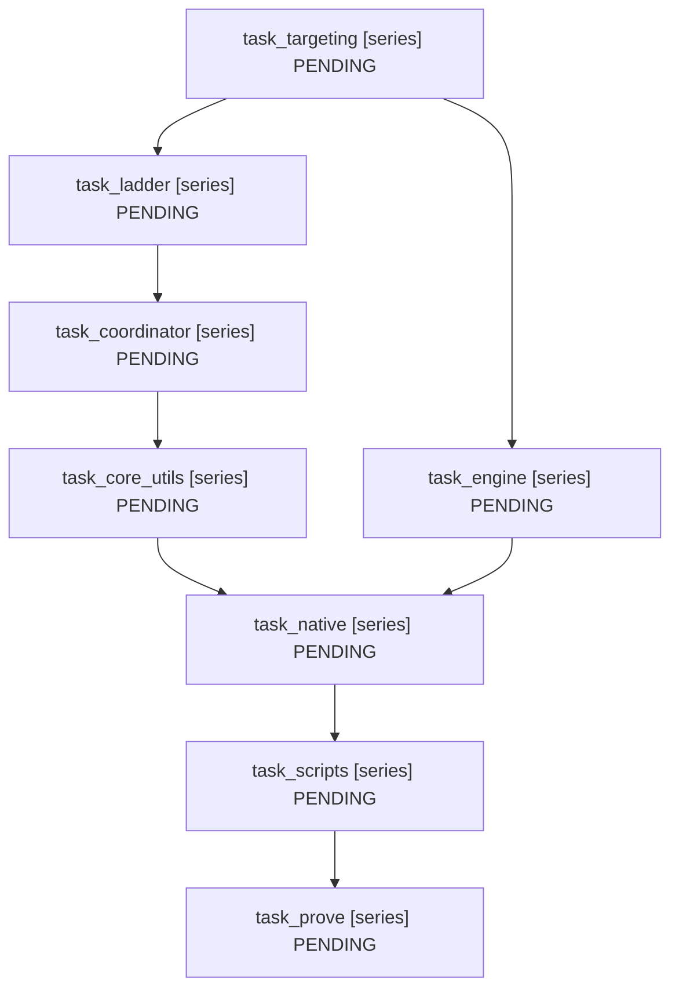

# iFocus Final Plan (Round 2): remediation of triage-r1

Author: `arbiter` | Round: 2 | Baseline: commit `fb078be` (54/54 tests) | Status: ready for `builder`
Inputs: `docs/plans/plan-a-r2.md` (board #20), `docs/plans/plan-b-r2.md` (board #19), `docs/reviews/loop-dispatch-r2.md`, `docs/reviews/triage-r1.md`

This document is self-contained for Round 2. `docs/plans/final-plan-r1.md` stays in force for everything not changed here. Where this plan and the dispatch's fix guidance disagree, this plan wins; each such place is listed in 0.4 with its evidence.

Scope: all 28 validated findings, `TRG-01` to `TRG-28`. `DEF-01` and `DEF-02` stay deferred. No new features.

## 0. Decision

**Plan A is the base. Seven mechanisms are grafted from Plan B (RB1 to RB7), and eight arbiter amendments (AR1 to AR8) are added.**

Both plans cover all 28 findings with the same fix for about two thirds of them. They differ on six, and on each Plan A's version rests on something it measured or read in the code, and I reproduced the measurement (section 1).

### 0.1 Scores (out of 10)

| Axis | A | B | Deciding evidence |
|---|---|---|---|
| 1. Multi-monitor geometry and calibration | 9 | 7 | Both add a watchdog, a clickable cancel and camera observers. A's overlay uncovers the screens at the moment of cancel rather than on the next frame, and its de-roll uses the inter-ocular axis, a longer and steadier baseline than B's per-eye extreme points. |
| 2. Same-PID `AXUIElement` focus accuracy | 9 | 7 | A bounds the stall inside one actuator call (first `.cannotComplete` aborts, 0.5 s enumeration budget); B's deadline is only checked between calls, so one enumeration of a hung nine-window app can still take about 11 s. A's key-window check works without the private resolver; B's does not. B contributes the better rollback guard (RB1). |
| 3. Anti-misclick guards | 9 | 6 | B keeps the dispatch's `layer <= 1000` filter, which drops the lock shield: I see `loginwindow` at layers 2001 and 2004 right now (W1). B's challenger is cleared by any sample on the pending window, so gaze split evenly between two windows still commits the first; A's commits neither. B reports a prompt as `.secureInput`, which collides with `respectSecureInput = false`. |
| 4. Swift 6 concurrency, TCC, privacy | 9 | 7 | Same generation-token idea in both. A's retry lives in the coordinator behind an injected sleeper and is unit-tested; B's lives in `AppController` and cannot be. B's `--doctor` bridge mutates a captured `var` from a `Task`, which Swift 6 rejects; A's `Task { exit(...) }; dispatchMain()` was compiled and run. B defaults a system clock inside `iFocusCore`, which reads no clock by rule. |
| 5. Testability and scope | 9 | 7 | A adds 22 tests with controls and leaves the 54 originals byte-identical apart from one added assertion; B adds 13 and edits T17, T34 and T35 in place. A adds a script gate and a CLI gate. |
| **Total** | **45** | **34** | |

### 0.2 Grafted from Plan B

| # | Plan B mechanism | Where |
|---|---|---|
| RB1 | Rollback is skipped when the ladder timed out and the initially focused window belongs to the same PID as the target (the app is hung, so a rollback would stall again); rollback has its own 0.35 s budget. | 3.3 |
| RB2 | The permission cache is invalidated on `start()`, `setPaused`, `togglePaused` and `updateProfile`, so the menu reflects a user action at once. | 3.1 |
| RB3 | `AVCaptureDevice.wasConnectedNotification` restarts tracking immediately when the coordinator is in the error state, instead of waiting out the backoff. | 3.1 |
| RB4 | The HUD alpha reset goes through `panel.animator()` inside the zero-duration group, which is what replaces an in-flight animation, followed by the direct set. | 3.11 |
| RB5 | `prepare_secure_dir` also rejects an existing non-directory up front and re-checks for a symlink after `mkdir`. | 3.9 |
| RB6 | The messaging timeout is also set on the element returned by `kAXFocusedWindowAttribute`. | 3.3 |
| RB7 | The README lifecycle smoke list includes "camera light off at lock, on at unlock". | 3.8 |

### 0.3 Arbiter amendments

| # | Amendment | Why |
|---|---|---|
| AR1 | Prompt owners are recognised by bundle ID **or**, when the bundle ID does not resolve, by process name (`kCGWindowOwnerName`), and the catalog writes the canonical bundle ID into the descriptor. | Plan A's rule 6 ignores every window with a nil bundle ID. If `NSRunningApplication` fails to resolve `SecurityAgent` or `coreautha`, the prompt would be ignored instead of vetoing. Whether it resolves could not be checked (no prompt on a locked screen). The process names are verified (W2). The owner name is a process name, not a window title, so the privacy invariant holds. |
| AR2 | Classifier rule 6 ignores only known chrome bundles; a nil bundle ID is no longer ignored wholesale. Rule 7 becomes "width below 40 **or** height below 40", which still drops the menu-bar strip and status items. | An unknown panel above layer 0 then costs a local dead zone, not a switch through a visible dialog. Local dead zones are the cheaper error for this product. |
| AR3 | When the prompt veto fires, the published status carries `detail: "System prompt on screen: <bundle ID>"`. | A forgotten "disk not ejected" alert would otherwise disable iFocus with no visible reason, since the veto name is `.sourceNotAllowed`. |
| AR4 | `com.apple.Settings` is added as the dispatch requires, with a comment that System Settings on this OS is `com.apple.systempreferences`, which the Round 1 blocklist already has. | W2. The dispatch's ID is harmless but inert here. |
| AR5 | The supervisor never calls `gazeEstimator.start()` while the session is inactive. | Defence in depth for TRG-04: the camera stays off behind the lock even if `AppController`'s gating has a bug. |
| AR6 | `FocusStepResult` has a fourth case, `.refused`, for AX errors and timeouts. `.staleCandidate` means identity mismatch only. | Plan A returned `.staleCandidate` from the circuit breaker, which re-creates the conflation TRG-19 asks to remove. |
| AR7 | Two more tests, T77 (AR3) and T78 (AR5); T60, T66 and T72 gain assertions for AR1, AR2, RB1 and AR6. Expected total 78. | Each amendment has a test. |
| AR8 | Real-time delays are allowed in T55 and T56 only (at most 100 ms each, 2 s timeout). Everything else stays in virtual time. | A lifecycle race needs two tasks genuinely suspended; Round 1's "no wall clock in tests" rule would forbid the test the dispatch demands. |

### 0.4 Rulings on Plan A's six traps and five decisions

All six traps (plan-a-r2 section 0) are upheld; I checked each against the code or the machine.

| Item | Ruling |
|---|---|
| R1 / D1: no new `SafetyVeto` case; prompt veto reuses `.sourceNotAllowed` | Upheld. `SafetyTests.swift:34` asserts 14 cases against an exhaustive table. `.sourceNotAllowed` is also what TRG-06 prescribes for blocklisted apps, and it is independent of `respectSecureInput` (T54). AR3 supplies the missing explanation in the status line. |
| R2: `runUntilStreamFinishes()` must keep working when called directly | Upheld. Called without `start()` at `CoordinatorTests.swift:60`, `EngineTests.swift:409`, `ScenarioTests.swift:116`. |
| R3, R4 / D2: classifier instead of `0 <= layer <= 1000` | Upheld, with AR1 and AR2. |
| R5: per-element timeout alone does not bound the stall | Upheld. |
| R6: `--doctor` cannot be bridged with a blocking wait | Upheld. `CGWindowCatalogService.swift:19` awaits `MainActor.run`. |
| D3: camera retry lives in `FocusCoordinator` | Upheld, plus RB3. |
| D4: `FocusActuator.perform` returns a typed result | Upheld, with AR6. No test calls `perform` or declares a `FocusActuator`, so the change is source-compatible with T01 to T54. |
| D5: new tests T71 and T76 rather than editing T34 and T17 in place | Upheld. T71 is the dispatch's "extend T34"; T76 is its "extend T17"; `docs/build-r2.md` must state that mapping. T51 gets its control in place, as the dispatch words it. |

## 1. Facts verified for this round

Probes were compiled under `/tmp/ifocus-arb-spike/r2`, outside the workspace. The screen was locked while I worked, as it was for Plan A.

| # | Fact | How verified |
|---|---|---|
| W1 | Locked-state census, 50 on-screen windows: `loginwindow` layer 2001 at `(-15000,-15000,30000,30000)` and layer 2004 at `(0,0,1496,967)`; `Window Server` (no bundle ID) layer 2147483646 full display and layer 24 at `(0,0,1496,29)`; twelve `com.apple.controlcenter` items at layer 25, 29 pt high, 30 to 154 pt wide; 34 windows at layer 0. Session dictionary: on console 1, locked 1. `CGGetActiveDisplayList` returns no displays. Levels: floating 3, modal 8, main menu 24, status 25, pop-up 101, screen saver 1000. | My own probe; matches plan-a-r2 V1 to V3 line for line. |
| W2 | Bundle IDs and executables read from the system's own `Info.plist` files: `com.apple.SecurityAgent` / `SecurityAgent`; `com.apple.LocalAuthentication.UIAgent` / `coreautha` (there is no `CoreAuthUI.app` on this OS); `com.apple.UserNotificationCenter` / `UserNotificationCenter`; `com.apple.coreservices.uiagent` / `CoreServicesUIAgent`; `com.apple.loginwindow` / `loginwindow`; chrome: `com.apple.dock`, `com.apple.WindowManager`, `com.apple.controlcenter`, `com.apple.notificationcenterui`, `com.apple.systemuiserver`; System Settings is `com.apple.systempreferences`; Screen Sharing is `com.apple.ScreenSharing`. | `PlistBuddy` on each bundle. |
| W3 | Code at `fb078be`: T26 asserts `SafetyVeto.allCases.count == 14` (`SafetyTests.swift:34`); no test calls `.perform(`, declares a `FocusActuator` or names `FocusFailure`; rung C has three steps (`LadderFocusSwitcher.swift:28`) and any `false` sets the stale flag (`:61`); `stop()` awaits `runTask?.value` after a `start()` may have replaced it (`FocusCoordinator.swift:128-132`). | Read and grepped. |
| W4 | Adopted from plan-a-r2 without re-running: the `dirfd` sequence (`open` with `O_DIRECTORY|O_NOFOLLOW`, `fstat`, `fchmod`, `openat`, `renameat`, `unlinkat`, `fsync`) works; the AVCapture notification names compile; `self?.queue.async { self?.handle(x) }` in a `[weak self]` block warns, while `guard let self` first does not; a synchronous `main()` can use `MainActor.assumeIsolated` and bridge an async command with `Task { ...; exit(code) }; dispatchMain()`. | Plan A spikes V4 to V7. |

Not verified: the layer > 0 census of an **unlocked** session, and whether `NSRunningApplication` resolves the prompt owners' bundle IDs. AR1 and AR2 are written so that either answer is safe, and `--doctor` shows what is being treated as an occluder (section 7 adds the check to the desk list).

## 2. Rules of the round

1. T01 to T54 keep passing. Their source is byte-identical except one added run in T51. No threshold is loosened and nothing is skipped.
2. `SafetyVeto` keeps exactly 14 cases. No new config keys. No calibration-profile version bump.
3. `scripts/check-invariants.sh` I1 to I7 pass, with I4 extended (3.11).
4. The build stays warning-free under Swift 6 at deployment target macOS 14.
5. Every finding ends with a test or, where the code is native and cannot run headless, a `file:line` citation in `docs/build-r2.md`.

## 3. Remediations

Paths are relative to the repository root. "Keep green" names the existing tests most exposed to each change.

### 3.1 TRG-01, TRG-07, TRG-13, TRG-14: `FocusCoordinator`

File: `Sources/iFocusCore/Engine/FocusCoordinator.swift`.

**State.** Replace `isRunning` with:

```swift
private var generation: UInt64 = 0
private var activeGeneration: UInt64?          // nil means stopped
private var runTask: Task<Void, Never>?
private func isLive(_ g: UInt64) -> Bool { activeGeneration == g }
```

**`start()`**: return if `activeGeneration != nil`; otherwise increment `generation`, set `activeGeneration`, invalidate the permission cache (RB2), and spawn `runTask = Task { await supervise(generation: g) }`.

**`stop()`**: set `activeGeneration = nil`; move `runTask` into a local and set the property to nil; `local?.cancel()`; `await gazeEstimator.stop()`; `await local?.value`. A `start()` that arrives during these awaits creates a new task under a new generation, and this `stop()` never touches it. That removes the hang.

**`runUntilStreamFinishes()`** (public, used by T38, T51, T53): increment `generation`, set `activeGeneration`, `await runOnce(generation: g)`, then clear `activeGeneration` only if it still equals `g`. No retry, no session gate.

**`runOnce(generation:) -> RunExit`**, where `RunExit` is `.stopped`, `.streamEnded`, `.interrupted(String)`, `.startFailed(String)`:

1. After each of `topologyService.current()`, `windowCatalog.snapshot()` and `gazeEstimator.start()`: if `!isLive(g)`, return `.stopped`. After `gazeEstimator.start()` specifically, a stale run calls `await gazeEstimator.stop()` only when `activeGeneration == nil`; if a newer generation is active, that one owns the estimator.
2. In the `for await` loop: break when `!isLive(g)`. On `.interrupted(reason)`, feed the event to the pipeline (existing reset behaviour), `await gazeEstimator.stop()`, and return `.interrupted(reason)`.
3. `processSingleEvent` takes `g` and re-checks `isLive(g)` after its fresh awaits and immediately before `focusSwitcher.focus(target)`.

**`supervise(generation:)`** (TRG-14, AR5): loop:

1. If `!sessionProvider.isSessionActive()`: do not start the estimator. With a retry sleeper, sleep one backoff interval and loop; without one, exit.
2. `runOnce`. On `.stopped`, exit.
3. On any other exit while still live: publish `.status(state: .error, detail: reason)`, sleep `retryBackoff` through the injected sleeper (5 s, doubling to a 60 s cap, reset after the first event of a successful run), re-check liveness, loop.

New init parameter `retrySleeper: (any Sleeper)? = nil`; nil means no retry, so existing tests are unaffected. `AppController` passes a `SystemSleeper` built on `try? await Task.sleep`, so the `cancel()` in `stop()` ends a backoff sleep at once.

`AppController` also observes `AVCaptureDevice.wasConnectedNotification` (RB3): if the last status was `.error` and the agent is neither paused nor calibrating, it calls `await coordinator.stop()` then `startTrackingIfReady()`.

**Bounded log** (TRG-07): new init parameter `maxDecisionLogEntries: Int = 4096` (clamped to at least 1). Entries live in a private ring (`storage`, `head`, O(1) append); `log()` returns them oldest first. 4096 exceeds the 1201 steps of the longest scenario, so T38's equality holds.

**Status** (TRG-13, AR3):

- `publishStatus` builds the key `(state, lastVeto, failureCount, detail)` and returns early when it equals the last published key.
- `permissionChecker()` results are cached for 1.0 s of `clock.now()` and invalidated by `start()`, `setPaused`, `togglePaused` and `updateProfile` (RB2).
- When the step's veto is `.sourceNotAllowed` and `WindowHitTester.securityPrompt(in: snapshot)` returns a window, `detail` is `"System prompt on screen: \(bundleID)"`; otherwise nil (AR3).
- `events()` replays the last status to a new subscriber, so the menu still gets an initial value.
- `public func diagnostics() -> CoordinatorDiagnostics` returns `statusPublishes`, `permissionChecks`, `estimatorStarts`, `logCount`, so tests assert on counters instead of racing an event stream.

In `StatusMenuController.update`, keep the last `(status key, warning)` and return early if unchanged; rebuild the icon only when the paused flag changes; show `detail` when present.

Keep green: T38 (direct `runUntilStreamFinishes`, log equality), T51, T53.

### 3.2 TRG-02, TRG-15, TRG-23: calibration overlay and camera session

**Core, new file `Sources/iFocusCore/Engine/WatchedStream.swift`.**

```swift
public enum Watched<Element: Sendable>: Sendable { case event(Element); case stalled }
public struct WatchedStream<Element: Sendable>: Sendable {
    public let stream: AsyncStream<Watched<Element>>
    public init(source: AsyncStream<Element>, timeout: TimeInterval,
                clock: any MonotonicClock, sleeper: any Sleeper, pollInterval: TimeInterval = 0.5)
    public func cancel()        // finishes `stream`, cancels both internal tasks
}
```

One internal task forwards source events and records the time of the last one in a private actor; a second polls through the sleeper and, when `clock.now() - lastEvent > timeout`, yields `.stalled` and finishes. The stream also finishes when the source finishes.

**`CalibrationOverlay`.**

- `run(...)` wraps the estimator stream in `WatchedStream(timeout: 5.0)`. `.stalled` returns `.failure(.cameraError("No camera frames for 5 s"))`. `.noFace` events count as frames, so an absent user does not trip the watchdog. `.interrupted(reason)` returns `.failure(.cameraError(reason))`.
- New `public func cancel()`: set the cancel flag, call `watched.cancel()`, call `teardownWindows()` immediately, and start `Task { await gazeEstimator.stop() }`. The screens are uncovered at the moment of cancel, not when the next frame arrives.
- Escape and a new `NSButton` titled "Cancel (Esc)" on every overlay window (target-action) both call `cancel()`. Mouse cancel therefore works even if `NSApp.activate()` did not make the window key.
- No global event monitor; invariant I1 forbids it. The window level is unchanged.

**`CameraSession`.**

- After a successful start, register observers for `AVCaptureSession.runtimeErrorNotification`, `AVCaptureSession.wasInterruptedNotification` and `AVCaptureDevice.wasDisconnectedNotification`. Each handler takes a strong `self` first (W4), hops to the camera queue, yields `.interrupted(reason)` on `activeContinuation`, then runs `stopOnQueue()`. Tokens live in a queue-confined array and are removed in `stopOnQueue()`.
- TRG-15: in `startOnQueue`, when already running, call `activeContinuation?.finish()` before replacing it. In `VisionGazeEstimator.start()` re-entry, call `streamContinuation?.finish()` before replacing it. In `VisionGazeEstimator.stop()`, finish the continuation **before** awaiting `session.stop()`, so consumers are released even if AVFoundation is slow to stop.
- TRG-23: order becomes `commitConfiguration()`, then query `device.activeFormat.videoSupportedFrameRateRanges`, then `lockForConfiguration()`, set `activeVideoMinFrameDuration` if supported, `startRunning()`, `unlockForConfiguration()`. A lock failure stays non-fatal.

### 3.3 TRG-03, TRG-09, TRG-11, TRG-19: focus ladder and AX actuator

**Types** (`FocusTypes.swift`, `Services.swift`).

```swift
public enum FocusStepResult: Sendable, Equatable { case performed, staleCandidate, refused, notTrusted }   // AR6
public enum KeyWindowCheck: Sendable, Equatable { case matches, differs, unknown }
// FocusFailure gains: case timedOut
public protocol FocusActuator: Sendable {
    func windows(of pid: Int32) async -> [AXWindowCandidate]
    func perform(_ step: FocusStep, pid: Int32, window: AXWindowCandidate) async -> FocusStepResult
    func keyWindowCheck(pid: Int32, expected: AXWindowCandidate) async -> KeyWindowCheck
}
extension FocusActuator {
    public func keyWindowCheck(pid: Int32, expected: AXWindowCandidate) async -> KeyWindowCheck { .unknown }
}
```

Every exhaustive `switch` over `FocusFailure` in `Sources/` gains the new case. `.failed(.timedOut)` starts the failure backoff like any other failure.

**`LadderFocusSwitcher`.**

- TRG-19: rung C becomes `[.raiseAndMakeMain, .activateApp]`. Step results: `.performed` continues; `.staleCandidate` and `.refused` end the rung as unverified and move to the next rung; `.notTrusted` returns `.failed(.notTrusted)` at once. After the last rung the result is `.failed(.staleCandidate)` only if the last thing that happened was a `.staleCandidate`; otherwise `.failed(.unverified)`.
- TRG-03: new init parameters `clock: (any MonotonicClock)? = nil, deadlineSeconds: TimeInterval = 1.0`. With a clock, elapsed time is checked before each rung, before each step and before each verification poll; past the deadline the ladder stops and returns `.failed(.timedOut)` after the rollback rule below. With no clock (every existing test) nothing changes. `AppController` passes its `SystemClock`.
- TRG-11: `verifyFocused` requires `snapshot.focusedWindowID == target.windowID` **and** `keyWindowCheck(...) != .differs`.
- TRG-09: on a final `.unverified` or `.timedOut`, take one snapshot. Roll back only if all hold: its `focusedWindowID` is neither the target nor `initial.focusedWindowID`; the initially focused window is still in the snapshot; and not (timed out and the initial window's PID equals the target's PID) (RB1). The rollback is one pass: enumerate the initial window's PID, match it, perform `[.raiseAndMakeMain, .setAppFrontmost]`. No verification loop, no second attempt, and with a clock it stops once 0.35 s have passed since it began (RB1). The returned outcome is unchanged by the rollback.

**`AXActuator`.**

- `fetchWindowElements` calls `AXUIElementSetMessagingTimeout(element, 0.25)` on every returned element before returning. The element returned by `kAXFocusedWindowAttribute` gets the same (RB6).
- Circuit breaker: every read helper reports its `AXError`. The first `.cannotComplete` during `windows(of:)` aborts and returns `[]`; during `perform` it returns `.refused`. Independently, `windows(of:)` stops and returns `[]` once 0.5 s of `ProcessInfo.processInfo.systemUptime` have elapsed.
- `perform` returns `.notTrusted` when `AXIsProcessTrusted()` is false, `.staleCandidate` for an out-of-range index or a failed identity check, `.refused` for any other AX failure of a required call. The tolerated `kAXFocusedAttribute` failure stays tolerated.
- `keyWindowCheck`: read `kAXFocusedWindowAttribute` on the app element, resolve its window ID through `AXWindowID` and compare with `expected.windowID`. Without the private resolver, compare frames with the existing 2 pt edge test. Any read failure is `.unknown`.

**`SimFocusActuator`** (`SimServices.swift`): return `FocusStepResult` (`rejectIdentityMismatch` and identity failures give `.staleCandidate`). Add `wrongWindowOnlyForTargetID: UInt32?` (the wrong-window behaviour applies only when the candidate resolves to that ID, so a rollback towards another window behaves normally), `keyWindowOverride: KeyWindowCheck?` and `forcedStepResult: FocusStepResult?`. All new parameters default to nil so existing call sites compile unchanged.

Keep green: T31 (case 3 still reaches rung C through `.activateApp`; case 4 never moves focus, so no rollback), T32 (the sim actuator mis-raises on every call including the rollback, outcome stays `.failed(.unverified)`), T45 (`.failed(.staleCandidate)`, focus unchanged), T46.

### 3.4 TRG-04: session state

**Core, new file `Sources/iFocusCore/Model/SessionActivity.swift`.**

```swift
public struct SessionSignals: Sendable, Equatable {
    public var dictionaryAvailable: Bool   // CGSessionCopyCurrentDictionary() != nil
    public var onConsole: Bool             // kCGSSessionOnConsoleKey, true if the key is absent
    public var screenLocked: Bool          // CGSSessionScreenIsLocked, false if the key is absent
    public var systemSleeping: Bool
    public var displaysSleeping: Bool
}
public enum SessionActivity {
    public static func isActive(_ s: SessionSignals) -> Bool
    // dictionaryAvailable && onConsole && !screenLocked && !systemSleeping && !displaysSleeping
}
```

**`SystemSessionStateProvider`.**

- Initial state is computed from the dictionary, not assumed `true`.
- Notifications only change the two sleep flags (`willSleep` / `didWake`, `screensDidSleep` / `screensDidWake`) or trigger a re-query. The two `DistributedNotificationCenter` names and the two `NSWorkspace` session names never set state directly; a spoofed "unlocked" post re-reads the dictionary and stays inactive (W1).
- `isSessionActive()` re-queries, cached for 0.25 s, and publishes a change on `updates()` when the result differs from the last published value.
- While inactive, a 5 s heartbeat task re-queries, so a missed unlock notification cannot leave iFocus off for good. The heartbeat stops when active.

**`AppController`.**

- `runCalibrateCommand()` creates a provider, refuses to start when inactive (exit code 1 with a message), and cancels the overlay (3.2 `cancel()`) on the first inactive update.
- `runInteractiveCalibration()` keeps a reference to the live overlay; the existing `sessionTask` calls `overlay.cancel()` as well as `coordinator.stop()` when the session goes inactive.

### 3.5 TRG-05, TRG-06, TRG-11 (catalog half), TRG-12, TRG-27: windows, occlusion, blocklist

**Model** (`WindowTypes.swift`): `WindowDescriptor` gains `public var layer: Int`, last in the initialiser with default `0`, and a hand-written `init(from:)` using `decodeIfPresent(...) ?? 0` so old encodings still decode.

**Config** (`Config.swift`), static data only, no new config keys:

- `hardBlocklist` gains `com.apple.LocalAuthentication.UIAgent`, `com.apple.UserNotificationCenter`, `com.apple.ScreenSharing`, `com.apple.Settings` (AR4: comment that System Settings here is `com.apple.systempreferences`, already present).
- `securityPromptBundleIDs`: `com.apple.SecurityAgent`, `com.apple.LocalAuthentication.UIAgent`, `com.apple.UserNotificationCenter`, `com.apple.coreservices.uiagent`.
- `promptOwnerNames: [String: String]` (AR1), process name to canonical bundle ID: `SecurityAgent`, `coreautha`, `UserNotificationCenter`, `CoreServicesUIAgent`, `loginwindow`, each mapped to its W2 bundle ID.
- `chromeBundleIDs`: `com.apple.dock`, `com.apple.WindowManager`, `com.apple.controlcenter`, `com.apple.notificationcenterui`, `com.apple.systemuiserver`.

**Core, new file `Sources/iFocusCore/Targeting/WindowClassifier.swift`**, pure functions the native catalog calls per window:

```swift
public enum WindowRole: Sendable, Equatable { case normal, occluder, securityPrompt, ignored }
public enum WindowClassifier {
    /// AR1: the resolved bundle ID if there is one, else the canonical ID for a known prompt owner's process name, else nil.
    public static func canonicalBundleID(bundleID: String?, ownerName: String?) -> String?
    public static func classify(layer: Int, alpha: Double, pid: Int32, ownPID: Int32,
                                bundleID: String?, bounds: CGRect, displayBounds: [CGRect]) -> WindowRole
}
```

`classify` takes the canonical bundle ID. Rules, first match wins:

| Order | Condition | Role |
|---|---|---|
| 1 | Own PID, alpha at most 0.01, empty bounds, or `layer < 0` | ignored |
| 2 | Bundle in `securityPromptBundleIDs`, at least 40 pt in both dimensions, any layer | securityPrompt |
| 3 | Bundle is `com.apple.loginwindow`, `layer >= 1000`, at least 40 pt in both dimensions | securityPrompt |
| 4 | `layer == 0` | normal |
| 5 | `layer >= 1000` | ignored |
| 6 | Bundle in `chromeBundleIDs` (AR2: a nil bundle is **not** matched here) | ignored |
| 7 | Width below 40 or height below 40 (AR2) | ignored |
| 8 | Covers at least 80 percent of any display's area (never matches when `displayBounds` is empty) | ignored |
| 9 | Otherwise | occluder |

Rule 3 is tied to `layer >= 1000` because W1 shows that is where the lock shield lives, and it avoids a permanent veto if `loginwindow` keeps some low-layer window in a normal session. Rule 8 is the fail-functional choice for transparent full-display overlays; a real prompt is caught by rules 2 and 3 whatever its size. Under AR2 the menu-bar strip (1496x29) and the status items (29 pt high) fall to rule 7.

Also in core: `WindowSnapshot.resolveFocusedWindowID(windows:frontmostPID:)`, returning the frontmost `layer == 0` window of that PID that is at least 120x80, falling back to any `layer == 0` window of that PID (TRG-11).

**`WindowHitTester`.**

- `isEligible` additionally requires `window.layer == 0`.
- `static func securityPrompt(in: WindowSnapshot) -> WindowDescriptor?`: the first window at least 40 pt in both dimensions whose bundle is in `securityPromptBundleIDs`, or `com.apple.loginwindow` at `layer >= 1000`. `securityPromptVisible(in:)` is `securityPrompt(in:) != nil`.
- TRG-27: before returning a snapped window, return `.none` if any other window that is not eligible and is either `layer > 0` or at least 120x80 lies strictly closer to the point.

**Safety** (`FocusTypes.swift`, `SafetyPolicy.swift`, `FocusDecisionEngine.swift`).

- `SafetyContext` gains `securityPromptVisible: Bool`, last in the initialiser with default `false`. The engine fills it in both `step` and `confirm`.
- `DefaultSafetyGuardPolicy`: immediately after the secure-input check, `if context.securityPromptVisible { return .deny(.sourceNotAllowed) }`. Immediately before the `requireAllowedSource` check, `if let front = context.frontmostBundleID, Config.hardBlocklist.contains(front) { return .deny(.sourceNotAllowed) }`. Both use an existing veto with a default-false input or an unreachable-in-T26 condition, so T26's precedence table is undisturbed.

**`CGWindowCatalogService`.**

- For every entry read layer, alpha, owner PID, window number, bounds and `kCGWindowOwnerName` (the process name; `kCGWindowName`, the title, stays forbidden by I1). Resolve the bundle ID through `NSRunningApplication`, pass it through `canonicalBundleID`, classify, and keep `normal`, `occluder` and `securityPrompt` windows with their `layer` and canonical bundle ID, in the order Core Graphics returned them. Display bounds come from `CGGetActiveDisplayList` and `CGDisplayBounds` once per snapshot.
- `focusedWindowID` comes from `resolveFocusedWindowID`.
- TRG-12: delete the `bundleIDCache` property; use a dictionary local to each `snapshot()` call.

**`Doctor`**: print the retained occluders and prompt windows (bundle ID or process name, layer, bounds), whether each bundle ID came from the process-name fallback, and whether the prompt veto is active now. This is the instrument for the unverified unlocked census.

Keep green: T15 to T18 (all fixtures are layer 0 through the defaulted initialiser), T26, T28, T53.

### 3.6 TRG-08: AX matcher

`AXWindowMatcher.match`: after the exact-ID pass, the geometric, ambiguous and approximate passes consider only candidates with `windowID == nil`. With no such candidate the result is `.notFound`. T30 and T53 use nil IDs throughout and are unaffected.

### 3.7 TRG-10: challenger candidate

`FocusDecisionEngine` gains `private var challenger: PendingCandidate?`. When a sample resolves to target X and `pending` exists for a different target:

1. If `now - pending.lastSeenAt > candidateDropoutSeconds`, `pending` has expired: promote `challenger` if it is for X (keeping its own `enteredAt`), otherwise start a fresh `pending` for X; clear `challenger`.
2. Otherwise `pending` survives this sample as a dropout: set or refresh `challenger` for X (`enteredAt` is the first sample of its current run) and return `.none` reporting the pending candidate.

A sample on `pending`'s own target refreshes `pending` but does not clear `challenger`; the challenger lapses only when it has had no sample of its own for `candidateDropoutSeconds`. Commit requires dwell met on a sample that lands on `pending`'s target **and** no live challenger. The no-target path and `dropout` vetoes expire both on the same dropout rule. `clear` vetoes and the reconcile step clear both.

Consequences, all intended:

- An occasional outlier delays a commit by at most `candidateDropoutSeconds` (0.12 s) instead of restarting the dwell.
- A genuine move from M to F promotes F with `enteredAt` equal to F's first sample, so F commits when it would have before. M cannot commit during the hand-over even if a noisy sample lands back on it, because F is a live challenger. The rule is stricter than Round 1 for fly-overs, not looser.
- Gaze split evenly between two non-focused windows commits to neither. Ambiguous gaze producing no switch is the safe outcome.

Keep green: T19, T20, T21, T22, T35, T44 (fly-over: the destination is a live challenger, so no intermediate window can commit).

### 3.8 TRG-16: CLI entry point

`Sources/iFocusApp/IFocusCLI.swift`: `static func main()` becomes synchronous.

- `--run` and no arguments: `exit(MainActor.assumeIsolated { AppController.runAgentCommand() })`; `--calibrate` likewise.
- `--simulate`, `--help`, `--version` and usage errors compute a code and `exit`.
- `--doctor`: `Task { let code = await Doctor.run(focusTest: focusTest); fflush(stdout); fflush(stderr); exit(code) }` followed by `dispatchMain()`. No semaphore, no blocking wait (R6).
- Flush stdout and stderr before every `exit`.

`README.md` gains the lifecycle smoke list: start; pause and resume from the menu and the hotkey; lock the screen and confirm the camera light goes off; unlock and confirm it comes back (RB7); unplug or cover-and-uncover an external camera if one is used; Quit returns within 2 s.

### 3.9 TRG-17: scripts

`scripts/sbx.sh` and `scripts/bundle-app.sh` each carry this helper (duplicated, since scripts are standalone):

```bash
prepare_secure_dir() {
  local d="$1"
  if [ -L "$d" ]; then echo "refusing symlink: $d" >&2; exit 1; fi
  if [ -e "$d" ] && [ ! -d "$d" ]; then echo "refusing non-directory: $d" >&2; exit 1; fi
  mkdir -p -m 0700 "$d"
  if [ -L "$d" ] || [ ! -d "$d" ] || [ ! -O "$d" ]; then echo "refusing unowned or replaced directory: $d" >&2; exit 1; fi
  chmod 0700 "$d"
}
```

Defaults become `/tmp/ifocus-sbx-$(id -u)`, and for the SwiftPM branch `/tmp/ifocus-build-$(id -u)`, `/tmp/clang-cache-$(id -u)`, `/tmp/swiftpm-cache-$(id -u)`, `/tmp/swift-modcache-$(id -u)`. Every directory, including `$OUT/modcache` and a caller-supplied `IFOCUS_SBX_OUT`, goes through the helper before first use. Nothing is compiled, executed or signed before the checks pass.

New `scripts/check-scripts.sh` (`set -euo pipefail`, no `eval`, `curl` or `sudo`, so I7 holds): creates a real directory with `mktemp -d /tmp/ifocus-check.XXXXXX` and a symlink to it, runs `IFOCUS_SBX_OUT=<symlink> scripts/sbx.sh build` and `scripts/bundle-app.sh` with the same variable, and passes only if both exit 1 before compiling anything; then removes what it created.

`README.md` and `docs/build-r2.md` use the new default paths.

### 3.10 TRG-18: `SecureFileStore`

- `read`: open the directory with `O_RDONLY|O_DIRECTORY|O_NOFOLLOW|O_CLOEXEC`. `ENOENT` returns nil; `ELOOP` throws `.symlinkRefused(dirPath)` (T34's last assertion depends on that exact error); `ENOTDIR` throws `.insecureDirectory`. `fstat` the descriptor; wrong owner or `(mode & 0o077) != 0` throws `.insecureDirectory`. Open the file with `openat(dirFD, filename, O_RDONLY|O_NOFOLLOW|O_NONBLOCK|O_CLOEXEC)`; the per-file checks are unchanged and keep reporting the same paths.
- `write`: after `ensureDirectoryExists()`, open the directory the same way, `fchmod(dirFD, mode & ~0o077)` if needed, then `openat` for the temporary file, `renameat(dirFD, tmp, dirFD, filename)`, `fsync(dirFD)`, and `unlinkat(dirFD, tmp, 0)` on failure.
- `ensureDirectoryExists` keeps creating missing directories at `0700` and repairing loose permissions on the write path only. Every descriptor is closed on every path.

### 3.11 P3 items

| ID | Change |
|---|---|
| TRG-20 | `PreparedScenario` stores `seed`; `ScenarioResult.seed` reports it. New `ScenarioRunner.runWithLadder(_:seed:config:exposeWindowIDs:) async`, which drives `FocusCoordinator` with `LadderFocusSwitcher` and `SimFocusActuator` and returns a `ScenarioResult`. The synchronous `run` / `runPrepared` API and `--simulate` are untouched, so T35 to T38, T44 and T53 need no edits. |
| TRG-21 | Add a third, unperturbed run to T51's coordinator half asserting `recordedTargets().count == 1`. This is the only edit to an existing test, and it adds an assertion. |
| TRG-22 | New pure `FrameDecimator` in `Sources/iFocusCore/Filter/FrameDecimator.swift`: `mutating func shouldProcess(at now: TimeInterval) -> Bool` with `nextDue += 1 / targetFPS`, accept when `now >= nextDue - 0.005`, re-anchor when `now - nextDue > 0.25`. `FrameProcessor` uses it. |
| TRG-24 | `check-invariants.sh` I4 also greps `nonisolated(unsafe)` across `Sources/` and allows exactly one occurrence, in `Sources/iFocusCore/Simulation/SimServices.swift` (`LockedBox`, guarded by `NSLock`). |
| TRG-25 | New pure `EyeGeometry` in `Sources/iFocusCore/Filter/EyeGeometry.swift`. The de-roll angle is the direction of the line between the two eye-contour centroids (with one eye, the line between that contour's two most distant points), normalised to point towards +x. `FrameProcessor` passes `CGPoint` arrays and stops using Vision's `roll` for this. README adds a 15 degree head-tilt check and says to recalibrate after upgrading, since the eye feature changed. |
| TRG-26 | `runInteractiveCalibration()` reads `let wasPaused = await coordinator.paused()` first and ends with `await coordinator.setPaused(wasPaused)` on every path, including the missing-permission early return. |
| TRG-28 | In `HUDController.flash`: `NSAnimationContext.runAnimationGroup { ctx in ctx.duration = 0; panel.animator().alphaValue = 1.0 }`, then `panel.alphaValue = 1.0`, then the fade group (RB4). |

## 4. New tests

All in `Tests/iFocusCoreTests`, Swift Testing, virtual time except T55 and T56 (AR8). Each carries its ID in its display name. Test-local doubles live in a new `Tests/iFocusCoreTests/TestDoubles.swift`: `RecordingEstimator` (start count, live flag, optional stop delay, scripted streams), `SlowCatalog` (wraps `SimWindowCatalogService` with a real `Task.sleep` delay), `SteppingSleeper` (advances a `VirtualClock`, then `Task.yield()`), `ClockAdvancingActuator`.

| ID | Finding | Suite | Asserts |
|---|---|---|---|
| T55 | TRG-01 | Coordinator | With a 50 ms `SlowCatalog`, `start()` then `await stop()` leaves `RecordingEstimator.isLive == false` and at most one start. |
| T56 | TRG-01 | Coordinator | With a 50 ms estimator stop delay, `start()` issued while `stop()` is in flight: `stop()` returns within 2 s (raced against a timeout task), live streams never exceed one, and a final `stop()` leaves nothing live. |
| T57 | TRG-02 | Coordinator | `WatchedStream`: a silent source yields `.stalled` once at 5 s of virtual time and then finishes; three events then silence stalls 5 s after the last; `cancel()` finishes with no `.stalled`; a finished source finishes the watched stream. |
| T58 | TRG-03 | Ladder | An actuator that advances the clock 0.6 s per step: outcome `.failed(.timedOut)`, rung C never attempted. Without a clock the same actuator runs all three rungs. |
| T59 | TRG-04 | Safety | `SessionActivity.isActive` table: locked with displays awake is false; an "unlocked" trigger with `screenLocked` still true is false; unlocked, on console and awake is true; missing dictionary is false; each sleep flag alone is false. |
| T60 | TRG-05, AR1, AR2 | HitTest | `WindowClassifier` table with every W1 row as a fixture: both `loginwindow` shields are `securityPrompt`; the layer-2147483646 window, the 1496x29 menu-bar strip, the Control Center items, a Dock full-display window and a third-party full-display overlay are `ignored`; a 400x300 layer-8 panel is `occluder` with a bundle ID and with none; own PID is `ignored`. `canonicalBundleID(nil, "SecurityAgent")` and `(nil, "coreautha")` give the W2 IDs and classify as `securityPrompt`; an unknown process name stays nil. With no displays the full-display overlay is `occluder`. |
| T61 | TRG-05 | HitTest | A layer-8 dialog over a terminal returns `.blocked`; an allowlisted bundle at layer 3 is not eligible. |
| T62 | TRG-05 | Safety | A `SecurityAgent` window on another display: the policy returns `.deny(.sourceNotAllowed)` and a full engine run with otherwise sufficient dwell produces no `.focus`, including with `respectSecureInput == false`. Removing the window restores the switch. |
| T63 | TRG-06 | Safety | With `requireAllowedSource == false`, every `hardBlocklist` entry as frontmost, the four new IDs named explicitly, returns `.deny(.sourceNotAllowed)`; a non-blocklisted, non-allowlisted app is allowed. |
| T64 | TRG-07 | Coordinator | 5000 events with the default cap: `log().count == 4096` and the entries are the newest, in order. |
| T65 | TRG-08 | AXMatch | Target 999, candidates 111 and 222 sharing the target frame: `.notFound`. Mixed list (one mismatched ID, one nil ID with the frame): `.geometric` on the nil-ID candidate. |
| T66 | TRG-09, RB1 | Ladder | `wrongWindowOnlyForTargetID`: outcome `.failed(.unverified)` and the catalog's focused window equals the initial one. A timed-out ladder whose initial window shares the target's PID makes no rollback call. |
| T67 | TRG-10 | Engine | One outlier in six on neighbour C while dwelling on B: B commits no later than 0.45 s plus `candidateDropoutSeconds` plus one frame (Round 1 code never commits in 3 s). Control 1: 0.2 s on B then steadily on C commits C at C's entry plus dwell and never B. Control 2: strict B, C alternation for 3 s commits neither. |
| T68 | TRG-11 | Ladder | `resolveFocusedWindowID` skips a 100x60 window in front of an 800x600 one and falls back when only small windows exist; with `keyWindowOverride = .differs` the ladder never reports `.switched`; with `.unknown` it does. |
| T69 | TRG-13 | Coordinator | 200 `.noFace` events over 10 virtual seconds: `permissionChecks <= 12`, `statusPublishes` between 1 and 3. A `setPaused` call forces a fresh permission check. |
| T70 | TRG-14 | Coordinator | Stream one yields `.interrupted("disconnected")` and ends; with a retry sleeper the coordinator publishes `.error` with that detail, starts the estimator a second time, and processes events from stream two. `stop()` during the backoff returns promptly and prevents the second start. |
| T71 | TRG-18 | FileStore | Directory at `0o775` and at `0o777`: `read` throws `.insecureDirectory`; back at `0o700` it reads; a write repairs `0o750` to `0o700`. T34 is left byte-identical. |
| T72 | TRG-19, AR6 | Ladder | Rung C performs exactly `raiseAndMakeMain` then `activateApp`; `.notTrusted` yields `.failed(.notTrusted)` after one call; `.refused` on every step yields `.failed(.unverified)`, not `.staleCandidate`. |
| T73 | TRG-20 | Scenario | For each of the five built-in scenarios and seeds 1 to 3: `runWithLadder` switches equal `expectedSwitches` and equal the synchronous runner's; `ScenarioResult.seed` equals the seed passed. Also with `exposeWindowIDs: false` for the T53 scenario. |
| T74 | TRG-22 | FeaturePipeline | 30 Hz timestamps for 10 s at target 20: 195 to 205 accepted; 15 Hz input: all accepted; a 1 s gap re-anchors. |
| T75 | TRG-25 | FeaturePipeline | A synthetic eye pair rotated by 0, plus and minus 15, and plus and minus 30 degrees: offsets equal the unrotated values within `1e-9`. |
| T76 | TRG-27 | HitTest | A gap point 5 pt from a 600x400 Safari window and 60 pt from a terminal: `.none`. The same point with Safari removed: the terminal. T17 is left byte-identical. |
| T77 | AR3 | Coordinator | With a prompt window in the sim catalog the published status has veto `.sourceNotAllowed` and a detail naming the prompt's bundle ID; after the window is removed a status with nil detail is published. |
| T78 | AR5 | Coordinator | Session inactive: `start()` with a retry sleeper makes zero estimator starts across three backoff steps, then exactly one after the session becomes active; `start()` without a retry sleeper exits with zero starts. |

Expected total after this round: 54 existing plus 24 new, **78 tests**.

Findings closed by inspection plus build rather than a unit test: TRG-12 (no `bundleIDCache` property), TRG-15, TRG-16 (gates G4 and G7), TRG-17 (gate G6), TRG-23, TRG-24 (gate G3), TRG-26, TRG-28, RB3, and the native halves of TRG-02, TRG-03, TRG-04, TRG-05 and TRG-11. `docs/build-r2.md` cites the `file:line` of each.

## 5. Gates

| Gate | Command | Pass condition |
|---|---|---|
| G1b | `swift package --disable-sandbox describe` (with the Round 1 `/tmp` cache variables) | Exit 0. |
| G2 | `IFOCUS_SBX_OUT=<own dir> scripts/sbx.sh test` | 78 passed; the captured build output contains no `warning:` line; T01 to T54 unmodified except the added run in T51 (`git diff fb078be -- Tests/` shows it). |
| G3 | `scripts/check-invariants.sh` | Exit 0, including the extended I4. |
| G4 | `<out>/ifocus --simulate all` | Exit 0. |
| G5 | `scripts/bundle-app.sh` | Exit 0. |
| G6 | `scripts/check-scripts.sh` | Exit 0. |
| G7 | `<out>/ifocus --help`, `--version`, `--doctor` | Exit 0 each; `--doctor` returns within 10 s rather than hanging. |

The handoff message to the reviewers repeats the sandbox command with their own output directories, as in Round 1.

## 6. Task graph

Topology: single-agent | Integrity Mode: development

| ID | Task Name | Mode | Depends On | Inputs | Outputs | Gate | Status |
|---|---|---|---|---|---|---|---|
| task_targeting | Layer, classifier, hit-test, matcher, safety, config (TRG-05, 06, 08, 11 core, 27; AR1, AR2) | series | none | docs/plans/final-plan-r2.md | Sources/iFocusCore/Targeting/WindowClassifier.swift, Tests/iFocusCoreTests/TestDoubles.swift | scripts/sbx.sh test | PENDING |
| task_engine | Challenger candidate (TRG-10) | series | task_targeting | Sources/iFocusCore/Targeting/WindowClassifier.swift | Sources/iFocusCore/Engine/FocusDecisionEngine.swift | scripts/sbx.sh test | PENDING |
| task_ladder | Step results, deadline, rollback, key-window check, rung C (TRG-03, 09, 11, 19; RB1, AR6) | series | task_targeting | Sources/iFocusCore/Targeting/WindowClassifier.swift | Sources/iFocusCore/Engine/LadderFocusSwitcher.swift | scripts/sbx.sh test | PENDING |
| task_coordinator | Generations, bounded log, status dedupe and detail, retry, session gate (TRG-01, 07, 13, 14; RB2, AR3, AR5) | series | task_ladder | Sources/iFocusCore/Engine/LadderFocusSwitcher.swift | Sources/iFocusCore/Engine/FocusCoordinator.swift | scripts/sbx.sh test | PENDING |
| task_core_utils | WatchedStream, SessionActivity, FrameDecimator, EyeGeometry, file store, ladder-backed runner, T51 control (TRG-02, 04, 18, 20, 21, 22, 25) | series | task_coordinator | Sources/iFocusCore/Engine/FocusCoordinator.swift | Sources/iFocusCore/Engine/WatchedStream.swift, Sources/iFocusCore/Model/SessionActivity.swift, Sources/iFocusCore/Filter/FrameDecimator.swift, Sources/iFocusCore/Filter/EyeGeometry.swift | scripts/sbx.sh test | PENDING |
| task_native | Camera, overlay, session provider, catalog, actuator, app controller, menu, HUD, CLI, doctor (native halves; TRG-12, 15, 16, 23, 26, 28; RB3, RB4, RB6) | series | task_core_utils, task_engine | Sources/iFocusCore/Engine/WatchedStream.swift, Sources/iFocusCore/Model/SessionActivity.swift | Sources/iFocusMac/Gaze/CameraSession.swift, Sources/iFocusApp/IFocusCLI.swift | scripts/sbx.sh build | PENDING |
| task_scripts | Secure scratch dirs, script check, invariant I4 (TRG-17, 24; RB5) | series | task_native | scripts/sbx.sh | scripts/check-scripts.sh, scripts/check-invariants.sh | scripts/check-scripts.sh | PENDING |
| task_prove | All gates, README, build report, commit | series | task_scripts | scripts/check-scripts.sh | docs/build-r2.md, README.md | scripts/sbx.sh test | PENDING |



New files this round: `Sources/iFocusCore/Targeting/WindowClassifier.swift`, `Sources/iFocusCore/Engine/WatchedStream.swift`, `Sources/iFocusCore/Model/SessionActivity.swift`, `Sources/iFocusCore/Filter/FrameDecimator.swift`, `Sources/iFocusCore/Filter/EyeGeometry.swift`, `Tests/iFocusCoreTests/TestDoubles.swift`, `scripts/check-scripts.sh`, `docs/build-r2.md`. Everything else is an edit to an existing file.

## 7. On-desk checklist additions

Appended to the Round 1 list in `README.md` (final-plan-r1 section 14). None can be run in the sandbox.

| Step | Command or action | Retires | Pass looks like |
|---|---|---|---|
| 6 | `ifocus --doctor` on the **unlocked** desk | The unverified unlocked census | The occluder list holds only real panels and dialogs. No entry spans most of a display, and "prompt veto active" is "no" when no system dialog is open. |
| 7 | Trigger an authorisation dialog (for example unlock a pane in System Settings), then look at another terminal | AR1 | No switch while the dialog is up; the menu shows "System prompt on screen"; `--doctor` shows whether the owner was resolved by bundle ID or by process name. |
| 8 | Lock, wake the display without unlocking, then unlock | TRG-04 | Camera light stays off until the unlock. |
| 9 | During calibration press Esc, and in a second run click "Cancel (Esc)" | TRG-02 | Screens are uncovered at once both times; a paused agent stays paused. |
| 10 | Tilt the head about 15 degrees while looking at one terminal | TRG-25 | Focus does not jump to a neighbour. |
| 11 | The lifecycle smoke list of 3.8 | TRG-16 | Quit returns within 2 s. |

## 8. Scope

### 8.1 Not in this round

- `DEF-01` (fresh dwell after a typing pause) and `DEF-02` (native-tab disambiguation without the private resolver): deferred by triage.
- No new `SafetyVeto` case, no new config keys, no change to the overlay window level, no overall calibration time limit, no calibration-profile version bump.

### 8.2 v2 roadmap, re-ranked after Round 1 review

Ranks 1, 2, 4 and 12 are new or moved because of what the reviews found; the rest carry over from final-plan-r1 section 12.2.

| Rank | Feature | Value for a 4 to 5 terminal desk | Cost | Notes |
|---|---|---|---|---|
| 1 | **Enter Guard**: after a switch, or while gaze and focus disagree, hold Return for a short grace window and require a second press. | Closes the one residual keystroke risk. | Medium | Needs an event tap and Input Monitoring; opt-in; inspects only the Return key code. |
| 2 | **Fresh dwell after a typing pause** (`DEF-01`), as a config option, with a persistent amber border while gaze and focus disagree. | Copy-from-reference work: looking at docs in one terminal while typing in another no longer switches the moment typing pauses. | Low | A config key and one engine branch. Pairs with rank 1. |
| 3 | **Implicit recalibration** from clicks and first keystrokes. | Calibration stops drifting with posture. | Medium | Bounded update rate; never learns during a mismatch alert. |
| 4 | **Dedicated `systemPrompt` veto and per-prompt policy.** | The menu names the reason directly, and benign alerts (a forgotten "disk not ejected") can be exempted. | Low | Deferred only because a fifteenth `SafetyVeto` case changes T26. AR3 is the interim. |
| 5 | **Push-to-focus mode**: switch only while a modifier is held, or on a hotkey tap. | Zero-surprise mode for demos, pairing and shaky calibration. | Low | Reuses the Carbon hotkey. |
| 6 | **Persistent focus glow and gaze debug reticle.** | Constant confirmation of where keys will go. | Low | Reuses the HUD panel. |
| 7 | **Pane and tab bridge**, including native-tab disambiguation in public mode (`DEF-02`): iTerm2 scripting, `tmux select-pane`, kitty and WezTerm remote control, Ghostty AX splits, `AXTabs`. | Reaches people who tile or tab inside one window. | High | Needs finer gaze accuracy; pair with rank 8. |
| 8 | **Better gaze model**: head-translation compensation from `faceCenter` and `faceScale`, quadratic terms, a fixation classifier in place of plain dwell, or a Core ML appearance-based gaze network. | Accuracy from window level towards pane level. | High | Measure against v1 with the simulation harness plus opt-in recorded feature traces. |
| 9 | **Undo detection and auto-tuning**: a manual switch back within 2 s counts as a false positive and lengthens dwell. | Self-correcting defaults. | Low | Counters stay local. |
| 10 | **Adaptive power**: lower the processing rate when the face is absent, gaze is steady or typing is in progress. | Battery life. | Low | `FrameDecimator` already exists. |
| 11 | **Camera and desk awareness**: follow lid-close and camera hot-plug; named profile sets per desk keyed by the set of display UUIDs. | No manual re-selection when docking. | Medium | RB3 is the first step. |
| 12 | **Calibration comfort**: overall time limit, lower overlay window level, per-display recalibration. | Less intrusive wizard. | Low | Raised by CR-03; the trap itself is fixed this round. |
| 13 | **Settings window, launch at login, signed and notarised build.** | Usable without editing JSON; ends the Accessibility re-grant per build. | Medium | |
| 14 | **Focus without z-order churn**, and **beyond terminals** (editors, browsers with per-app dwell). | Cleaner cross-app switches; broader use. | Medium | More private API and a higher hijack risk; both need rank 1 first. |

## 9. Definition of done (Round 2)

1. Gates G1b and G2 to G7 pass inside the sandbox.
2. 78 tests pass. T01 to T54 are byte-identical to `fb078be` except the added control in T51. No stub, placeholder or disabled test.
3. `docs/build-r2.md` records: each gate command with the tail of its output; the test count; the commit hash; a table of all 28 `TRG` IDs with the fixing `file:line` and the test or gate that proves it; the same for RB1 to RB7 and AR1 to AR8; the mapping "T71 is the dispatch's T34 extension, T76 its T17 extension"; any deviation from this plan with its reason; and the reviewer command with an own output directory.
4. `README.md` carries the new default script paths, the lifecycle smoke list, the section 7 checklist steps, and the note to recalibrate after upgrading.
5. One clean commit `Round 2: ...`.
