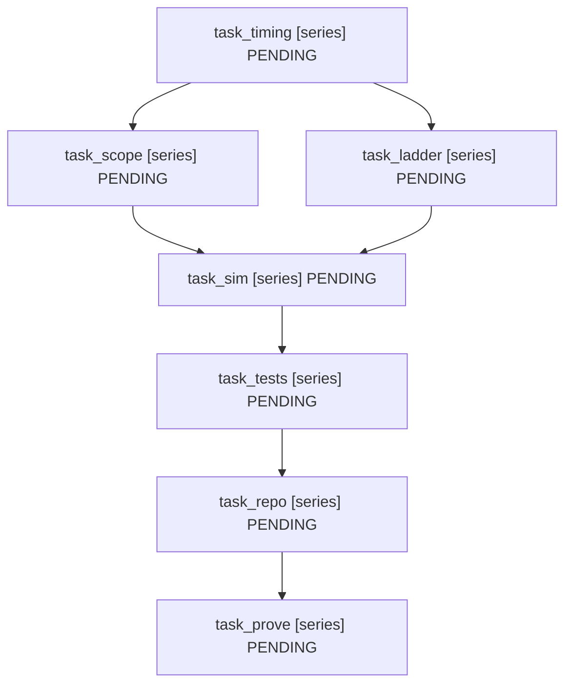

# iFocus Final Plan (Round 3, Wave 2): quiet-then-dwell timing, universal window focus, public-repo readiness

Author: `arbiter` | Round: 3 | Baseline: commit `ddc3550` (78/78 tests) | Status: ready for `builder`
Inputs: `docs/plans/plan-a-r3.md` (board #32), `docs/plans/plan-b-r3.md` (board #30), the coordinator's Wave 2 brief (board #29), `docs/reviews/triage-r2.md`. There is no `loop-dispatch-r3.md`; board #29 is the dispatch.

This document is self-contained for Round 3. `final-plan-r1.md` and `final-plan-r2.md` stay in force for everything not changed here. Where this plan and an input plan disagree, this plan wins.

Scope: the three requested upgrades only. `DEF-01` is absorbed by upgrade 1 and `TRG2-02` by the ladder change. `DEF-02` to `DEF-04`, `TRG2-01` and `TRG2-03` stay out.

## 0. Decision

**Plan A is the base. Five mechanisms are grafted from Plan B (RC1 to RC5), and ten arbiter amendments (AW1 to AW10) are added.**

Plan A prototyped the change in a throwaway copy and measured what breaks. I reproduced the timing half of that measurement independently and got the same sixteen tests, including one that hangs instead of failing (X1). Plan B's list of affected tests is wrong in both directions against that run: it re-times T42 and T44, which pass untouched, and misses T25, T39, T62 and T73, which fail.

### 0.1 Scores (out of 10)

| Axis | A | B | Deciding evidence |
|---|---|---|---|
| 1. Multi-monitor geometry and calibration | 9 | 7 | Neither plan changes geometry or calibration, which is correct. A re-proves the display path on the measured three-display desk with one or two windows per display (`Rig.mixedApps`) and tests the cross-display and same-display dwell at the real defaults. B names three scenarios but specifies no rig. |
| 2. Same-PID and cross-PID `AXUIElement` focus accuracy | 9 | 6 | A puts raise, activate, raise in the core ladder where the simulator can test it, found by running that skipping rung A alone breaks T45, and adds the re-match that fixes it. B re-raises only inside the native `.activateApp` step (not after rung B's set-frontmost, the rung that is tried first) and that code cannot run headless. B contributes the stricter already-focused test (RC1). |
| 3. Anti-misclick guards | 9 | 6 | Both move `.typing` to `.clear`. A measured zero pre-charge over 295 locked steps. A puts drag and scroll in the 2.5 s class as the brief says; B leaves them at 2.0 s. A adds modifier-held and key-up, keeps Spotlight an occluder, and fails closed on an unidentified owner. B's process-name aliases for password managers are ambiguous between "blocked" and "global veto". |
| 4. Swift 6 concurrency, TCC, privacy and repository security | 9 | 6 | A ships the canonical licence text unmodified behind a hash gate, linted its workflow, ran the guardian's scanner set, and invents no contact address. B writes an invented copyright holder into the licence, scans a fixed directory list for host paths (new top-level files escape it), and adds an unproven `bundle-app.sh --swiftpm` step to CI. |
| 5. Testability and scope | 10 | 5 | A keeps eleven mechanics tests intact with one fixture and zero assertion edits, lists every contract change, and adds 13 tests. B rewrites the timings of about fifteen tests by hand, edits assertions in T16, T17 and T31, adds 8 tests, and adds a menu toggle nobody asked for. |
| **Total** | **46** | **30** | |

### 0.2 Grafted from Plan B

| # | Plan B mechanism | Where |
|---|---|---|
| RC1 | `.alreadyFocused` requires both `frontmostPID == target.pid` and `focusedWindowID == target.windowID`. | 3.3 |
| RC2 | iFocus excludes itself by its runtime bundle identifier (`Bundle.main.bundleIdentifier`), as the brief words it, in addition to the own-PID rule and the `dev.ifocus.app` blocklist entry. | 3.2 |
| RC3 | Process name `CoreAuthUI` is recognised as an authentication prompt owner (the brief names it; this OS calls the process `coreautha`). | 3.2 |
| RC4 | CI runs the two cheap script gates before the builds, so a broken invariant fails in seconds. | 3.5 |
| RC5 | The guardian workflow is checked with `cmp -s` against the reference file when it is reachable; the hash is the portable check. | 5 |

### 0.3 Rejected from Plan B

| Plan B item | Reason |
|---|---|
| Re-timing the mechanics tests by hand | Fifteen rewrites with new magic numbers and no added coverage; its list of affected tests does not match the measured one (X1). |
| Drag and scroll in the 2.0 s class | The brief puts "click, drag, or scroll" in the 2.5 s quiet period. |
| Re-raise inside native `AXActuator.perform(.activateApp)` | Untestable headless, and it leaves rung B without a re-raise. |
| Password-manager process names in `promptOwnerNames` | That table feeds the prompt veto, which is global. An open password manager on another display must not disable iFocus (AW8). |
| A copyright holder written into `LICENSE` | The licence text is shipped unmodified; nobody has named a holder. |
| Menu toggle for the scope, with live persistence | New UI and a first config write path; `focusScope` in `config.json` is what was asked for. |
| `bundle-app.sh --swiftpm` as a CI step | Not in the brief's CI list, and a path that has never run anywhere should not gate the first pull request. It goes on the desk checklist instead. |
| Unverified exact bundle IDs for Bitwarden and 1Password 7 | The prefix rules cover both families whatever the suffix. |

### 0.4 Arbiter amendments

| # | Amendment | Why |
|---|---|---|
| AW1 | A cross-PID switch gets up to 8 verification polls 50 ms apart (350 ms); same-PID keeps 3. | Bringing another app forward is asynchronous. Today's 100 ms window was sized for a raise inside the frontmost app. If activation lands later than that, both rungs fail, the ladder reports failure and rolls focus back while the target is still arriving. Under `allApps` cross-app is the common case. This is reasoned, not measured: real activation latency needs an Accessibility grant (desk step 16). |
| AW2 | `ci.yml` first selects the newest non-beta Xcode on the runner; the plan names the fallback if the runner's compiler still rejects the code. | The code has only ever met a 6.4 compiler, and the `macos-15` image is expected to default to an older one. Neither the image's contents nor the step's effect can be checked offline; the step is lint-clean and does nothing when no versioned Xcode is found (X9 lowers the risk, it does not retire it). |
| AW3 | "Modifier held" means shift, control, option or command only (not fn, not caps lock). Mouse-up joins the click class. `--doctor` prints the live input sample. | A stuck or odd fn state would otherwise hold the typing veto for ever with no explanation. Mouse-up mirrors key-up: releasing a long press must start a quiet period. |
| AW4 | The `sbx.sh` toolchain probe searches explicit candidate lists, Command Line Tools first, and never calls `xcrun` when those paths exist. | The Xcode paths are from memory; a search fails loudly with what it looked for. Keeping `xcrun` out of the Command Line Tools branch keeps the sandbox path free of its cache writes. |
| AW5 | `docs/FINAL_REPORT.md`: links scrubbed, a link-rule comment at the top, and a short Wave 2 addendum. The full rewrite stays with the reporter. | The brief asks for the report to reflect the new model; rewriting it twice would be waste. The comment stops the next rewrite from re-introducing absolute links that I8 rejects. |
| AW6 | New invariant I9: no networking API in `Sources/`. | `SECURITY.md` will state that camera data never leaves the machine. A public claim like that should be enforced, and it holds today (X9). |
| AW7 | The zizmor gate is the default persona. | The pedantic and auditor personas report one low finding inside `pr-guardian.yml` (X5), which is a managed file that must be byte-identical. Plan A recorded both files as clean in the pedantic persona; that does not reproduce here. |
| AW8 | Password managers and credential stores are blocked as targets and as sources. They never raise the global prompt veto. | Clarifies the granularity B left open. Password fields themselves are covered by the secure-input veto. |
| AW9 | The menu shows "Waiting for input to go quiet" for the `.typing` veto. | It is now the most common reason nothing is happening, and it also covers a held modifier. |
| AW10 | Two more tests, T92 (AW1) and T93 (RC1). Expected total 93. | Each amendment that changes core behaviour has a test. |

### 0.5 Rulings on Plan A's seven decisions

| Item | Ruling |
|---|---|
| D1: retire the mismatch alert | Upheld. A dwell can no longer start during typing, so the path is dead, and typing in one window while reading another is now the supported workflow. |
| D2: `Config.v1Mechanics` fixture | Upheld. |
| D3: raise, activate, raise | Upheld, with AW1. |
| D4: `excludedBundleIDs`, modifier-held and key-up, blocklist prefixes, `TRG2-02` | All four kept, with AW3 narrowing the modifier set. |
| D5: Spotlight blocklisted but still an occluder | Upheld. Looking through the panel would let 1.2 s of reading results focus the window behind it. |
| D6: licence unmodified, no `NOTICE`, no invented holder | Upheld. The coordinator supplies a holder if one is wanted. |
| D7: `sbx.sh` layout probe | Upheld, with AW4. |

## 1. Facts verified for this round

Probes ran under `/tmp/ifocus-arb-spike/r3`, outside the workspace.

| # | Fact | How verified |
|---|---|---|
| X1 | With only the five timing defaults, their ranges and `.typing` moved to `.clear`: T19, T22, T25, T26, T27, T33, T35, T36, T37, T39, T43, T51, T62, T67 and T73 fail, and T70 runs into a 60 s suite time limit ("Time limit was exceeded", 64 s). 62 tests pass, among them T17, T31, T38, T42, T44, T45, T53, T61 and T63. No compiler warnings. | My own copy of the repository, three `sed` edits plus the suite time limit, `scripts/sbx.sh test`. Identical to plan-a-r3 V1. |
| X2 | T70 would wait for ever without the limit: it emits two samples 0.35 s apart under `Config()` and then loops on the event stream until a `.switched` arrives. | `Tests/iFocusCoreTests/CoordinatorTests.swift:485-494` |
| X3 | The reference `pr-guardian.yml` is 4732 bytes, SHA-256 `f895264c8c614957ab2e904d006727b9df8384f7aafd73ee0b03356cacf8ae1d`. Its first line says edits are reverted. It calls a reusable workflow at a pinned commit and passes two secrets. | `shasum`, read |
| X4 | A canonical Apache-2.0 text, 202 lines, SHA-256 `cfc7749b96f63bd31c3c42b5c471bf756814053e847c10f3eb003417bc523d30`, is at `~/code/github/skills/LICENSE`. | `shasum`, `wc -l` |
| X5 | The `ci.yml` in 3.5 and `pr-guardian.yml` together pass `actionlint` 1.7.12 (which also runs `shellcheck` on the `run` blocks) and `zizmor` 1.31.1 offline in the default persona with no findings. The pedantic and auditor personas each report one low finding, `undocumented-permissions`, at `pr-guardian.yml` lines 76 to 78, and nothing in `ci.yml`. | Ran `actionlint` and all three personas on the exact file text in 3.5 |
| X6 | `actions/checkout@3d3c42e5aac5ba805825da76410c181273ba90b1` is the pin, labelled v7.0.1, in the guardian's own workflows. | Local checkouts, `grep` |
| X7 | Bundle identifiers from the installed apps: Spotify `com.spotify.client`; Chrome `com.google.Chrome`; Ghostty `com.mitchellh.ghostty`; 1Password `com.1password.1password`; Passwords `com.apple.Passwords`; Keychain Access `com.apple.keychainaccess`; Spotlight `com.apple.Spotlight`. Bitwarden is not installed. | `PlistBuddy` |
| X8 | Host-path census over tracked and untracked files: 30 hits in `docs/FINAL_REPORT.md`, 1 in `docs/plans/plan-b-r1.md`, none anywhere else, including this round's plans. | The I8 patterns, run by hand |
| X9 | `Sources/` contains no networking API. `Sources/` and `Tests/` contain no trailing comma before a closing parenthesis (legal only from Swift 6.1) and no `@concurrent`, `nonisolated(nonsending)`, `InlineArray` or `Span`. | `grep`. A crude screen for compiler age, not proof. |
| X10 | Code at `ddc3550`: verification is 3 polls 50 ms apart (`LadderFocusSwitcher.swift:121-148`); `.failed(.staleCandidate)` returns before the rollback (`:113-115`); the simulated catalog derives the frontmost PID from the focused window (`SimServices.swift:151-160`), so RC1 leaves T46 alone; `ConfigStore.save` has no caller; `scripts/sbx.sh:26` exits 2 off the Command Line Tools layout; `sort -V` on macOS orders `Xcode_26.1` after `Xcode_16.10`. | Read, run |

Adopted from plan-a-r3 without re-running: adding the `allApps` default breaks T16 and T76 and widens T26; after the fixture, the re-timed scenarios and the new ladder, only T26, T27, T33, T58 and T72 fail; the measured timings (T35 latency 1.20 to 1.55 s, 10 s typing scenario switches at last key + 3.75 s, 0 of 295 locked steps carry a candidate); `CGEventSource.flagsState` and the `.keyUp` timer compile and need no permission; the guardian's scanner script reports the tree clean; the three product modules compile against the macOS 15.2 SDK.

Not verified, and why:

| Item | Why | Where it gets settled |
|---|---|---|
| The runner's compiler accepting this code | No older toolchain is installed here. | First CI run (7.2). |
| The Xcode branch of the `sbx.sh` probe | No Xcode here. | First CI run. |
| semgrep | Its rule packs come from a registry the sandbox cannot reach. | First pull request. |
| Live cross-app activation through AX, and how long it takes | No Accessibility grant in the sandbox. | Desk checklist steps 12, 13 and 16. |
| Spotlight's real window layer and size | The screen has been locked in every round. | Desk checklist step 17. |
| Bitwarden and 1Password 7 identifiers | Not installed. | `--doctor` on a machine that has them; `excludedBundleIDs` is the remedy. |

## 2. Behaviour contract

| Situation | Result |
|---|---|
| Hands idle; look at a window on another display | Focus moves after 1.2 s of steady gaze. |
| Hands idle; look at another window on the same display | Focus moves after 1.5 s of steady gaze. |
| Typing, clicking, dragging, scrolling, or holding a modifier or mouse button, while looking anywhere | Nothing. No candidate is kept and dwell progress stays at 0. |
| Activity stops | 2.5 s with no input (2.0 s after plain pointer movement) must pass first. Only then does a dwell start, from zero. Total 3.7 to 4.0 s after the last key. |
| Any input during that wait or during the dwell | Back to the start: full quiet period, then a full fresh dwell. |
| Look at a window and start typing within about a second | Keys go to the old window and focus stays there. This is the cost of the requested model; the switch flash is the cue that focus has moved. |
| Target is any normal app window (browser, music player, editor, terminal) | Eligible by default. |
| Target or frontmost app is a password manager, authentication prompt, screen sharing, System Settings, system chrome, an excluded app or iFocus | Never a target; never switched away from. |
| A system authentication prompt is visible anywhere | No switching at all (unchanged from Round 2). |

Config changes (all clamped on load):

| Key | Old default | New default | New range |
|---|---|---|---|
| `dwellCrossDisplaySeconds` | 0.30 | 1.2 | 0.15 to 5.0 |
| `dwellSameDisplaySeconds` | 0.45 | 1.5 | 0.15 to 5.0 |
| `typingLockSeconds` | 1.0 | 2.5 | 0.3 to 10.0 |
| `pointerMoveLockSeconds` | 0.8 | 2.0 | 0 to 10.0 |
| `pointerClickLockSeconds` | 1.5 | 2.5 | 0 to 10.0 |
| `focusScope` | (absent) | `"allApps"` | `"allApps"` or `"allowlist"`; a missing key is `"allApps"`; any other value loads as `"allowlist"` (the narrower scope) |
| `excludedBundleIDs` | (absent) | `[]` | up to 64 valid IDs; applies in both scopes |
| `mismatchAlert`, `mismatchBeep`, `mismatchAlertIntervalSeconds` | present | removed | ignored if found in a file |

`schemaVersion` stays 1. Old files still load and removed keys are ignored. Because no default file is ever written (X10), only values a user typed are on disk. A user who customised `allowedBundleIDs` and has no `focusScope` key gets `allApps` after upgrading; the README says so.

## 3. Changes

### 3.1 Timing and engine

| File | Change |
|---|---|
| `Sources/iFocusCore/Model/Config.swift` | Defaults, fallbacks and ranges per section 2. Remove the three mismatch keys. |
| `Sources/iFocusCore/Model/FocusTypes.swift` | `SafetyVeto.typing.disposition` becomes `.clear`. `.cooldown` stays `.hold` (the 0.6 s cooldown is shorter than any dwell, and T42 depends on it). Remove `EngineAction.mismatchAlert` and `CoordinatorEvent.mismatch`. The enum keeps 14 cases in the same order. |
| `Sources/iFocusCore/Model/InputTypes.swift` | Add `isModifierHeld: Bool = false`. Document the three classes below on the fields. |
| `Sources/iFocusCore/Engine/SafetyPolicy.swift` | `.typing` also fires while `isModifierHeld` is true. The order of the 14 checks is unchanged. |
| `Sources/iFocusCore/Engine/FocusDecisionEngine.swift` | Delete `lastAlertAt` and the `.typing` branch of the commit step (unreachable once `.typing` clears). The remaining hold branch serves `.cooldown` only. A `clear` veto drops both `pending` and `challenger`, as today. |
| `Sources/iFocusMac/Input/SystemInputActivityProvider.swift` | The classes below. Still elapsed-time counters and state flags only: no key codes, no tap. |
| `Sources/iFocusCore/Engine/FocusCoordinator.swift`, `Sources/iFocusCore/Simulation/ScenarioRunner.swift`, `Sources/iFocusApp/IFocusCLI.swift`, `Sources/iFocusMac/App/AppController.swift`, `Sources/iFocusMac/UI/HUDController.swift` | Remove the mismatch event, its log entries, `ScenarioResult.mismatchAlerts`, the CLI print and the amber flash. |
| `Sources/iFocusMac/UI/StatusMenuController.swift` | For veto `.typing` the state line reads "Waiting for input to go quiet" (AW9). |

Input classes (AW3):

| Class | Events | Quiet period | Veto |
|---|---|---|---|
| Keyboard | Minimum of the key-down, key-up and flags-changed timers | `typingLockSeconds` (2.5 s) | `.typing` |
| Modifier held | `CGEventSource.flagsState(.combinedSessionState)` contains shift, control, option or command | while held | `.typing` |
| Click | Minimum of the three mouse-down, three mouse-up, three drag and the scroll-wheel timers | `pointerClickLockSeconds` (2.5 s) | `.pointerActive` |
| Move | The mouse-moved timer | `pointerMoveLockSeconds` (2.0 s) | `.pointerActive` |
| Button held | Any button down | while held | `.pointerActive` |

Why no extra engine rule is needed for "no pre-charge": during a lock every sample either hits an earlier `clear` veto, hits a `dropout` veto (which gives the candidate no support, so it lapses after `candidateDropoutSeconds`), or reaches `.typing`, which clears. No sample can support a candidate until the lock ends, and the first one after it starts a new dwell from zero.

### 3.2 Universal window focus

`Config.isBundleAllowed(_:)` stays the single eligibility rule, used unchanged by `WindowHitTester.isEligible`, the engine's most-recently-used logic and the `requireAllowedSource` check:

```swift
public enum FocusScope: String, Sendable, Equatable, Codable { case allApps, allowlist }

public func isBundleAllowed(_ bundleID: String?) -> Bool {
    guard let bundleID, !bundleID.isEmpty else { return false }      // unidentified owner: fail closed
    guard !Self.isHardBlocked(bundleID) else { return false }
    guard !excludedBundleIDs.contains(bundleID) else { return false }
    switch focusScope {
    case .allApps:   return true
    case .allowlist: return allowedBundleIDs.contains(bundleID)
    }
}
public static func isHardBlocked(_ bundleID: String) -> Bool   // hardBlocklist.contains or a hardBlockPrefixes match
```

`DefaultSafetyGuardPolicy` switches its unconditional frontmost-app check from `hardBlocklist.contains` to `isHardBlocked`. The `requireAllowedSource` check is unchanged and now means: in `allApps`, the frontmost app must be identified, not blocked and not excluded; in `allowlist`, it must be on the list.

Additions to `Config.hardBlocklist` (existing entries stay):

| Identifier | Why | Verified |
|---|---|---|
| `com.1password.1password` | Password manager | X7 |
| `com.apple.Passwords` | Password manager | X7 |
| `com.apple.keychainaccess` | Credential store | X7 |
| `com.apple.Spotlight` | System chrome | X7 |
| `com.apple.systemuiserver` | System chrome | Round 2 W2 |
| `dev.ifocus.app` | iFocus itself (`Resources/Info.plist`) | Read |

`Config.hardBlockPrefixes`: `com.1password.`, `com.agilebits.onepassword`, `com.bitwarden.`, `com.apple.Passwords`. The second and third are unverified (not installed here); a prefix that never matches costs nothing.

`Config.promptOwnerNames` gains `"CoreAuthUI"` mapped to `com.apple.LocalAuthentication.UIAgent` (RC3). Nothing else is added to that table or to `securityPromptBundleIDs` (AW8).

Self-exclusion (RC2): `AppController` and `Doctor`, after loading the config, append `Bundle.main.bundleIdentifier` to `excludedBundleIDs` in memory when it is non-nil and not already blocked. This covers a build signed under a different identifier. Own-PID windows are still dropped by the catalog.

Points the brief does not spell out:

1. **Spotlight goes on the blocklist but not into `chromeBundleIDs`.** That set means "look through this" for windows above layer 0. Left out of it, the panel is an occluder and gaze on it resolves to `.blocked`.
2. **A window whose owner has no bundle ID is not eligible.** The blocklist cannot be applied to an unidentified owner.
3. **Password fields in any app are already covered** by the secure-input veto, which fires before any targeting. The README says so now that browsers are targets.
4. **An excluded app is never focused by gaze, and while it is frontmost gaze does not switch away from it** (unless `requireAllowedSource` is false).

Other files: `Sources/iFocusMac/App/Doctor.swift` prints `focusScope`, every on-screen window's bundle ID with its eligibility and the reason when not eligible, and the live input sample (seconds since keyboard, click and move; modifier held; button held) (AW3). `--focus-test` is capped at six windows, preferring distinct PIDs. User-facing strings in `StatusMenuController`, `Doctor` and `README.md` say "window" where they describe targets.

Known limit to document, not fix: a layer-0 window that AX does not list as a window (some sheets and helper panels) fails with `.windowNotFound` and waits out the 2 s failure backoff before the next attempt.

### 3.3 Cross-PID focus ladder

File: `Sources/iFocusCore/Engine/LadderFocusSwitcher.swift`. `AXActuator` needs no change.

```swift
if initial.frontmostPID == target.pid && initial.focusedWindowID == target.windowID { return .alreadyFocused }   // RC1
let crossPID = initial.frontmostPID != target.pid
let rungs: [(FocusStrategy, [FocusStep])] = crossPID
    ? [(.rungB, [.raiseAndMakeMain, .setAppFrontmost, .raiseAndMakeMain]),
       (.rungC, [.raiseAndMakeMain, .activateApp,     .raiseAndMakeMain])]
    : [(.rungA, [.raiseAndMakeMain]),
       (.rungB, [.raiseAndMakeMain, .setAppFrontmost]),
       (.rungC, [.raiseAndMakeMain, .activateApp])]
let verificationAttempts = crossPID ? 8 : 3                                                                      // AW1
```

| Change | Reason |
|---|---|
| Cross-PID starts at rung B | Rung A cannot give a background app the keyboard. Today it raises the window, fails three polls, then escalates. |
| Raise, bring forward, raise again | The first raise makes the target the app's main window before the app comes forward, so the wrong window never takes keys. The second covers apps that ignore a raise while in the background or re-order on activation: without it, Chrome window 1 could come forward when window 2 was the target. |
| One re-match per step on `.staleCandidate` | When a step reports stale: enumerate again, match again by `CGWindowID`, and retry that step once with the fresh candidate. A second stale result, an empty list or `.notFound` ends the rung. The fresh candidate is the one used for the key-window check. No extra AX traffic unless a step reports stale. |
| Verification requires `snapshot.frontmostPID == target.pid` **and** `snapshot.focusedWindowID == target.windowID` **and** `keyWindowCheck != .differs` | The app has the keyboard, and the target is its key window. |
| Longer verification window across apps (AW1) | Up to 8 snapshots 50 ms apart, the first straight after the rung. Both rungs still fit inside the 1.0 s ladder deadline (about 0.4 s each at worst). |
| Roll back before returning `.failed(.staleCandidate)` | This is `TRG2-02`: one line in the function being edited, and a half-completed cross-app switch is exactly when it matters. |

Same-PID behaviour is what it is today, so Ghostty to Ghostty and Chrome to Chrome still take rung A with one AX step and three polls.

### 3.4 Simulation

| File | Change |
|---|---|
| `Sources/iFocusCore/Simulation/Presets.swift` | New `Rig.mixedApps` on the `deskThree` displays, one or two windows per display: Ghostty (pid 1001) filling the portrait panel; Chrome windows 1 and 2 (pid 3001, `com.google.Chrome`) as left and right halves of the main panel; Spotify (pid 3002, `com.spotify.client`) on the built-in panel. |
| `Sources/iFocusCore/Simulation/SimServices.swift` | `SimFocusActuator` gains `ignoreRaiseWhileAppInBackground: Bool = false` and `activationLatencySeconds: TimeInterval = 0` (a set-frontmost or activate step becomes visible in the catalog only after that much virtual time; AW1). `keyWindowCheck` without an override returns `.matches` when the catalog's focused window is the expected one and `.differs` otherwise (T68 sets its override explicitly). |
| `Sources/iFocusCore/Simulation/Scenario.swift` | `ScenarioInputEvent` gains `.scroll(at:)` (click class) and `.modifierHeld(Bool, at:)`. Re-time `dualExternalSwitchBeforeTyping` (keys at 2.00, 2.15, 2.30; duration 3.0) and `dualExternalMismatchDuringTyping` (duration 7.0; renamed `dualExternalTypingThenQuiet`). New `mixedAppsTour`, `mixedAppsTypingWhileReading`, `dualExternalTypeTooSoon`. |
| `Sources/iFocusApp/IFocusCLI.swift` | `--simulate mixed-apps`, included in `all`. |

### 3.5 Repository readiness

| Item | Specification |
|---|---|
| `LICENSE` | Canonical Apache-2.0 text, unmodified (X4). No copyright line is added to it and no `NOTICE` file is created. |
| `.github/workflows/pr-guardian.yml` | Byte-for-byte copy of `~/code/github/agent-skill-forge/.github/workflows/pr-guardian.yml` (X3). Never edit it. |
| `.github/workflows/ci.yml` | The file below, verbatim (X5). |
| `scripts/sbx.sh` | Replace the hard exit at line 26 with the probe below (AW4). |
| `scripts/check-invariants.sh` | New I8 and I9, below. |
| Path scrub | `docs/FINAL_REPORT.md`: rewrite the 30 absolute links as relative links (`../Sources/...`, `plans/...`, `reviews/...`), keeping line anchors. `docs/plans/plan-b-r1.md`: replace the one absolute workspace path with "the repository root". Then let I8 find anything this round's documents added. |
| `docs/FINAL_REPORT.md` (AW5) | Besides the scrub: an HTML comment on the first line saying that links must be repo-relative because invariant I8 rejects absolute home paths and local file URLs; and a section "Wave 2 addendum (Round 3)" of at most 25 lines covering the new timing model, `allApps` with its exclusions, the cross-PID ladder, the mismatch alert's retirement and the CI workflows. The reporter rewrites the report in full at convergence. |
| `SECURITY.md` | Supported version (main). Reports go through GitHub private vulnerability reporting; no e-mail address is invented. What is in scope. Data handling: frames are processed in memory and never stored; no key codes, only elapsed-time counters and state flags; two permissions (Camera, Accessibility); files at `0600`; no network I/O (enforced by I9); one read-only private symbol with a public fallback. |
| `CONTRIBUTING.md` | The gate commands of section 5; invariants I1 to I9 in one line each; the test ID convention; "no external dependencies"; "never loosen an existing test without a contract note"; "documents use repo-relative links only". |
| `DESIGN.md` | Sections: purpose and non-goals; module map; coordinate spaces; gaze features and One-Euro filtering; per-display ridge calibration; window census and the nine classifier rules; eligibility and `focusScope`; decision engine (quiet period, dwell, challenger, hysteresis); the 14 vetoes in order with dispositions; focus ladder (same-PID and cross-PID); concurrency model; threat model (assets, trust boundaries, the findings of the two security reviews and how each was closed, residual risks); testing strategy. Claims link to a repo-relative `path#Lnn`. |
| `README.md` | New one-line description (any window, not only terminals); the section 2 contract and config tables; `focusScope` and `excludedBundleIDs`; the upgrade note; the look-then-type trade-off under known limits; mismatch rows removed; the new default script behaviour on Xcode; the section 7.1 desk steps. |
| Commit | One commit `Round 3: ...` containing everything, including the review, triage, summary and report files that are untracked today. No push and no `gh` calls. |

```yaml
name: ci
on:
  push:
    branches: [main]
  pull_request:
permissions:
  contents: read
concurrency:
  group: ci-${{ github.ref }}
  cancel-in-progress: true
jobs:
  macos:
    name: Build and test (macOS)
    runs-on: macos-15
    timeout-minutes: 30
    steps:
      - name: Check out
        uses: actions/checkout@3d3c42e5aac5ba805825da76410c181273ba90b1 # v7.0.1
        with:
          persist-credentials: false
      - name: Select the newest installed Xcode
        run: |
          newest="$(find /Applications -maxdepth 1 -type d -name 'Xcode_*.app' ! -name '*[Bb]eta*' | sort -V | tail -n 1)"
          if [ -n "$newest" ]; then
            echo "DEVELOPER_DIR=$newest/Contents/Developer" >> "$GITHUB_ENV"
            echo "Selected $newest"
          else
            echo "No versioned Xcode found; keeping the runner default"
          fi
      - name: Show toolchain
        run: |
          xcode-select -p
          swift --version
      - name: Architecture and security invariants
        run: ./scripts/check-invariants.sh
      - name: Script hardening
        run: ./scripts/check-scripts.sh
      - name: swift build
        run: swift build
      - name: swift test
        run: swift test
      - name: Direct swiftc build and test (sbx.sh)
        run: ./scripts/sbx.sh test
```

Toolchain probe for `scripts/sbx.sh` (the Command Line Tools branch ran here and is `shellcheck` clean; the Xcode paths are from memory and unverified):

```bash
DEV="$(xcode-select -p)"
first_dir_with() {  # first_dir_with <entry> <dir>...
  local entry="$1"; shift
  local d
  for d in "$@"; do
    if [ -e "$d/$entry" ]; then printf '%s\n' "$d"; return 0; fi
  done
  return 1
}
if [ -x "$DEV/usr/bin/swiftc" ]; then        # Command Line Tools: no xcrun, so nothing is written outside /tmp
  LAYOUT="Command Line Tools"
  SWIFTC="$DEV/usr/bin/swiftc"
  export SDKROOT="${SDKROOT:-$DEV/SDKs/MacOSX.sdk}"
else                                         # Xcode
  LAYOUT="Xcode"
  SWIFTC="$(xcrun --find swiftc)"
  export SDKROOT="${SDKROOT:-$(xcrun --sdk macosx --show-sdk-path)}"
fi
echo "sbx.sh: $LAYOUT layout at $DEV"
FW_CANDIDATES=("$DEV/Library/Developer/Frameworks" "$DEV/Platforms/MacOSX.platform/Developer/Library/Frameworks")
PLUG_CANDIDATES=("$DEV/usr/lib/swift/host/plugins/testing" "$DEV/Toolchains/XcodeDefault.xctoolchain/usr/lib/swift/host/plugins/testing")
RTLIB_CANDIDATES=("$DEV/Library/Developer/usr/lib" "$DEV/Platforms/MacOSX.platform/Developer/usr/lib")
```

In `test` mode only (a plain `build` must not need the testing library):

```bash
FW="$(first_dir_with Testing.framework "${FW_CANDIDATES[@]}")" \
  || { echo "sbx.sh: Testing.framework not found; searched: ${FW_CANDIDATES[*]}" >&2; exit 2; }
PLUG="$(first_dir_with libTestingMacros.dylib "${PLUG_CANDIDATES[@]}")" \
  || { echo "sbx.sh: libTestingMacros.dylib not found; searched: ${PLUG_CANDIDATES[*]}" >&2; exit 2; }
RTLIB="$(first_dir_with . "${RTLIB_CANDIDATES[@]}")" || RTLIB="$FW"
```

`RTLIB` replaces the hard-coded second `-rpath`. The directory checks of Round 2 (`prepare_secure_dir`) still run before the probe, so `check-scripts.sh` keeps passing. The script never skips silently.

New invariants in `scripts/check-invariants.sh`:

| # | Scope | Rule |
|---|---|---|
| I8 | Every tracked file and every untracked file that is not ignored (`git ls-files` plus `git ls-files --others --exclude-standard`, with `git`'s stderr discarded; outside a checkout fall back to `find` without `.git`, `dist` and build output), text files only (`grep -I`) | No host home path and no local file URL. Three patterns, each assembled from split string literals the way I7 already does, so the script does not match itself: `"/Us" "ers/[A-Za-z0-9._-]+"`, `"/ho" "me/[A-Za-z0-9._-]+/"`, `"fi" "le:///"`. |
| I9 | `Sources/` | None of `URLSession`, `URLRequest`, `NWConnection`, `NWListener`, `import Network`, `CFSocket`, `NSURLConnection` (AW6). |

Handoff note, to be repeated in `docs/build-r3.md`: every document added after this commit (reviews, triage, the final report) is scanned by I8 in CI. Use repo-relative links.

## 4. Tests

### 4.1 Existing tests that change

Add to `Tests/iFocusCoreTests/TestDoubles.swift`:

```swift
extension Config {
    /// Round 1 and 2 mechanics fixture: allowlist scope and the short v1 timings.
    static var v1Mechanics: Config {
        Config(dwellCrossDisplaySeconds: 0.30, dwellSameDisplaySeconds: 0.45, typingLockSeconds: 1.0,
               pointerMoveLockSeconds: 0.8, pointerClickLockSeconds: 1.5, focusScope: .allowlist)
    }
}
```

**Do the T70 swap and the suite time limit in the same step as the new defaults.** Otherwise the test binary does not fail, it hangs (X1, X2).

| Tests | Change | Assertions edited |
|---|---|---|
| T16, T19, T22, T25, T39, T43, T51, T62, T67, T70, T76 | Replace `Config()` with `Config.v1Mechanics` inside these eleven tests (16 occurrences). | None |
| Coordinator suite | `@Suite("Coordinator", .timeLimit(.minutes(1)))`, so the next change of this kind fails after a minute instead of hanging. | None |
| T26 | Disposition table: `.typing` is `.clear`. The `.sourceNotAllowed` trigger becomes a blocklisted frontmost app (`com.apple.systempreferences`). Still 14 vetoes, same order. | 2 lines |
| T27 | Rewritten and retitled "typing burst clears the candidate and a fresh dwell follows the quiet period": no candidate on any step while locked; no switch before last key + 2.5 + 1.2; exactly one switch after. | Whole test |
| T33 | Clamped `dwellCrossDisplaySeconds` expectation 2.0 becomes 5.0. | 1 line |
| T35 | Latency bound 1.0 s becomes 2.0 s (measured 1.20 to 1.55). The switch-sequence assertion is unchanged. | 1 line |
| T36 | Uses the re-timed scenario; asserts the switch precedes the first key at 2.00 s. | 1 line |
| T37 | Uses the renamed scenario; drops the mismatch assertions; asserts one switch at or after 5.05 s (last key 1.35 + 2.5 + 1.2). | 4 lines |
| T58 | Cross-PID call count with no clock: 5 becomes 6. | 1 line |
| T72 | Cross-PID call count 5 becomes 6; the tail is `[.raiseAndMakeMain, .activateApp, .raiseAndMakeMain]`. | 2 lines |

Every other existing test passes unedited, T17, T31, T38, T42, T44, T45, T46, T53 and T73 among them. If one of them fails, that is a defect in the change, not a reason to edit the test. `docs/build-r3.md` carries this table as its "Contract changes" section with the before and after of each edited assertion.

### 4.2 New tests

| ID | Suite | Asserts |
|---|---|---|
| T79 | Config | New defaults and ranges; `focusScope` decodes `allApps` and `allowlist`, a missing key is `allApps`, an unknown string loads as `allowlist`; a file containing the removed mismatch keys loads cleanly; `excludedBundleIDs` is sanitised and capped at 64. |
| T80 | Engine | Under `Config()`: while keys arrive every 150 ms and gaze rests on another window, every step reports no candidate and progress 0. After the last key there is no commit before +3.7 s and a commit on the first sample at or after it. One key 0.8 s into the dwell restarts the full 2.5 + 1.2. |
| T81 | Safety | Table-driven, one row per input class of 3.1: key activity, modifier held, click class (2.5 s), move class (2.0 s), button held. Each clears the candidate and each needs its own full quiet period. |
| T82 | Engine | A dropout veto interleaved with typing (looking down at the keyboard, then back) cannot keep a candidate alive across the lock. |
| T83 | Engine | Idle hands under `Config()`: no commit at dwell minus one frame; commit at 1.2 s across displays and 1.5 s on the same display. |
| T84 | HitTest | Eligibility table in `allApps`: Chrome, Spotify, Ghostty, VS Code and Finder eligible; every blocklist entry, one ID from each prefix family, a nil and an empty bundle ID, an excluded ID, a layer-3 window and a 100x60 window not eligible. In `allowlist`: Safari blocked, Ghostty eligible. |
| T85 | Safety | A 1Password window in front of Chrome gives `.blocked`, never Chrome. A Spotlight panel above layer 0 gives `.blocked`. A password manager as frontmost app gives `.sourceNotAllowed` even with `requireAllowedSource == false`. A password-manager window on another display does **not** raise the prompt veto (AW8). `canonicalBundleID(nil, "CoreAuthUI")` gives the authentication agent's ID and classifies as `securityPrompt` (RC3). |
| T86 | Ladder | Ghostty to Spotify on `Rig.mixedApps`: `.switched(.rungB)`; steps exactly raise, set-frontmost, raise; no single-step rung A. Afterwards the frontmost PID is Spotify's, the focused window is Spotify's, and `keyWindowCheck` is `.matches`. |
| T87 | Ladder | Ghostty to Chrome window 2 while Chrome's own front window is window 1: lands on window 2, including with `ignoreRaiseWhileAppInBackground`. Then window 2 to window 1: `.switched(.rungA)` with one step. Repeated with window IDs hidden. |
| T88 | Ladder | An actuator that raises the window but never brings the app forward is never reported as `.switched`; outcome `.failed(.unverified)` and focus is back on the initial window. A stale result after a wrong raise also rolls back (`TRG2-02`). |
| T89 | Scenario | `mixedAppsTour` through `runWithLadder`, 10 seeds: Ghostty, Spotify, Chrome 2, Chrome 1, Ghostty. Switch sequence exact; strategies are rung B for each app change and rung A for Chrome to Chrome; latency at most dwell + 0.5 s. |
| T90 | Scenario | `mixedAppsTypingWhileReading`, 10 seeds: 10 s of typing in Ghostty while looking at Chrome, a 1.5 s pause, 0.9 s more typing, then idle. Zero switches and zero candidate entries up to last key + 2.5 s; exactly one switch, between last key + 3.7 s and + 4.2 s. |
| T91 | Scenario | `dualExternalTypeTooSoon`: typing starts 0.6 s after the gaze lands and continues for 5 s. Zero switches. Pins the look-then-type trade-off. |
| T92 | Ladder | AW1. With `activationLatencySeconds = 0.2`, Ghostty to Spotify is `.switched(.rungB)` with exactly three steps and no rollback call (three polls would have failed it). A same-PID switch still takes at most three verification snapshots. |
| T93 | Ladder | RC1. A scripted catalog whose snapshot reports the target as `focusedWindowID` but another app as frontmost does not yield `.alreadyFocused`; the cross-PID rungs run. |

Expected total: 78 existing plus 15 new, **93 tests**.

Closed by inspection plus build rather than a unit test, with `file:line` in `docs/build-r3.md`: the native input classes (AW3), the runtime self-exclusion (RC2), the menu wording (AW9), the `--doctor` additions, the mismatch removal in native code.

## 5. Gates

| Gate | Command | Pass condition |
|---|---|---|
| G1b | `swift package --disable-sandbox describe` (with the `/tmp` cache variables) | Exit 0. |
| G2 | `IFOCUS_SBX_OUT=<own dir> scripts/sbx.sh test` | 93 passed; no `warning:` line in the build output. |
| G3 | `scripts/check-invariants.sh` | Exit 0, including I8 and I9. |
| G4 | `<out>/ifocus --simulate all` | Exit 0, including `mixed-apps`. |
| G5 | `scripts/bundle-app.sh` | Exit 0. |
| G6 | `scripts/check-scripts.sh` | Exit 0. |
| G7 | `<out>/ifocus --help`, `--version`, `--doctor` | Exit 0 each. |
| G8 | `actionlint .github/workflows/*.yml` and `zizmor --offline .github/workflows/` (default persona, AW7) | No findings. |
| G9 | `cmp -s ~/code/github/agent-skill-forge/.github/workflows/pr-guardian.yml .github/workflows/pr-guardian.yml` when the reference is reachable; always `shasum -a 256 LICENSE .github/workflows/pr-guardian.yml` | Identical; hashes equal X4 and X3. |
| G10 | `python3 ~/code/github/agent-skill-forge/skills/security-review/scripts/run_scanners.py --repo-root .` when reachable; otherwise `gitleaks`, `trivy fs` and `osv-scanner` run one by one | Status clean, 0 leads. Report semgrep's exit code as observed; do not claim it passed if it could not reach its rules. |
| G11 | `git status --porcelain` after the commit | Empty. |

`swift build` and `swift test` remain impossible in the sandbox (Round 1 finding). Their first proof is the `ci.yml` run on the pull request; say so in `docs/build-r3.md` instead of reporting them as passed.

## 6. Task graph

Topology: single-agent | Integrity Mode: development

| ID | Task Name | Mode | Depends On | Inputs | Outputs | Gate | Status |
|---|---|---|---|---|---|---|---|
| task_timing | Config defaults, typing clears, input classes, mismatch removal, fixture and T70 guard (3.1, first rows of 4.1) | series | none | docs/plans/final-plan-r3.md | Sources/iFocusCore/Model/Config.swift, Sources/iFocusCore/Engine/FocusDecisionEngine.swift, Sources/iFocusMac/Input/SystemInputActivityProvider.swift, Tests/iFocusCoreTests/TestDoubles.swift | scripts/sbx.sh build | PENDING |
| task_scope | focusScope, blocklists, self-exclusion, doctor and wording (3.2) | series | task_timing | Sources/iFocusCore/Model/Config.swift | Sources/iFocusCore/Engine/SafetyPolicy.swift, Sources/iFocusMac/App/Doctor.swift | scripts/sbx.sh build | PENDING |
| task_ladder | Cross-PID rungs, re-match, verification window, rollback (3.3) | series | task_timing | Sources/iFocusCore/Model/Config.swift | Sources/iFocusCore/Engine/LadderFocusSwitcher.swift | scripts/sbx.sh build | PENDING |
| task_sim | Mixed-apps rig, sim flags, scenarios, CLI (3.4) | series | task_scope, task_ladder | Sources/iFocusCore/Engine/LadderFocusSwitcher.swift, Sources/iFocusCore/Engine/SafetyPolicy.swift | Sources/iFocusCore/Simulation/Presets.swift, Sources/iFocusCore/Simulation/Scenario.swift | scripts/sbx.sh build | PENDING |
| task_tests | Contract changes, T79 to T93 (4) | series | task_sim | Sources/iFocusCore/Simulation/Scenario.swift | Tests/iFocusCoreTests/ScenarioTests.swift, Tests/iFocusCoreTests/LadderTests.swift | scripts/sbx.sh test | PENDING |
| task_repo | Licence, policies, design doc, workflows, sbx probe, I8 and I9, scrub, README, report addendum (3.5) | series | task_tests | Tests/iFocusCoreTests/ScenarioTests.swift | LICENSE, SECURITY.md, CONTRIBUTING.md, DESIGN.md, .github/workflows/ci.yml, .github/workflows/pr-guardian.yml | scripts/check-invariants.sh | PENDING |
| task_prove | All gates, build report, commit | series | task_repo | LICENSE, .github/workflows/ci.yml | docs/build-r3.md | scripts/sbx.sh test | PENDING |



## 7. Checklists that need a person

### 7.1 On the desk (appended to the README list, which ends at step 11)

| Step | Action | Retires | Pass looks like |
|---|---|---|---|
| 12 | Hands off the keyboard, look at Spotify for a little over a second, press Space | Cross-app keyboard readiness | Playback toggles. |
| 13 | From Ghostty look at the second of two Chrome windows; then look at the first | Same-app window accuracy after an app change | The second window takes focus, not the first; then the first after about 1.5 s. |
| 14 | Type in Ghostty for ten seconds while reading Chrome, pause for a second, type again, then stop | The quiet-then-dwell model | No switch while typing or during the short pause; focus moves about four seconds after the last key. |
| 15 | `ifocus --doctor` | Scope and blocklist on real apps | `focusScope` is `allApps`; your password manager is listed as not eligible; "modifier held" is "no" with hands off the keyboard. |
| 16 | `ifocus --doctor --focus-test` | AW1 | Rung B for each app change, rung A inside one app, no `unverified`. If `unverified` appears for a slow app, the verification window is the knob. |
| 17 | Open Spotlight and read the results for two seconds | Spotlight as an occluder | The window behind it does not take focus and the panel stays open. |
| 18 | `scripts/bundle-app.sh --swiftpm` outside the sandbox | The SwiftPM bundle path, which has never run | A signed `dist/iFocus.app`. |

### 7.2 On the first pull request (for the coordinator)

| # | Check | If it fails |
|---|---|---|
| 1 | The repository has the two secrets `pr-guardian.yml` passes on (X3). | Add them. |
| 2 | "Show toolchain" in the `ci` run names the Xcode and compiler chosen (AW2). | If `swift build` reports language or compiler-version errors, change `runs-on` to the newest macOS image label available and re-run. Change code only if the errors persist there. |
| 3 | `sbx.sh test` on the runner. | An exit 2 lists the directories it searched (AW4); add the runner's real location to the candidate list. |
| 4 | semgrep's verdict, which could not be checked offline. | Triage as a normal finding. |
| 5 | A copyright holder and `NOTICE`, if wanted. | Add them; `LICENSE` itself stays unmodified. |
| 6 | Documents added after the builder's commit pass `scripts/check-invariants.sh`. | Rewrite absolute links as relative ones. |

## 8. Scope

### 8.1 Not in this round

- `DEF-02` (native-tab disambiguation), `DEF-03` (majority-share dwell), `DEF-04` (Dock and banner sub-rects), `TRG2-01` (partial AX enumeration), `TRG2-03` (heartbeat hops).
- AX subrole filtering of targets, a quarantine for windows AX cannot focus, a veto while a menu is open, per-app dwell, a settings window, a scope toggle in the menu.
- A dedicated veto case for system prompts (it would change T26's count).
- Creating the GitHub repository, pushing, or opening the pull request: the coordinator's step.

### 8.2 v2 roadmap, re-ranked for the new model

The 1.2 to 1.5 s dwell and the look-then-type trade-off change what is most valuable next.

| Rank | Feature | Value on a three-display desk with one or two windows each | Cost | Notes |
|---|---|---|---|---|
| 1 | **Look-and-chord commit**: tap a hotkey to focus the window under gaze at once. | Removes the look-then-type cost for anyone willing to tap one key, without shortening the safe default. | Low | Reuses the Carbon hotkey and the ladder; bypasses dwell, never the hard blocks. |
| 2 | **Dwell progress cue**: a thin border on the candidate that fills over the dwell. | With a dwell this long the user needs to see that a switch is coming, and can cancel by looking away. | Low | Reuses the HUD panel; the engine already reports progress. |
| 3 | **Undo last switch** hotkey, with a false-positive counter that lengthens dwell. | One key to recover from a wrong switch; self-correcting defaults. | Low | Counters stay local. |
| 4 | **Enter Guard**: hold Return briefly after a switch or while gaze and focus disagree. | Closes the remaining wrong-window keystroke risk. | Medium | Needs an event tap and Input Monitoring; opt-in. |
| 5 | **Per-app profiles**: dwell and quiet period per app (shorter for a music player, longer for a browser), plus a visible exclusion list. | Tunes the model to how each app is used. | Medium | Builds on `excludedBundleIDs`. |
| 6 | **Visible sub-rect occlusion for the Dock and notification banners** (`DEF-04`) and a veto while a menu is open. | Under `allApps`, gaze on the Dock currently passes through to the window beneath. | Medium | |
| 7 | **AX robustness for many-window apps**: ID-first enumeration with partial results (`TRG2-01`) and a quarantine for windows AX cannot focus. | Browsers with many windows are first-class targets now. | Low | |
| 8 | **Implicit recalibration** from clicks and first keystrokes. | Calibration stops drifting with posture. | Medium | |
| 9 | **Pane, tab and native-tab bridge** (`DEF-02`): terminal panes, browser tabs. | Reaches inside one window. | High | Needs finer gaze accuracy; pair with rank 10. |
| 10 | **Better gaze model** and a fixation classifier, with `DEF-03` tuned on recorded traces. | Accuracy from window level towards pane level. | High | |
| 11 | **Adaptive power**: lower the processing rate when the face is absent or input is active. | Battery life; the quiet period makes "input active" a long, cheap state. | Low | |
| 12 | **Settings window, launch at login, signed and notarised releases built by CI.** | Usable without editing JSON; ends the Accessibility re-grant per build. | Medium | |

## 9. Definition of done (Round 3)

1. Gates G1b and G2 to G11 pass. `swift build` and `swift test` are reported as "first proven in CI", not as passed.
2. 93 tests pass. Assertion edits exist only in T26, T27, T33, T35, T36, T37, T58 and T72; eleven tests take the fixture swap; nothing is skipped or disabled.
3. `docs/build-r3.md` records: each gate command with the tail of its output; the test count; the commit hash; the "Contract changes" table; `file:line` and proving test or gate for upgrades 1 to 3, RC1 to RC5 and AW1 to AW10; what could not be verified (section 1); the I8 handoff note; any deviation from this plan with its reason; and the reviewer command with an own output directory.
4. The tree contains `LICENSE`, `SECURITY.md`, `CONTRIBUTING.md`, `DESIGN.md`, both workflows, and updated `README.md` and `docs/FINAL_REPORT.md`; I8 finds nothing.
5. One clean commit `Round 3: ...` that includes every previously untracked document. Nothing is pushed.
