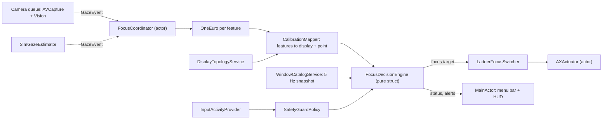
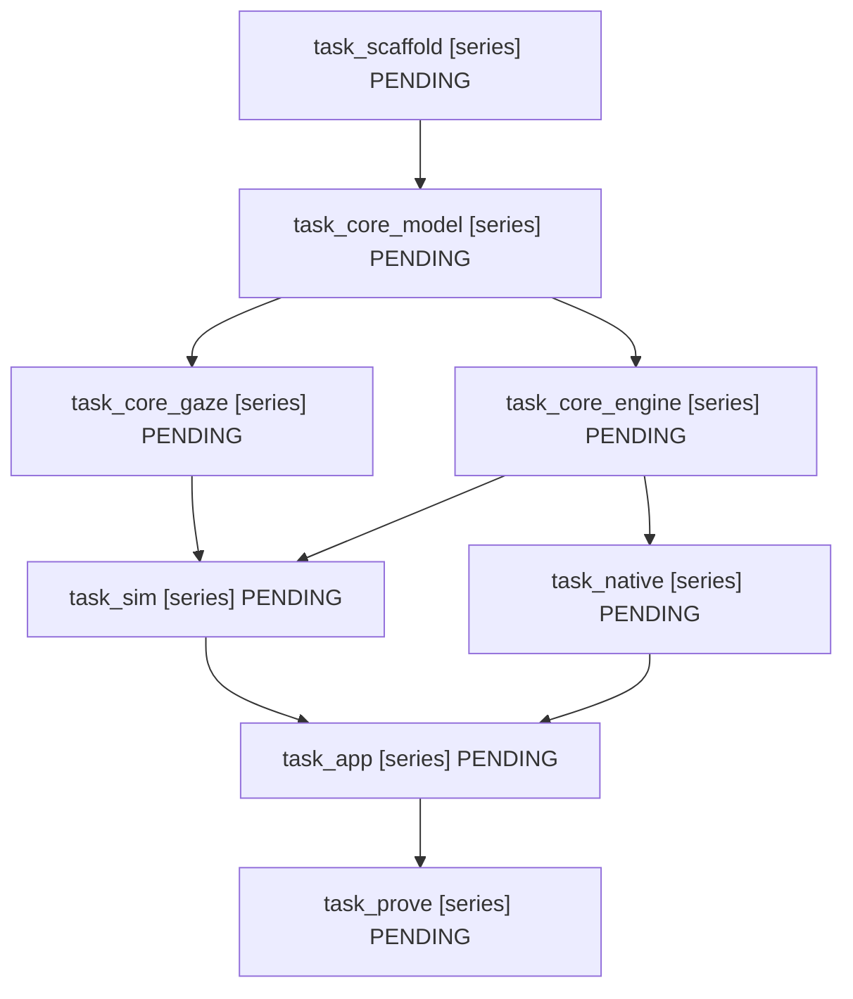

# iFocus Plan A (Round 1): gaze-driven window focus for multi-monitor terminal work

Author: `planner-a` | Round: 1 | Status: ready for arbiter | Scope: design + build plan only (no source written)

## 0. Summary

iFocus moves keyboard focus to the terminal window the user is looking at, using webcam head pose plus pupil offset, a per-display calibrated mapping, z-order-aware hit-testing, and a same-PID Accessibility raise. It never moves the cursor, never posts synthetic input, and never installs a keyboard tap.

Three positions in this plan differ from the obvious design and are each backed by a measurement taken on this machine (section 1):

1. **Calibrate per display into normalised panel coordinates, not into one global Quartz plane.** The desk here has a 32" landscape main, a built-in panel above it, and a portrait panel to the left, at three different points-per-millimetre scales. One global regression cannot fit that; three small per-display models can, and they survive resolution and arrangement changes.
2. **Resolve AX windows by `CGWindowID` through a `dlsym`-probed `_AXUIElementGetWindow`, with public geometry matching as the fallback.** The live window list on this machine already contains same-PID Ghostty windows with identical frames, which pure geometry cannot tell apart, and `kCGWindowName` is unavailable without Screen Recording permission.
3. **Ship a sandbox-proof build and test script alongside SwiftPM.** `swift build` fails inside the agent sandbox even with `--disable-sandbox`, because Foundation atomic writes are blocked. A direct `swiftc` pipeline with a Swift Testing runner works, and was run end to end.

## 1. Verified environment facts

All rows were checked on this machine in a throwaway spike under `/tmp/ifocus-spike-a` (not in the workspace). "Not verified" rows could not be checked because the sandbox has no Camera or Accessibility grant.

| # | Fact | Evidence | Consequence for the plan |
|---|---|---|---|
| E1 | Toolchain is Command Line Tools only: Swift 6.4, SDK `MacOSX27.0.sdk`, no Xcode. | `swift --version`, `ls /Library/Developer/CommandLineTools/SDKs` | No `xcodebuild`, no `.xcodeproj`; app bundle is assembled by script. |
| E2 | `XCTest.framework` is absent; `Testing.framework` is present. | `find /Library/Developer/CommandLineTools -name XCTest.framework` returns nothing | All tests use Swift Testing (`import Testing`, `@Test`, `#expect`). No `import XCTest` anywhere. |
| E3 | The brief's `swift build` command fails in the sandbox: `sandbox-exec: sandbox_apply: Operation not permitted`. | Ran it verbatim | Needs `--disable-sandbox` at minimum. |
| E4 | With `--disable-sandbox` it still fails: `unable to write manifest to .../manifest.json ... Operation not permitted`; `--build-system native` fails on `output-file-map.json`. | Ran both | SwiftPM cannot build in the sandbox at all. |
| E5 | Root cause of E4: Foundation atomic writes use `/var/folders/.../T/TemporaryItems`, which the sandbox blocks and `TMPDIR` does not redirect. Plain writes to `/tmp` succeed. | Probe: `Data.write(options: .atomic)` fails with `NSCocoaErrorDomain 513`; non-atomic succeeds; `NSTemporaryDirectory()` ignores `TMPDIR` | (a) Build fallback in section 9. (b) App code must not use `.atomic` or `FileManager.temporaryDirectory`; see 6.4. |
| E6 | Direct `swiftc` works in the sandbox: module compile with `-swift-version 6 -enable-testing -wmo`, executable link, and a Swift Testing runner (`await Testing.__swiftPMEntryPoint() as Never`) that ran 2 tests green. | Spike output: `Test run with 2 tests in 1 suite passed` | `scripts/sbx.sh` is a real, working gate. |
| E7 | These compile clean under Swift 6 strict concurrency: AX calls inside an `actor`; `dlsym` + `unsafeBitCast` to `@convention(c)`; `CGEventSource.secondsSinceLastEventType`; `IsSecureEventInputEnabled()`; Carbon `RegisterEventHotKey`; `VNDetectFaceRectanglesRequest` + `VNDetectFaceLandmarksRequest` at revision 3 inside an `AVCaptureVideoDataOutputSampleBufferDelegate`; click-through `NSPanel`. | Spike compiled with zero errors after one fix (E8) | Section 5 signatures are compile-proven, not guessed. |
| E8 | Capturing `AVCaptureSession` in a `@Sendable` closure is a hard error. | `error: capture of 'session' with non-Sendable type 'AVCaptureSession'` | Route start/stop through the owning queue-confined wrapper (`[weak self]`), never capture the session. |
| E9 | `_AXUIElementGetWindow` resolves at runtime on macOS 26.7. | Spike printed `AXPrivate.available: true` | Position 2 above is viable. |
| E10 | Passing `["AXTrustedCheckOptionPrompt": Bool] as CFDictionary` compiles; this avoids the non-Sendable global `kAXTrustedCheckOptionPrompt`. | Spike | Use the string literal. |
| E11 | Real display topology: main `(0,0,2560,1440)` 699x389 mm; built-in `(1140,-1117,1728,1117)` 344x223 mm; portrait `(-1152,-188,1152,2048)` 340x598 mm. | Spike `CGGetActiveDisplayList` dump | Negative origins, unequal heights, portrait, and 3.66 / 5.02 / 3.39 pt per mm. Becomes test fixture `Rig.deskThree`. |
| E12 | Real window list: at least 9 on-screen Ghostty windows under one PID (4433), including two pairs with identical frames (`(1280,30,1280,1410)` twice; `(0,30,2560,1410)` twice). | Spike `CGWindowListCopyWindowInfo` dump | Geometry-only AX matching is ambiguous on the user's actual desk. |
| E13 | Bounds, PID, layer and window number are returned without Screen Recording permission. | Spike ran with no TCC grants | iFocus needs exactly two permissions: Camera and Accessibility. |
| NV1 | Not verified: Vision actually populates `yaw`/`pitch` on landmark-request observations. | No camera in sandbox | Read pose from the landmarks result, fall back to the rectangles result (5.1). |
| NV2 | Not verified: the AX raise sequence switches focus on macOS 26. | No Accessibility grant in sandbox | Post-switch verification plus a strategy ladder (4.8); `--doctor --focus-test` for manual proof. |

## 2. Behaviour contract (v1)

| Situation | iFocus does |
|---|---|
| Focus is on terminal A; user looks at terminal B (same app or not) and holds gaze for the dwell time, keyboard idle | Raises and focuses B; flashes a border on B. |
| User is typing in A and glances at B or at documentation | Nothing. Typing lock holds focus on A. |
| User is typing in A but has been looking steadily at B (the "wrong terminal" race) | Does not switch mid-burst. Flashes an amber border on A (and optionally beeps) to warn that keystrokes are landing where the user is not looking. Switches to B once typing pauses and gaze is still on B. |
| User looks at a non-allowlisted window (browser, editor) | Nothing; focus stays where it was. |
| User looks down at the keyboard, away from all displays, or leaves | Nothing. Off-screen and low-confidence gaze can never cause a switch. |
| Second face in frame, password field focused, screen locked, mouse button held, paused | Nothing. |
| Gaze is on a display but on no eligible window | If that display differs from the focused window's display, focus that display's most recently used eligible window (display-level fallback). |

Defaults (all in `config.json`, all range-clamped on load):

| Key | Default | Range | Purpose |
|---|---|---|---|
| `dwellCrossDisplaySeconds` | 0.30 | 0.15 to 2.0 | Dwell when the candidate is on a different display (head pose is decisive there). |
| `dwellSameDisplaySeconds` | 0.45 | 0.15 to 2.0 | Dwell between windows on one display (relies on the noisier eye term). |
| `stickyMarginPoints` | 48 | 0 to 200 | Gaze must leave the focused window's rect inflated by this margin before a neighbour can become a candidate. |
| `snapRadiusPoints` | 80 | 0 to 300 | Gaze just outside an eligible window still counts as that window. |
| `candidateDropoutSeconds` | 0.12 | 0.03 to 0.5 | Candidate survives this long without a supporting sample (blink, one bad frame). |
| `switchCooldownSeconds` | 0.60 | 0.2 to 5.0 | Minimum gap between two switches. |
| `typingLockSeconds` | 1.00 | 0.3 to 5.0 | No switch while the last key-down is more recent than this. |
| `minConfidence` | 0.50 | 0.1 to 0.95 | Vision face confidence gate. |
| `staleSampleSeconds` | 0.30 | 0.1 to 1.0 | Older gaze is ignored. |
| `allowedBundleIDs` | Terminal, iTerm2, Ghostty, kitty, Alacritty, WezTerm, Warp | list | Only these can be focus targets. |
| `requireAllowedSource` | true | bool | Only switch when the currently focused app is also allowlisted (terminal to terminal). |
| `displayFallback` | true | bool | Row 7 of the table above. |
| `mismatchAlert` / `mismatchBeep` | true / false | bool | Row 3 of the table above. |
| `cameraFPS` | 20 | 5 to 30 | Capture rate. |
| `pauseHotKey` | ctrl+opt+cmd+F | key spec | Global pause toggle. |

Latency budget from "eyes land" to "focus moved": frame interval 50 ms + Vision about 10 ms + filter lag about 60 ms + dwell 300 to 450 ms + AX round trip about 30 ms, so roughly 0.45 to 0.6 s.

## 3. Architecture

### 3.1 Targets

| Target | Kind | Imports | Contents |
|---|---|---|---|
| `iFocusCore` | library | Foundation, CoreGraphics (geometry types only) | Protocols, value types, filter, calibration solver, hit-tester, decision engine, safety policy, AX match logic, focus ladder, config schema, simulation harness. No AppKit, AVFoundation, Vision or ApplicationServices. |
| `iFocusMac` | library | AppKit, AVFoundation, Vision, ApplicationServices, Carbon.HIToolbox | Native implementations of every protocol, HUD, calibration overlay, menu bar, permission checks, secure file store. |
| `ifocus` | executable | both | Argument parsing and mode dispatch only (`--run`, `--doctor`, `--calibrate`, `--simulate`, `--version`). |
| `iFocusCoreTests` | test | Testing, `@testable iFocusCore` | Everything in section 8. Needs no permissions, no camera, no displays. |

Keeping native code out of `iFocusCore` is what makes the test target hermetic; `scripts/check-invariants.sh` enforces it by grep.

### 3.2 Data flow



### 3.3 Concurrency model

| Isolation domain | Owns | Rule |
|---|---|---|
| Camera serial `DispatchQueue` | `AVCaptureSession`, Vision requests, `CVPixelBuffer` | Frames never leave the delegate callback. Only a `Sendable` `GazeEvent` struct is yielded, through `AsyncStream` with `.bufferingNewest(1)`. |
| `actor FocusCoordinator` | Filter state, calibration, engine state, last-switch time | Single consumer of the gaze stream. All decisions are made by the synchronous pure `FocusDecisionEngine.step`; the actor only sequences I/O around it. |
| `actor AXActuator` | Every `AXUIElement` | AX elements are created, used and dropped inside one actor call. Messaging timeout 0.25 s per app element so a hung app cannot stall the pipeline. |
| `@MainActor` | `NSStatusItem`, HUD panel, calibration overlay, hotkey | UI subscribes to an `AsyncStream<EngineStatus>`; it never calls into engine state. |

`@unchecked Sendable` is allowed in exactly two places, both queue-confined AVFoundation wrappers (`CameraSession`, `FrameProcessor`), each with a comment naming the confining queue. No `Timer`, no `DispatchQueue.main.async` hops, no global mutable state apart from the Carbon hotkey trampoline, which is `@MainActor`.

## 4. Core design (`iFocusCore`)

### 4.1 Coordinate spaces

One space is used for all logic: **global Quartz points** (origin at the top-left of the main display, y down). `CGDisplayBounds`, `kCGWindowBounds` and AX `kAXPosition` all report in it, so no conversion happens in the pipeline.

AppKit's bottom-left space is needed only to place the HUD panel and calibration overlay. One function does it, and nothing else may flip y:

```swift
public enum CoordinateSpace {
    /// primaryHeight = CGDisplayBounds(CGMainDisplayID()).height
    public static func cocoaRect(fromQuartz r: CGRect, primaryHeight: CGFloat) -> CGRect
    public static func quartzRect(fromCocoa r: CGRect, primaryHeight: CGFloat) -> CGRect
}
// y_cocoa = primaryHeight - (r.minY + r.height)
```

The flip always uses the **primary** display height, never the height of the display the rect is on. That is the classic bug on unequal-height rigs and is pinned by tests against `Rig.deskThree` (E11).

### 4.2 Protocols

```swift
public protocol GazeEstimator: Sendable {
    func start() async throws -> AsyncStream<GazeEvent>   // idempotent; stream finishes on stop()
    func stop() async
}
public protocol DisplayTopologyService: Sendable {
    func current() async -> DisplayTopology
    func updates() -> AsyncStream<DisplayTopology>
}
public protocol WindowCatalogService: Sendable {
    func snapshot() async -> WindowSnapshot                // front-to-back, layer 0, on-screen
}
public protocol FocusSwitcher: Sendable {
    func focus(_ target: WindowDescriptor) async -> FocusOutcome
}
public protocol SafetyGuardPolicy: Sendable {
    func evaluate(_ context: SafetyContext) -> SafetyVerdict   // pure, ordered vetoes
}
public protocol InputActivityProvider: Sendable {
    func sample() -> InputActivity      // seconds since key-down, button held, secure input
}
public protocol FocusActuator: Sendable {                  // seam under LadderFocusSwitcher
    func windows(of pid: Int32) async -> [AXWindowCandidate]
    func perform(_ step: FocusStep, pid: Int32, candidateIndex: Int) async -> Bool
}
```

Key value types (all `Sendable`, `Equatable`; persisted ones `Codable`):

```swift
public struct GazeFeatures { var timestamp: TimeInterval; var yaw, pitch, roll: Double
                             var eyeX, eyeY: Double?      // nil while blinking
                             var faceCenter: CGPoint; var faceScale: Double
                             var confidence: Double; var faceCount: Int }
public enum GazeEvent { case features(GazeFeatures); case noFace(TimeInterval); case interrupted(String) }
public struct DisplayDescriptor { var id: UInt32; var uuid: String; var bounds: CGRect
                                  var physicalSizeMM: CGSize; var isBuiltin, isMain: Bool }
public struct WindowDescriptor { var windowID: UInt32; var pid: Int32; var bundleID: String?
                                 var bounds: CGRect; var zIndex: Int }   // 0 = frontmost
public struct WindowSnapshot { var windows: [WindowDescriptor]; var frontmostPID: Int32?
                               var focusedWindowID: UInt32?; var takenAt: TimeInterval }
public struct GazePoint { var point: CGPoint; var displayUUID: String; var confidence: Double; var timestamp: TimeInterval }
public enum FocusOutcome { case switched(FocusStrategy); case alreadyFocused; case failed(FocusFailure) }
```

Time is always an injected monotonic `TimeInterval` carried on the sample. Nothing in `iFocusCore` reads a clock.

### 4.3 Gaze filter

One-Euro filter (Casiez et al., CHI 2012), one instance per feature channel, applied **before** calibration. Filtering in feature space keeps the signal continuous; filtering the mapped screen point would smear across display boundaries.

| Channel | `minCutoff` (Hz) | `beta` | `dCutoff` (Hz) |
|---|---|---|---|
| yaw, pitch (radians) | 1.2 | 4.0 | 1.0 |
| eyeX, eyeY (eye widths) | 0.8 | 5.0 | 1.0 |

These are starting values to tune on hardware; tests assert behaviour (jitter attenuation, step lag bound), not the constants. Edge rules: non-finite input is dropped; `dt <= 0` returns the previous output; a gap longer than 0.5 s resets the filter. A Kalman variant is deferred to v2 behind the same `GazeFilter` protocol because One-Euro needs no noise model and has two interpretable knobs.

### 4.4 Calibration

**Model.** For each display, a ridge regression from standardised features `[1, yaw, pitch, eyeX, eyeY]` to normalised panel coordinates `(u, v)` in `[0,1]²`, top-left origin. A second head-only model `[1, yaw, pitch]` is fitted from the same data and used when the eye term is missing for longer than 0.3 s.

Why per-display and normalised (position 1):

- Points per millimetre differ by 48 percent across this desk's panels (E11), and logical arrangement only approximates physical placement, so one smooth global function does not exist.
- Output normalised to the physical panel is unaffected by resolution changes and by rearranging displays in System Settings. Only physically moving a monitor or the camera invalidates it.
- The regression absorbs camera position, mirroring and sign conventions, so an external webcam needs no special case.

**Solver.** Normal equations `(ΦᵀΦ + λN·D)w = Φᵀy` with `D = diag(0,1,1,1,1)` (bias not penalised), `λ = 0.05`, solved by Cholesky on a 5x5 (3x3 head-only) matrix. With `λ > 0` on standardised features the matrix is positive definite, so the solve cannot hit a zero pivot. Feature standard deviations are floored at `1e-6`.

**Rejection rules** (each returns a typed `CalibrationError`, never a NaN model):

| Check | Threshold | Error |
|---|---|---|
| Distinct targets | at least 4 | `.tooFewTargets` |
| Target hull area in unit square | at least 0.05 | `.collinearTargets` |
| Determinant of yaw/pitch covariance across target medians | greater than `1e-8` rad⁴ | `.noHeadMovement` |
| Any non-finite sample or weight | none allowed | `.nonFinite` |
| Leave-one-target-out RMS error in `(u,v)` | at most 0.20 | `.poorFit(rms)` |

Per-target outliers beyond 3 MAD of the target median are discarded before fitting.

**Wizard sequence** (per display, about 13 s): five targets looked at naturally (four corners inset 10 percent, then centre), then the four corners again with the instruction "keep your head facing the centre, move only your eyes". The second pass exists because users turn head and eyes together, which makes yaw and eyeX collinear; without it the eye weights are unidentifiable and an eyes-only glance at runtime is mapped wrongly. Each target: 0.6 s settle, 0.8 s capture, at least 8 valid samples or the target repeats.

**Display selection at runtime.** For each calibrated display `i`, compute `(u,v)ᵢ` and its distance outside the unit square converted to millimetres using `physicalSizeMM` (if `CGDisplayScreenSize` reports zero, assume 0.25 mm per point). Choose the smallest distance. If it exceeds 60 mm the gaze is off-screen and yields no `GazePoint`. If more than one display claims zero distance, keep the previously selected display; otherwise take the one whose calibration feature centroid is nearest in standardised units. The chosen `(u,v)` is clamped to the panel and converted to global Quartz points through the display's current bounds.

**Profile.** `CalibrationProfile { schemaVersion, cameraUniqueID, createdAt, models: [displayUUID: DisplayModel] }` where `DisplayModel` holds means, deviations, both weight sets, feature centroid and CV error. A display with no model cannot be selected; the menu shows "Calibration needed". A different camera ID invalidates the whole profile.

### 4.5 Hit-testing

Input: gaze point and a front-to-back `WindowSnapshot`. Output is one of `.window(w)`, `.blocked`, `.none`.

1. Walk windows front to back. The first whose bounds contain the point is what the user sees there. If it is eligible, return it. If it is not eligible (a browser overlapping a terminal), return `.blocked`; never look through an occluder.
2. If no window contains the point, take the eligible window with the smallest rect distance, provided the distance is within `snapRadiusPoints` and the nearest point on that window is not covered by a window in front of it.
3. Otherwise `.none`.

Eligible means: layer 0, at least 120x80 points, not owned by iFocus, bundle ID in `allowedBundleIDs`, not in the hard blocklist (`com.apple.loginwindow`, `com.apple.SecurityAgent`, `com.apple.ScreenSaver.Engine`, `com.apple.coreservices.uiagent`, `com.apple.systempreferences`).

### 4.6 Decision engine

`FocusDecisionEngine` is a value type with one entry point, `mutating func step(_ input: EngineInput) -> EngineOutput`. State: `.stable` or `.pending(candidate, enteredAt, lastSeenAt)`, plus `lastSwitchAt`, `lastAlertAt`, and a per-display MRU of focused eligible windows (learned by observing `focusedWindowID` in each snapshot, so manual clicks and Cmd-Tab keep it honest).

Per step:

1. Reconcile: take the real focused window from the snapshot. If it equals the pending candidate, clear pending.
2. Resolve target: hit-test. On `.none` with `displayFallback`, if the gazed display differs from the focused window's display, use that display's MRU eligible window.
3. Hysteresis: a target on the same display as the focused window is ignored while the gaze point is inside the focused window's bounds inflated by `stickyMarginPoints`, unless the target is in front of the focused window at that point.
4. Dwell: a new target starts `.pending`. A matching target updates `lastSeenAt`. No supporting sample for `candidateDropoutSeconds` clears pending. Required dwell is the cross-display or same-display value.
5. Commit: when dwell is met, ask the safety policy. `allow` emits `.focus(target)`. A typing-lock denial keeps the candidate alive and, if `mismatchAlert` is on and 2 s have passed since the last alert, emits `.mismatchAlert`. Any other denial clears pending.

The coordinator re-snapshots immediately before acting on `.focus` and drops the action if the target window is gone or no longer the topmost window at the gaze point (time-of-check to time-of-use guard). `lastSwitchAt` advances only on `.switched`.

### 4.7 Safety policy

`DefaultSafetyGuardPolicy.evaluate` is a pure function returning the first matching veto, in this order:

| Order | Veto | Condition |
|---|---|---|
| 1 | `.paused` | User paused via menu or hotkey. |
| 2 | `.sessionInactive` | Screen locked, display asleep, or fast-user-switched out. |
| 3 | `.secureInput` | `IsSecureEventInputEnabled()` is true (a password field has focus somewhere). |
| 4 | `.uncalibrated` | No valid model for the gazed display. |
| 5 | `.staleGaze` | Sample older than `staleSampleSeconds`. |
| 6 | `.lowConfidence` | Confidence below `minConfidence`. |
| 7 | `.multipleFaces` | `faceCount != 1`. |
| 8 | `.sourceNotAllowed` | `requireAllowedSource` and the focused app is not allowlisted. |
| 9 | `.pointerBusy` | A mouse button is held (drag or selection in progress). |
| 10 | `.typing` | Last key-down more recent than `typingLockSeconds`. |
| 11 | `.cooldown` | Last switch more recent than `switchCooldownSeconds`. |

Typing detection uses only `CGEventSource.secondsSinceLastEventType(.combinedSessionState, eventType: .keyDown)`: a single elapsed-time number, polled. No event tap, no global monitor, no key codes, no Input Monitoring permission.

Known residual risk, stated plainly: v1 cannot intercept a key. If the user types a command in A, stops for longer than the lock, looks at B long enough to switch, and then presses Return without looking back, Return goes to B. That is consistent with "keys go where you look" and the switch flash signals it, but it is the case the v2 Enter Guard closes.

### 4.8 Same-PID window matching and the focus ladder

**Matching** is a pure function, `AXWindowMatcher.match(target:candidates:) -> AXMatch`, over `AXWindowCandidate { index, windowID: UInt32?, frame: CGRect?, isMinimized, subrole }`:

| Step | Rule | Result |
|---|---|---|
| 1 | A candidate's `windowID` equals the target's | `.exact(index)` |
| 2 | Exactly one non-minimised candidate has all four edges within 2 pt of the target bounds | `.geometric(index)` |
| 3 | Several do (the E12 case) | `.ambiguous(index: lowest AX index, count)`; AX lists an app's windows front to back and the hit-tester only ever targets the frontmost of a stack |
| 4 | None do, but one is within 8 pt summed corner distance (mid-animation) | `.approximate(index)` |
| 5 | Otherwise | `.notFound` |

Natively, `windowID` comes from `_AXUIElementGetWindow`, looked up once with `dlsym(RTLD_DEFAULT, ...)`. If the symbol ever disappears the lookup returns nil, every candidate has `windowID == nil`, and matching degrades to steps 2 to 5 with no crash and no link-time dependency. `--doctor` reports which mode is active.

**Ladder.** `LadderFocusSwitcher` (in core, generic over `FocusActuator`) runs these steps and verifies after each rung:

| Rung | Steps | Used when |
|---|---|---|
| A | `kAXRaiseAction`, set `kAXMainAttribute` true, set `kAXFocusedAttribute` true | Always first. Sufficient when the target app is already frontmost, which is the headline same-PID terminal case. |
| B | Rung A, then set the application element's `kAXFrontmostAttribute` true | Target app is not frontmost. |
| C | Rung A, then `NSRunningApplication.activate(options: [])` | Rung B did not verify. Never `.activateAllWindows`, which would reshuffle every terminal. |

**Verification** uses the public window list, independent of AX: within 150 ms (three polls, 50 ms apart) the target `windowID` must be the frontmost layer-0 window of its PID and that PID must be frontmost. Failure after rung C returns `.failed(.unverified)`, the engine applies the cooldown, and the menu shows the failure count.

Hard invariants, enforced by `scripts/check-invariants.sh`: the source tree contains no `CGWarpMouseCursorPosition`, `CGEventPost`, `CGEvent(mouseEventSource`, `CGEvent(keyboardEventSource`, `CGEventTapCreate`, `addGlobalMonitorForEvents`, `AXUIElementPostKeyboardEvent`, or `kAXPressAction`.

## 5. Native implementations (`iFocusMac`)

### 5.1 `VisionGazeEstimator`

- Device: `AVCaptureDevice.default(.builtInWideAngleCamera, for: .video, position: .unspecified)`, overridable by `cameraUniqueID`; Continuity Camera devices are skipped unless chosen explicitly.
- Session: preset `.hd1280x720`, pixel format `420YpCbCr8BiPlanarFullRange`, frame duration from `cameraFPS`, `alwaysDiscardsLateVideoFrames = true`.
- Per frame: one `VNImageRequestHandler` performing `VNDetectFaceRectanglesRequest` and `VNDetectFaceLandmarksRequest`, both revision 3. Largest face wins; `faceCount` is reported. Pose is read from the landmarks observation and falls back to the rectangles observation with the highest overlap (NV1).
- Eye term, per eye: rotate eye contour and pupil by `-roll`; `eyeX = (pupil.x - centre.x) / eyeWidth`, `eyeY = (pupil.y - centre.y) / eyeWidth`. An eye with height/width below 0.12 is treated as closed. The feature is the mean over open eyes, nil if neither is open.
- Lifecycle: stops on `NSWorkspace.willSleepNotification`, `screensDidSleepNotification`, `sessionDidResignActiveNotification`, the distributed `com.apple.screenIsLocked` notification, and on pause; restarts on the matching wake/unlock/resume events. The camera indicator light is therefore off whenever iFocus is paused.

### 5.2 Other services

| Type | APIs | Notes |
|---|---|---|
| `CGDisplayTopologyService` | `CGGetActiveDisplayList`, `CGDisplayBounds`, `CGDisplayScreenSize`, `CGDisplayIsBuiltin`, `CGDisplayCreateUUIDFromDisplayID`, `CGDisplayRegisterReconfigurationCallback` | UUID is the persistence key; display IDs change across reboots. |
| `CGWindowCatalogService` | `CGWindowListCopyWindowInfo([.optionOnScreenOnly, .excludeDesktopElements], kCGNullWindowID)`, `NSWorkspace.shared.frontmostApplication`, `NSRunningApplication(processIdentifier:)` | Never reads `kCGWindowName` (E13). `focusedWindowID` is the frontmost layer-0 window of the frontmost PID. Bundle IDs cached per PID. |
| `AXActuator` | `AXUIElementCreateApplication`, `AXUIElementSetMessagingTimeout`, `kAXWindowsAttribute`, `kAXPositionAttribute`, `kAXSizeAttribute`, `kAXMinimizedAttribute`, `kAXSubroleAttribute`, plus the ladder actions | `AXValue` type IDs are checked before `AXValueGetValue`. |
| `SystemInputActivityProvider` | `CGEventSource.secondsSinceLastEventType`, `CGEventSource.buttonState`, `IsSecureEventInputEnabled` | Stateless. |
| `HUDController` | One borderless `NSPanel`: `ignoresMouseEvents`, `.nonactivatingPanel`, level `.statusBar`, `[.canJoinAllSpaces, .stationary, .ignoresCycle, .fullScreenAuxiliary]` | Draws a 3 pt rounded border that fades over 0.4 s: accent colour on switch, amber on mismatch. Cannot take focus or clicks. |
| `StatusMenuController` | `NSStatusItem` | Enabled toggle, state line (running, paused, needs permission, needs calibration, last veto), Calibrate, Open Config Folder, Quit. |
| `CalibrationOverlay` | One borderless window per `NSScreen` | Drives the 4.4 wizard; Escape cancels and leaves the old profile untouched. |
| `HotKeyController` | Carbon `RegisterEventHotKey` + `InstallEventHandler` | No permission, no tap. |
| `Permissions` | `AVCaptureDevice.authorizationStatus` / `requestAccess`, `AXIsProcessTrustedWithOptions` | Prompts only from `--run` and `--calibrate`, never from `--doctor`. |

### 5.3 CLI modes

| Mode | Behaviour | Needs permissions |
|---|---|---|
| `--run` (default) | Menu bar agent (`NSApplication.setActivationPolicy(.accessory)`). | Camera, Accessibility |
| `--calibrate` | Runs the wizard, writes the profile, exits. | Camera |
| `--doctor` | Read-only report: permission states, displays, cameras, eligible windows with AX match kind per window, window-ID resolver mode, secure-input state, config and calibration validity. `--doctor --focus-test` additionally cycles focus across eligible windows and prints the ladder rung and verification result for each. | None for the report |
| `--simulate [scenario]` | Runs a named scripted scenario through the real pipeline with simulated services, prints the decision timeline, exits non-zero if expected switches do not match. | None |

## 6. Security and privacy

### 6.1 Permissions and distribution

Two TCC permissions only: Camera and Accessibility. No Screen Recording, no Input Monitoring. `Resources/Info.plist` carries `NSCameraUsageDescription`, `LSUIElement = true`, `CFBundleIdentifier = dev.ifocus.app`. `scripts/bundle-app.sh` assembles `iFocus.app` and ad-hoc signs it; `Resources/iFocus.entitlements` contains only `com.apple.security.device.camera` for hardened-runtime signing. The README must say that ad-hoc signatures change per build, so the Accessibility grant has to be re-approved after each rebuild unless a stable signing identity is used.

### 6.2 Camera data

Pixel buffers exist only inside the capture callback. No frame, crop, landmark set or feature vector is written to disk or logged. The only persisted gaze-derived data is the calibration profile (regression weights and feature statistics).

### 6.3 Keyboard data

iFocus reads one number: seconds since the last key-down. It holds no key codes, characters or buffers, in memory or on disk.

### 6.4 File handling

Location `~/Library/Application Support/iFocus/` (directory `0700`), files `config.json` and `calibration.json` (`0600`). `SecureFileStore` rules:

- Write: `open(tmp, O_WRONLY|O_CREAT|O_EXCL|O_NOFOLLOW, 0600)` in the same directory, `write`, `fsync`, `rename`. This is deliberate on two counts: permissions are correct from creation, and Foundation's `.atomic` option fails under the agent sandbox (E5), which would break tests.
- Read: `lstat` first; refuse symlinks, non-regular files, files not owned by the current user, files writable by group or other, and files over 1 MB.
- Decode: strict `Codable` with `schemaVersion`; every numeric field clamped to its range in section 2; unknown bundle IDs are plain strings and are never executed or interpolated into a command.
- The base directory is injectable so tests use `mkdtemp` under `/tmp`, never `FileManager.temporaryDirectory`.

### 6.5 Focus-hijack surface

Targets are limited to the allowlist; the blocklist in 4.5 always wins; `requireAllowedSource` stops iFocus pulling the user out of a non-terminal app; secure input freezes switching. Logging uses `os.Logger` with window IDs and bundle IDs only.

### 6.6 Shell scripts

`set -euo pipefail`, all expansions quoted, no `eval`, no network, no `sudo`.

## 7. Simulation harness (in `iFocusCore/Simulation`)

| Type | Role |
|---|---|
| `SeededRNG` | SplitMix64 plus Box-Muller, so every noisy test is reproducible from a seed. |
| `SimRig` | Physical model: per display a centre position, facing angle and size in millimetres, plus eye position and camera position. Presets below. |
| `SyntheticUser` | Forward model: given a point on a display, produces `GazeFeatures`. Splits the gaze angle between head and eye by a configurable `headShare`, adds Gaussian noise (defaults: head 1.5°, eye 0.03 eye-widths), and can inject blinks, a second face, low confidence and dropouts. |
| `SimGazeEstimator`, `SimDisplayTopologyService`, `SimWindowCatalogService`, `SimFocusSwitcher`, `SimFocusActuator`, `ManualInputActivityProvider` | Protocol implementations. The sim switcher reorders the sim catalog on success and can be told to fail or to raise the wrong window. |
| `Scenario` / `ScenarioRunner` | A scripted timeline of look-at, type, click, pause and topology-change events run in virtual time through filter, mapper, engine and switcher. Returns the full decision log. Used by both tests and `--simulate`. |

Presets:

| Preset | Displays | Windows |
|---|---|---|
| `Rig.deskThree` | Exactly E11: main landscape, built-in above right, portrait left. | Five terminals under one PID: top and bottom of the portrait panel, left and right halves of main, one on the built-in; plus a browser overlapping the main-left terminal and an identical-frame twin under main-right. |
| `Rig.dualExternal` | Two 27" panels side by side, angled 20° inward. | Four terminals under one PID: top-left and bottom-left of the left panel, left and right halves of the right panel; a fifth from a second terminal app. This is the brief's "top of left monitor versus right of right monitor" case. |

The forward model (physical, trigonometric) and the calibration model (linear regression) are deliberately different, so a passing test shows the regression generalises rather than inverting itself.

## 8. Test plan (`Tests/iFocusCoreTests`, Swift Testing)

Every test asserts behaviour against an independently computed expectation; none restates the implementation.

| ID | Suite | Proves |
|---|---|---|
| T01 | Coordinates | Quartz to Cocoa and back is the identity for rects on all three `deskThree` displays, including the negative-origin and portrait panels. |
| T02 | Coordinates | A rect on the built-in panel (above main) flips using primary height 1440, not its own 1117; expected values hand-computed. |
| T03 | Topology | `display(containing:)` and nearest-display for points on shared edges, in gaps, and at negative coordinates. |
| T04 | OneEuro | Static signal with seeded noise: output variance at most 25 percent of input variance. |
| T05 | OneEuro | Step input: output reaches 90 percent within 150 ms at 20 Hz. |
| T06 | OneEuro | `dt <= 0`, NaN, infinity and a 1 s gap never yield a non-finite output. |
| T07 | Calibration | Noise-free synthetic data on each `deskThree` display: mapped error under 5 percent of panel size at held-out points (the forward model is trigonometric, the fit is linear). |
| T08 | Calibration | Noisy data, 20 seeds, filtered: mean held-out error under 10 percent of panel size. |
| T09 | Calibration | Collinear targets, fewer than four targets, no head movement, and NaN samples each return the specific typed error. |
| T10 | Calibration | Eyes-only glance (head share 0) maps to the correct window only when the eyes-only pass was included; documents why the wizard has it. |
| T11 | Calibration | Blink (nil eye term) beyond 0.3 s falls back to the head-only model and still selects the correct display. |
| T12 | Display selection | For each display's centre and near-edge points on both rigs, the selected display is correct; a point 100 mm below every panel is off-screen. |
| T13 | Display selection | Zero physical size from the OS does not divide by zero and still selects. |
| T14 | Profile | Encode/decode round trip; changing the camera ID invalidates; rearranging bounds with the same UUIDs does not. |
| T15 | Hit-test | Each of five terminals is returned for its centre on both rigs. |
| T16 | Hit-test | A point on a browser overlapping a terminal returns `.blocked`, not the terminal beneath. |
| T17 | Hit-test | Snap inside and outside the radius; snap refused when the nearest edge is covered. |
| T18 | Hit-test | Identical-frame twin: only the front one is returned. |
| T19 | Engine | Dwell: no switch at dwell minus one frame, switch at dwell; cross-display and same-display thresholds differ. |
| T20 | Engine | Border jitter of ±30 pt around the edge between two adjacent terminals for 10 s produces zero switches. |
| T21 | Engine | A 100 ms glance at another terminal and back produces zero switches. |
| T22 | Engine | Candidate survives a 100 ms dropout and is cleared by a 200 ms one. |
| T23 | Engine | Cooldown blocks a second switch; `lastSwitchAt` does not advance on a failed switch. |
| T24 | Engine | Manual focus change in the snapshot is adopted and clears a pending candidate for that window. |
| T25 | Engine | Display fallback picks the MRU eligible window on the gazed display; disabled flag turns it off. |
| T26 | Safety | Table-driven: each of the eleven vetoes fires alone, and precedence holds when several conditions are true. |
| T27 | Safety | Typing burst with 150 ms gaps while gazing at another terminal: zero switches, one mismatch alert per 2 s; switch occurs once the lock expires with gaze still there. |
| T28 | Safety | Gaze below all displays (looking at keyboard), second face, secure input, button held: zero switches each. |
| T29 | AX match | Five same-PID windows with IDs: exact match for each. |
| T30 | AX match | IDs unavailable: geometric match with 1 pt jitter; identical frames give `.ambiguous` with the lowest index; minimised candidates skipped; nothing within 8 pt gives `.notFound`. |
| T31 | Ladder | Already-frontmost app stops at rung A; background app escalates to B then C; stops at the first verified rung; unverified after C returns `.failed`. |
| T32 | Ladder | Actuator that raises the wrong window is caught by verification. |
| T33 | Config | Out-of-range values clamp; malformed JSON falls back to defaults with an error surfaced; unknown keys ignored. |
| T34 | File store | Written file is `0600` in a `0700` directory; symlink, group-writable and oversized files are refused on read. Uses `mkdtemp` under `/tmp`. |
| T35 | Scenario | `deskThree`, 60 s scripted session visiting all five terminals with noise: every intended switch happens within 1 s, zero unintended switches, across 10 seeds. |
| T36 | Scenario | `dualExternal`: focus on top-left of left panel, look to right half of right panel, begin typing after 600 ms: the switch precedes the first key. |
| T37 | Scenario | Same as T36 but typing begins after 150 ms: no switch during typing, mismatch alert fires, switch follows the pause. |
| T38 | Coordinator | Async integration: `FocusCoordinator` consumes a finite `SimGazeEstimator` stream and produces the same decision log as the synchronous runner. |

Native code that cannot run headless is covered by `ifocus --doctor`, `--doctor --focus-test` and the manual checklist the builder puts in `README.md`.

## 9. Build and verification gates

| Gate | Command | Where it works |
|---|---|---|
| G1 canonical | `TMPDIR=/tmp CLANG_MODULE_CACHE_PATH=/tmp/clang-cache SWIFTPM_MODULECACHE_OVERRIDE=/tmp/swiftpm-cache swift test --disable-sandbox --scratch-path /tmp/ifocus-build -Xswiftc -module-cache-path -Xswiftc /tmp/swift-modcache` | Outside the agent sandbox only (E3 to E5). |
| G2 sandbox-proof | `scripts/sbx.sh test` | Inside the sandbox (E6). Mandatory. |
| G3 invariants | `scripts/check-invariants.sh` | Anywhere. |
| G4 end to end | `scripts/sbx.sh build && /tmp/ifocus-sbx/ifocus --simulate desk-three` | Anywhere. |

The builder should attempt G1 once; if it fails with the E3/E4 signatures, that is the known sandbox limit, not a code defect, and G2 to G4 are the proof of record. Reviewers should use G2 with their own `IFOCUS_SBX_OUT` directory.

`scripts/sbx.sh` compiles the same `Sources/` and `Tests/` trees as SwiftPM by globbing, so the two paths cannot drift. Verified shape:

```bash
#!/bin/bash
set -euo pipefail
cd "$(dirname "$0")/.."
OUT="${IFOCUS_SBX_OUT:-/tmp/ifocus-sbx}"; MC="$OUT/modcache"; mkdir -p "$OUT"
export TMPDIR=/tmp
DEV="$(xcode-select -p)"
FW="$DEV/Library/Developer/Frameworks"; PLUG="$DEV/usr/lib/swift/host/plugins/testing"
COMMON=(-swift-version 6 -module-cache-path "$MC" -I "$OUT")
lib() {  # lib <Module>
  find "Sources/$1" -name '*.swift' -print0 | xargs -0 swiftc "${COMMON[@]}" -enable-testing \
    -parse-as-library -wmo -module-name "$1" -emit-module -emit-module-path "$OUT/$1.swiftmodule" -c -o "$OUT/$1.o"
}
lib iFocusCore; lib iFocusMac
find Sources/ifocus -name '*.swift' -print0 | xargs -0 swiftc "${COMMON[@]}" \
  "$OUT/iFocusCore.o" "$OUT/iFocusMac.o" -o "$OUT/ifocus"
if [ "${1:-build}" = test ]; then
  printf 'import Testing\n@main struct Runner { static func main() async { await Testing.__swiftPMEntryPoint() as Never } }\n' > "$OUT/Runner.swift"
  find Tests/iFocusCoreTests -name '*.swift' -print0 | xargs -0 swiftc "${COMMON[@]}" -parse-as-library \
    -F "$FW" -plugin-path "$PLUG" "$OUT/Runner.swift" "$OUT/iFocusCore.o" -o "$OUT/tests" \
    -Xlinker -rpath -Xlinker "$FW" -Xlinker -rpath -Xlinker "$DEV/Library/Developer/usr/lib"
  "$OUT/tests"
fi
```

The spike proved this shape with one library module, one executable and one test file. The two-library version above is the same pattern and is not separately verified; `ifocus` must use `@main` or a `main.swift` consistently with its compile flags.

`Package.swift`: `// swift-tools-version: 6.0`, `platforms: [.macOS(.v14)]`, `swiftLanguageModes: [.v6]`, no external dependencies, no `unsafeFlags`.

## 10. File layout

```
Package.swift
README.md
.gitignore
Resources/Info.plist
Resources/iFocus.entitlements
scripts/sbx.sh
scripts/check-invariants.sh
scripts/bundle-app.sh
Sources/iFocusCore/
  Model/{Geometry,GazeTypes,DisplayTypes,WindowTypes,FocusTypes,Config}.swift
  Protocols/{GazeEstimator,DisplayTopologyService,WindowCatalogService,FocusSwitcher,SafetyGuardPolicy,InputActivityProvider,FocusActuator}.swift
  Geometry/CoordinateSpace.swift
  Filter/OneEuroFilter.swift
  Calibration/{RidgeSolver,CalibrationSolver,CalibrationProfile,CalibrationMapper}.swift
  Targeting/{WindowHitTester,AXWindowMatcher}.swift
  Engine/{FocusDecisionEngine,DefaultSafetyGuardPolicy,LadderFocusSwitcher,FocusCoordinator}.swift
  Simulation/{SeededRNG,SimRig,SyntheticUser,SimServices,Scenario,ScenarioRunner,Presets}.swift
Sources/iFocusMac/
  Gaze/{CameraSession,FrameProcessor,VisionGazeEstimator}.swift
  Display/CGDisplayTopologyService.swift
  Windows/CGWindowCatalogService.swift
  Focus/{AXActuator,AXWindowID}.swift
  Input/SystemInputActivityProvider.swift
  Storage/SecureFileStore.swift
  UI/{StatusMenuController,HUDController,CalibrationOverlay,HotKeyController}.swift
  App/{AppController,Permissions,Doctor}.swift
Sources/ifocus/main.swift
Tests/iFocusCoreTests/{Coordinate,OneEuro,Calibration,DisplaySelection,HitTest,Engine,Safety,AXMatch,Ladder,Config,FileStore,Scenario,Coordinator}Tests.swift
```

## 11. Task graph for the builder

Topology: single-agent | Integrity Mode: development

| ID | Task Name | Mode | Depends On | Inputs | Outputs | Gate | Status |
|---|---|---|---|---|---|---|---|
| task_scaffold | Package, scripts, gitignore | series | none | docs/plans/final-plan-r1.md | Package.swift, scripts/sbx.sh, scripts/check-invariants.sh, .gitignore | scripts/sbx.sh build | PENDING |
| task_core_model | Core types, protocols, coordinates, config | series | task_scaffold | Package.swift | Sources/iFocusCore/Model/Geometry.swift, Sources/iFocusCore/Geometry/CoordinateSpace.swift, Tests/iFocusCoreTests/CoordinateTests.swift | scripts/sbx.sh test | PENDING |
| task_core_gaze | One-Euro filter, ridge solver, calibration, display selection | series | task_core_model | Sources/iFocusCore/Model/Geometry.swift | Sources/iFocusCore/Filter/OneEuroFilter.swift, Sources/iFocusCore/Calibration/CalibrationSolver.swift, Tests/iFocusCoreTests/CalibrationTests.swift | scripts/sbx.sh test | PENDING |
| task_core_engine | Hit-tester, AX matcher, decision engine, safety policy, ladder | series | task_core_model | Sources/iFocusCore/Model/Geometry.swift | Sources/iFocusCore/Engine/FocusDecisionEngine.swift, Sources/iFocusCore/Targeting/AXWindowMatcher.swift, Tests/iFocusCoreTests/EngineTests.swift | scripts/sbx.sh test | PENDING |
| task_sim | Simulation harness, presets, coordinator, scenario tests | series | task_core_gaze, task_core_engine | Sources/iFocusCore/Calibration/CalibrationSolver.swift, Sources/iFocusCore/Engine/FocusDecisionEngine.swift | Sources/iFocusCore/Simulation/ScenarioRunner.swift, Sources/iFocusCore/Engine/FocusCoordinator.swift, Tests/iFocusCoreTests/ScenarioTests.swift | scripts/sbx.sh test | PENDING |
| task_native | Camera, Vision, displays, windows, AX, input, file store | series | task_core_engine | Sources/iFocusCore/Engine/FocusDecisionEngine.swift | Sources/iFocusMac/Gaze/VisionGazeEstimator.swift, Sources/iFocusMac/Focus/AXActuator.swift, Sources/iFocusMac/Storage/SecureFileStore.swift | scripts/sbx.sh build | PENDING |
| task_app | CLI modes, menu bar, HUD, calibration overlay, hotkey, bundle script | series | task_native, task_sim | Sources/iFocusMac/Gaze/VisionGazeEstimator.swift, Sources/iFocusCore/Simulation/ScenarioRunner.swift | Sources/ifocus/main.swift, Sources/iFocusMac/UI/HUDController.swift, scripts/bundle-app.sh, Resources/Info.plist | scripts/sbx.sh build && /tmp/ifocus-sbx/ifocus --simulate desk-three | PENDING |
| task_prove | Full gates, README, build report, commit | series | task_app | Sources/ifocus/main.swift | README.md, docs/build-r1.md | scripts/sbx.sh test && scripts/check-invariants.sh | PENDING |



## 12. Scope: v1 now, v2 later

### 12.1 v1 MVP (build this round)

| Area | In v1 |
|---|---|
| Sensing | Vision head pose plus pupil offset from one camera; One-Euro filtering. |
| Mapping | Per-display ridge calibration with the two-pass wizard; head-only fallback; display selection; persisted profile. |
| Targeting | Z-order hit-test with snap and occlusion; terminal allowlist; display-level MRU fallback. |
| Switching | Window-ID AX matching with geometric fallback; three-rung ladder; public-API verification. |
| Safety | All eleven vetoes of 4.7; dwell, sticky margin, dropout tolerance, cooldown; mismatch alert. |
| Feedback | Switch flash and mismatch flash (one click-through panel); menu bar state. |
| Control | Menu toggle, global pause hotkey, JSON config. |
| Tooling | `--doctor`, `--simulate`, `--calibrate`, `scripts/sbx.sh`, invariant check, app bundle script. |

If the arbiter needs to cut, cut in this order: mismatch beep, hotkey, display-level fallback, `--doctor --focus-test`. Do not cut the switch flash, the window-ID resolver or the verification step; they are what make a wrong switch visible and rare.

### 12.2 v2 roadmap, by value against cost

| Rank | Feature | Value | Cost | Notes |
|---|---|---|---|---|
| 1 | **Enter Guard**: after a switch, or while gaze and focus disagree, hold Return for a short grace window and require a second press. | Closes the one residual risk in 4.7. | Medium | Needs an active event tap and Input Monitoring; opt-in; must inspect only the Return key code. Kept out of v1 so v1 has no tap at all. |
| 2 | **Implicit recalibration**: treat each click or first keystroke after a pause as ground truth that the user is looking at the focused window, and nudge the per-display bias. | Calibration stops drifting as posture changes; fewer wizard runs. | Medium | Bounded update rate; never learns during a mismatch alert. |
| 3 | **Pane and tab bridge**: target split panes inside one window via iTerm2's scripting API, `tmux select-pane`, kitty and WezTerm remote control; Ghostty through AX split elements. | Extends the product to people who tile inside one window. | High | Needs finer gaze accuracy; pair with rank 5. |
| 4 | **Persistent focus glow and gaze debug overlay**. | Constant confirmation of where keys will go; makes tuning visible. | Low | Reuses the HUD panel. |
| 5 | **Better gaze model**: head-translation compensation using `faceCenter`/`faceScale` (already captured in v1), quadratic terms, or a Core ML appearance-based gaze network. | Accuracy from window level towards pane level. | High | Measure against v1 with the simulation harness plus recorded feature traces. |
| 6 | **Adaptive power**: drop to 5 fps when the face is absent or gaze is steady, pause on low battery. | Battery life. | Low | |
| 7 | **Undo detection and auto-tuning**: a manual switch back within 2 s counts as a false positive; lengthen dwell automatically. | Self-correcting defaults. | Low | Counters stay local. |
| 8 | **Settings window, per-app profiles, launch at login** (`SMAppService`), signed and notarised build. | Usable by people who will not edit JSON. | Medium | Stable signing also fixes the Accessibility re-grant issue in 6.1. |
| 9 | **Kalman filter option** and dwell-progress ring. | Marginal smoothness; anticipatory feedback. | Low | |
| 10 | **Beyond terminals**: opt-in focus-follows-gaze for editors and browsers with per-app dwell. | Broader use. | Medium | Higher hijack risk; needs rank 1 first. |

## 13. Risks and decisions for the arbiter

| # | Decision | Recommendation | If rejected |
|---|---|---|---|
| D1 | Use `_AXUIElementGetWindow` (private, `dlsym`-probed). | Yes. E12 shows identical-frame same-PID windows on this desk; the fallback keeps a public-API-only path alive. | Geometry-only matching; accept `.ambiguous` raising the wrong twin in stacked-window cases, caught only by verification. |
| D2 | Per-display normalised calibration instead of one global model. | Yes, for the reasons in 4.4. | A global model needs a physical-millimetre desktop reconstruction and still breaks on the portrait panel. |
| D3 | Mismatch alert and switch flash in v1. | Yes. Without an event tap this is the only v1 defence in the "started typing too soon" race. | The typing lock silently leaves keystrokes going to the unlooked-at window. |
| D4 | `scripts/sbx.sh` as the gate of record. | Yes. E3 to E5 show SwiftPM cannot build in the sandbox. | Every build and test step needs an unsandboxed run. |
| D5 | Split native code into `iFocusMac`. | Yes; hermetic tests. | One library works but the "core imports no AppKit" invariant must be dropped. |

Residual risks the builder cannot retire in the sandbox: real-world gaze accuracy (NV1) and the AX ladder on macOS 26 (NV2). Both need a run on the user's desk with permissions granted; `--doctor --focus-test` and the calibration wizard's reported CV error are the instruments for that.

Honest accuracy expectation: head pose separates displays reliably. Separating two side-by-side windows on one display depends on the eye term, which at 720p is good to roughly 5° to 8°. Half-display windows (about 30° wide on the main panel at 60 cm) are within reach; quarter-display tiles are not, which is why the sticky margin, the longer same-display dwell and the display-level fallback exist.

## 14. References

- Casiez, Roussel, Vogel. "1€ Filter: A Simple Speed-based Low-pass Filter for Noisy Input in Interactive Systems", CHI 2012. https://gery.casiez.net/1euro/
- Vision: `VNFaceObservation` yaw, pitch, roll; `VNFaceLandmarks2D` pupils. `MacOSX.sdk/System/Library/Frameworks/Vision.framework/Headers/VNObservation.h` lines 125 to 137 and `VNFaceLandmarks.h` lines 173 to 182.
- Quartz Window Services: https://developer.apple.com/documentation/coregraphics/quartz_window_services
- `AXUIElement.h`: https://developer.apple.com/documentation/applicationservices/axuielement_h
- `CGEventSource.secondsSinceLastEventType`: https://developer.apple.com/documentation/coregraphics/cgeventsource/secondssincelasteventtype(_:eventtype:)
- Swift Testing: https://developer.apple.com/documentation/testing
