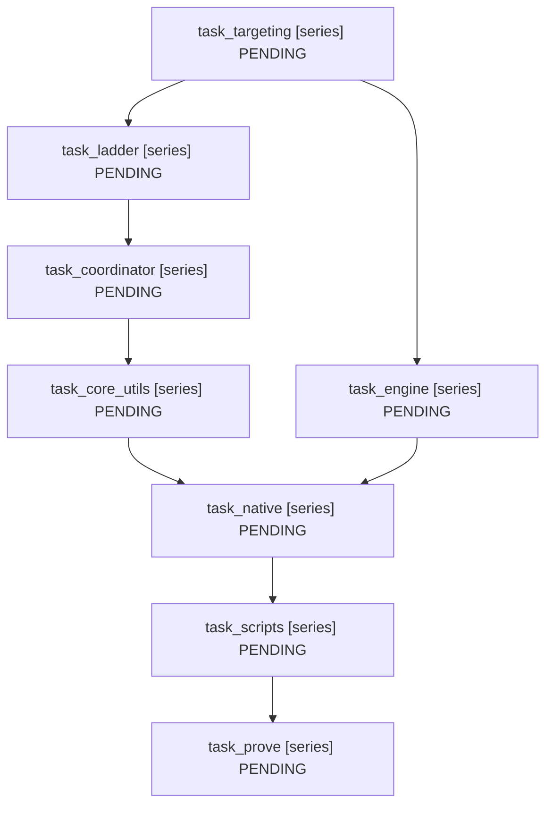

# iFocus Plan A (Round 2): remediation of triage-r1 findings

Author: `planner-a` | Round: 2 | Baseline: commit `fb078be` (54/54 tests) | Inputs: `docs/reviews/loop-dispatch-r2.md`, `docs/reviews/triage-r1.md`
Scope: `TRG-01` to `TRG-28`, all 28 included. `DEF-01` and `DEF-02` stay deferred. No new features.

## 0. Summary

Every validated finding gets a minimal fix and a test or a mechanical check. The codebase was read against each finding; six places where the dispatch's fix guidance, applied literally, would break an existing test or leave the defect open are listed first because they change what the builder should do.

| # | Trap | Evidence | What this plan does instead |
|---|---|---|---|
| R1 | **TRG-05 must not add a `SafetyVeto` case.** T26 asserts `SafetyVeto.allCases.count == 14`, checks a 14-entry disposition table, and has an exhaustive `switch` over the enum. | `Tests/iFocusCoreTests/SafetyTests.swift:34, 36-54` | The security-prompt veto returns the existing `.deny(.sourceNotAllowed)`, the same veto TRG-06 already prescribes for blocklisted apps. |
| R2 | **TRG-01: removing `isRunning = true` from `runUntilStreamFinishes()` breaks T38**, which calls that method directly without `start()`; the loop would exit on its first event. | `Tests/iFocusCoreTests/CoordinatorTests.swift:60`; `FocusCoordinator.swift:136, 144` | `runUntilStreamFinishes()` claims its own generation; the liveness test is "my generation is still the active one". |
| R3 | **TRG-05: retaining only `layer <= screenSaverWindow` (1000) drops the lock-screen shield.** A live window dump taken while this machine was locked shows `loginwindow` at layers 2001 and 2004, and 34 layer-0 windows still listed as on-screen beneath it. | Probe output in section 1, row V2 | Prompt-owner windows are retained at any layer; generic occluders only below 1000. Lock itself is handled by TRG-04. |
| R4 | **TRG-05: a naive "keep every layer > 0 window" rule can block every switch.** System chrome draws full-display transparent windows above layer 0. | Menu bar strip and 12 Control Center items in the same dump | A pure, unit-tested classifier ignores chrome owners, owner-less windows, sub-40-pt items and full-display overlays. |
| R5 | **TRG-03: a per-element timeout alone does not bound the stall.** Enumeration makes about five AX calls per window; nine Ghostty windows at 0.25 s each is over 11 s per rung. | `AXActuator.swift:24-35` | First `.cannotComplete` aborts the enumeration, plus a wall-clock budget inside the actuator and the 1.0 s ladder deadline. |
| R6 | **TRG-16: bridging `--doctor` with a semaphore deadlocks.** `Doctor.run` reaches `MainActor.run` through `CGWindowCatalogService.snapshot()`. | `CGWindowCatalogService.swift:19`; `Doctor.swift:77` | `Task { exit(await Doctor.run(...)) }` followed by `dispatchMain()`; compiled and run in a spike. |

## 1. Facts verified for this round

Spikes were compiled with `swiftc -swift-version 6` under `/tmp/pa-probe`, outside the workspace.

| # | Fact | How verified |
|---|---|---|
| V1 | `CGSessionCopyCurrentDictionary()` returned `kCGSSessionOnConsoleKey = 1` and `CGSSessionScreenIsLocked = 1` while the screen was locked. `kCGSessionOnConsoleKey as String` is the string `"kCGSSessionOnConsoleKey"`. | Probe run during planning; the machine happened to be locked. |
| V2 | Locked-state on-screen window list (50 windows): `Window Server` layer 2147483646 full display; `loginwindow` layer 2004 full display; `loginwindow` layer 2001 at `(-15000,-15000,30000,30000)`; twelve `com.apple.controlcenter` items at layer 25, 29 pt high, 30 to 154 pt wide; `Window Server` (no bundle ID) layer 24 at `(0,0,1496,29)`; the remaining 34 at layer 0. | Same probe. |
| V3 | Window levels on this OS: floating 3, modal panel 8, dock 20, main menu 24, status 25, pop-up menu 101, overlay 102, screen saver 1000, cursor 2147483630. | `CGWindowLevelForKey` in the probe. |
| V4 | These compile and run: `open(dir, O_RDONLY\|O_DIRECTORY\|O_NOFOLLOW\|O_CLOEXEC)`, `fstat`, `fchmod`, `openat`, `renameat`, `unlinkat`, `fsync(dirFD)`. | Probe returned 0 for the full write, rename, read, unlink sequence. |
| V5 | These names compile: `AVCaptureSession.runtimeErrorNotification`, `AVCaptureSession.wasInterruptedNotification`, `AVCaptureDevice.wasDisconnectedNotification`, `AVCaptureDevice.wasConnectedNotification`, `AVCaptureSessionErrorKey`. | Probe. |
| V6 | Writing `self?.queue.async { self?.handle(x) }` inside a `[weak self]` notification block emits a `SendableClosureCaptures` warning. | Probe. Use `guard let self else { return }` first, then capture the strong reference; the build must stay warning-free. |
| V7 | A synchronous `static func main()` can call `MainActor.assumeIsolated { ... }` for AppKit commands and bridge an async command with `Task { ...; exit(code) }; dispatchMain()`. | Probe printed the bridged result and exited 0. |

Not verified: the layer > 0 window census of an **unlocked** session on this desk (the screen was locked throughout). Section 2.5 is written to fail towards "iFocus still works" for unknown overlays, and `--doctor` is extended so the user can see what is being treated as an occluder.

## 2. Remediations

File paths are relative to the repository root. "Keep green" names the existing tests most exposed to each change.

### 2.1 TRG-01, TRG-07, TRG-13, TRG-14: `FocusCoordinator` lifecycle, log, status, recovery

File: `Sources/iFocusCore/Engine/FocusCoordinator.swift`. Callers in `Sources/iFocusMac/App/AppController.swift` need no lifecycle logic of their own after this.

**State.** Replace `isRunning` with:

```swift
private var generation: UInt64 = 0
private var activeGeneration: UInt64?          // nil means stopped
private var runTask: Task<Void, Never>?
private func isLive(_ g: UInt64) -> Bool { activeGeneration == g }
```

**`start()`**: return if `activeGeneration != nil`; otherwise increment `generation`, set `activeGeneration`, and spawn `runTask = Task { await supervise(generation: g) }`.

**`stop()`**: set `activeGeneration = nil`; move `runTask` into a local and set the property to nil; `local?.cancel()`; `await gazeEstimator.stop()`; `await local?.value`. A `start()` that arrives during these awaits creates a new task under a new generation, and `stop()` never touches it. That removes the hang.

**`runUntilStreamFinishes()`** (public, used by T38): increment `generation`, set `activeGeneration`, `await runOnce(generation: g)`, then clear `activeGeneration` only if it still equals `g`. No retry.

**`runOnce(generation:) -> RunExit`** where `RunExit` is `.stopped`, `.streamEnded`, `.interrupted(String)`, `.startFailed(String)`:

1. After each of `topologyService.current()`, `windowCatalog.snapshot()` and `gazeEstimator.start()`: if `!isLive(g)`, return `.stopped`. After `gazeEstimator.start()` specifically, a stale run calls `await gazeEstimator.stop()` only when `activeGeneration == nil`; if a newer generation is active it owns the estimator.
2. In the `for await` loop: break when `!isLive(g)`; on `.interrupted(reason)` feed the event to the pipeline (existing reset behaviour), `await gazeEstimator.stop()`, return `.interrupted(reason)`.
3. `processSingleEvent` takes `g` and re-checks `isLive(g)` after its two fresh awaits and immediately before `focusSwitcher.focus(target)`.

**`supervise(generation:)`** (TRG-14): loop `runOnce`. On `.stopped`, exit. On any other exit while still live: publish `.status(state: .error, detail: reason)`, sleep `retryBackoff` through the injected sleeper (5 s, doubling to a 60 s cap, reset after the first event of a successful run), re-check liveness, retry. New init parameter `retrySleeper: (any Sleeper)? = nil`; nil means no retry, so existing tests are unaffected. `AppController` passes `SystemSleeper()`. `SystemSleeper` uses `try? await Task.sleep`, so the `cancel()` in `stop()` ends a backoff sleep at once.

**Bounded log** (TRG-07): new init parameter `maxDecisionLogEntries: Int = 4096` (clamped to at least 1). Store entries in a small private ring (`storage`, `head`, O(1) append); `log()` returns them oldest first. 4096 exceeds the 1201 steps of the longest scenario, so T38's equality holds.

**Status** (TRG-13): `publishStatus` computes the key `(state, lastVeto, failureCount, detail)` and returns early when it equals the last published key. `permissionChecker()` results are cached for 1.0 s of `clock.now()`. `events()` replays the last status to a new subscriber so the menu still gets an initial value. Add `public func diagnostics() -> CoordinatorDiagnostics` returning `statusPublishes`, `permissionChecks`, `estimatorStarts`, `logCount`, so tests assert on counters instead of racing an event stream.

In `StatusMenuController.update`, keep the last `(status key, warning)` and return early if unchanged; call `updateIcon` only when the paused flag changes.

Keep green: T38 (direct `runUntilStreamFinishes`, log equality), T51.

### 2.2 TRG-02, TRG-15, TRG-23: calibration overlay trap and camera session

**Core, new file `Sources/iFocusCore/Engine/WatchedStream.swift`.**

```swift
public enum Watched<Element: Sendable>: Sendable { case event(Element); case stalled }
public struct WatchedStream<Element: Sendable>: Sendable {
    public let stream: AsyncStream<Watched<Element>>
    public init(source: AsyncStream<Element>, timeout: TimeInterval,
                clock: any MonotonicClock, sleeper: any Sleeper, pollInterval: TimeInterval = 0.5)
    public func cancel()        // finishes `stream`, cancels both internal tasks
}
```

One internal task forwards source events and records the time of the last one in a private actor; a second polls through the sleeper and, when `clock.now() - lastEvent > timeout`, yields `.stalled` and finishes. The stream also finishes when the source finishes. No closure crosses an isolation boundary, so the overlay can consume it on the main actor.

**`CalibrationOverlay`.**

- `run(...)` wraps the estimator stream in `WatchedStream(timeout: 5.0)`. `.stalled` returns `.failure(.cameraError("No camera frames for 5 s"))`. `.noFace` events count as frames, so an absent user does not trip the watchdog.
- New `public func cancel()`: set the cancel flag, call `watched.cancel()`, call `teardownWindows()` immediately, and start `Task { await gazeEstimator.stop() }`. The screens are uncovered at the moment of cancel, not when the next frame arrives.
- Escape and a new `NSButton` titled "Cancel (Esc)" (top-centre of every overlay window, target-action, no key equivalent needed) both call `cancel()`. Mouse cancel therefore works even if `NSApp.activate()` did not make the window key.
- Do not add any global event monitor; invariant I1 forbids it.

**`CameraSession`.**

- After a successful start, register three observers (V5) for the session and device. Each handler takes a strong `self` (V6), hops to the camera queue, yields `.interrupted(reason)` on `activeContinuation`, then runs `stopOnQueue()`. Tokens are stored in a queue-confined array and removed in `stopOnQueue()`.
- TRG-15: in `startOnQueue`, when already running, call `activeContinuation?.finish()` before replacing it. In `VisionGazeEstimator.start()` re-entry, call `streamContinuation?.finish()` before replacing it. In `VisionGazeEstimator.stop()`, finish the continuation **before** awaiting `session.stop()`, so consumers are released even if AVFoundation is slow to stop.
- TRG-23: order becomes `commitConfiguration()`, then query `device.activeFormat.videoSupportedFrameRateRanges`, then `lockForConfiguration()`, set `activeVideoMinFrameDuration`, `startRunning()`, `unlockForConfiguration()`. A lock failure stays non-fatal.

### 2.3 TRG-03, TRG-09, TRG-11, TRG-19: focus ladder and AX actuator

**Types** (`FocusTypes.swift`, `Services.swift`).

```swift
public enum FocusStepResult: Sendable, Equatable { case performed, staleCandidate, notTrusted }
public enum KeyWindowCheck: Sendable, Equatable { case matches, differs, unknown }
// FocusFailure gains: case timedOut
public protocol FocusActuator: Sendable {
    func windows(of pid: Int32) async -> [AXWindowCandidate]
    func perform(_ step: FocusStep, pid: Int32, window: AXWindowCandidate) async -> FocusStepResult
    func keyWindowCheck(pid: Int32, expected: AXWindowCandidate) async -> KeyWindowCheck
}
extension FocusActuator {
    public func keyWindowCheck(pid: Int32, expected: AXWindowCandidate) async -> KeyWindowCheck { .unknown }
}
```

No existing test calls `perform` directly or switches over `FocusFailure`, so both changes are source-compatible with T01 to T54.

**`LadderFocusSwitcher`.**

- TRG-19: rung C becomes `[.raiseAndMakeMain, .activateApp]`. A step result of `.staleCandidate` skips to the next rung and, if it was the last thing that happened, yields `.failed(.staleCandidate)`; `.notTrusted` returns `.failed(.notTrusted)` at once.
- TRG-03: new init parameters `clock: (any MonotonicClock)? = nil, deadlineSeconds: TimeInterval = 1.0`. With a clock, elapsed time is checked before each rung, before each step and before each verification poll; exceeding the deadline stops the ladder and returns `.failed(.timedOut)` after the rollback below. With no clock (every existing test) nothing changes. `AppController` passes its `SystemClock`.
- TRG-11: `verifyFocused` requires `snapshot.focusedWindowID == target.windowID` **and** `keyWindowCheck(...) != .differs`.
- TRG-09: on a final `.unverified` or `.timedOut`, take one snapshot. If its `focusedWindowID` is neither the target nor `initial.focusedWindowID`, and the initially focused window still exists, run one rollback: enumerate the initial window's PID, match it, perform `[.raiseAndMakeMain, .setAppFrontmost]` once. No verification loop, no second attempt, and the returned outcome is unchanged.

**`AXActuator`.**

- `fetchWindowElements` calls `AXUIElementSetMessagingTimeout(element, 0.25)` on every returned element before returning.
- Circuit breaker: every read helper reports `AXError`; the first `.cannotComplete` during `windows(of:)` or `perform` aborts and returns `[]` or `.staleCandidate`. Independently, `windows(of:)` stops and returns `[]` once 0.5 s of `ProcessInfo.processInfo.systemUptime` has elapsed.
- `perform` returns `.notTrusted` when `AXIsProcessTrusted()` is false and `.staleCandidate` for an out-of-range index or a failed identity check.
- `keyWindowCheck`: read `kAXFocusedWindowAttribute` on the app element (with timeout), resolve its window ID through `AXWindowID`; compare with `expected.windowID`. Without the private resolver compare frames with `edgesWithin(…, 2.0)`. Any read failure is `.unknown`.

**`SimFocusActuator`** (`SimServices.swift`): return `FocusStepResult` (`rejectIdentityMismatch` and identity failures give `.staleCandidate`); add `wrongWindowOnlyForTargetID: UInt32?` (wrong-window behaviour applies only when the candidate resolves to that ID, so a rollback towards another window behaves normally) and `keyWindowOverride: KeyWindowCheck?`.

Keep green: T31 (case 3 still reaches rung C through `.activateApp`; case 4 never moves focus, so no rollback), T32 (the sim actuator mis-raises on every call including the rollback, outcome stays `.failed(.unverified)`), T45 (`.failed(.staleCandidate)`, focus unchanged), T46.

### 2.4 TRG-04: session state

**Core, new file `Sources/iFocusCore/Model/SessionActivity.swift`.**

```swift
public struct SessionSignals: Sendable, Equatable {
    public var dictionaryAvailable: Bool   // CGSessionCopyCurrentDictionary() != nil
    public var onConsole: Bool             // kCGSSessionOnConsoleKey, true if the key is absent
    public var screenLocked: Bool          // CGSSessionScreenIsLocked, false if the key is absent
    public var systemSleeping: Bool
    public var displaysSleeping: Bool
}
public enum SessionActivity {
    public static func isActive(_ s: SessionSignals) -> Bool
    // dictionaryAvailable && onConsole && !screenLocked && !systemSleeping && !displaysSleeping
}
```

**`SystemSessionStateProvider`.**

- Initial state is computed from the dictionary, not assumed `true`.
- Notifications only change the two sleep flags (`willSleep`/`didWake`, `screensDidSleep`/`screensDidWake`) or trigger a re-query. The two `DistributedNotificationCenter` names and the two `NSWorkspace` session names never set state directly; a spoofed "unlocked" post re-reads the dictionary and stays inactive (V1).
- `isSessionActive()` re-queries, cached for 0.25 s, and publishes a change on `updates()` when the result differs from the last published value.
- While inactive, a 5 s heartbeat task re-queries, so a missed unlock notification cannot leave iFocus off for good. The heartbeat stops when active.

**`AppController`.**

- `runCalibrateCommand()` creates a provider, refuses to start when inactive, and cancels the overlay (2.2 `cancel()`) on the first inactive update.
- `runInteractiveCalibration()` keeps a reference to the live overlay; the existing `sessionTask` calls `overlay.cancel()` as well as `coordinator.stop()` when the session goes inactive.

### 2.5 TRG-05, TRG-06, TRG-11 (catalog half), TRG-12, TRG-27: windows, occlusion, blocklist

**Model** (`WindowTypes.swift`): `WindowDescriptor` gains `public var layer: Int`, last in the initialiser with default `0`, and a hand-written `init(from:)` using `decodeIfPresent(...) ?? 0` so old encodings still decode.

**Config** (`Config.swift`): add to `hardBlocklist` the four IDs named in TRG-06. Add two static sets:

- `securityPromptBundleIDs`: `com.apple.SecurityAgent`, `com.apple.LocalAuthentication.UIAgent`, `com.apple.UserNotificationCenter`, `com.apple.coreservices.uiagent`.
- `chromeBundleIDs`: `com.apple.dock`, `com.apple.WindowManager`, `com.apple.controlcenter`, `com.apple.notificationcenterui`, `com.apple.systemuiserver`.

**Core, new file `Sources/iFocusCore/Targeting/WindowClassifier.swift`**, a pure function the native catalog calls per window:

```swift
public enum WindowRole: Sendable, Equatable { case normal, occluder, securityPrompt, ignored }
public static func classify(layer: Int, alpha: Double, pid: Int32, ownPID: Int32,
                            bundleID: String?, bounds: CGRect, displayBounds: [CGRect]) -> WindowRole
```

Rules, first match wins:

| Order | Condition | Role |
|---|---|---|
| 1 | Own PID, alpha at most 0.01, empty bounds, or `layer < 0` | ignored |
| 2 | Bundle in `securityPromptBundleIDs` and at least 40x40, any layer | securityPrompt |
| 3 | Bundle is `com.apple.loginwindow`, `layer >= 1000`, at least 40x40 | securityPrompt |
| 4 | `layer == 0` | normal |
| 5 | `layer >= 1000` | ignored |
| 6 | Bundle is nil or in `chromeBundleIDs` | ignored |
| 7 | Smaller than 40x40 | ignored |
| 8 | Covers at least 80 percent of any display's area | ignored |
| 9 | Otherwise | occluder |

Rule 3 is tied to `layer >= 1000` on purpose: V2 shows that is where the lock shield lives, and it avoids a permanent veto if `loginwindow` keeps some low-layer window in a normal session, which could not be checked this round. Rule 8 is the fail-functional choice for unknown transparent overlays; a real security prompt is caught by rules 2 and 3 regardless of size.

Also in core: `WindowSnapshot.resolveFocusedWindowID(windows:frontmostPID:)`, returning the frontmost `layer == 0` window of that PID that is at least 120x80, falling back to any `layer == 0` window of that PID.

**`WindowHitTester`.**

- `isEligible` additionally requires `window.layer == 0`.
- `static func securityPromptVisible(in: WindowSnapshot) -> Bool`: any window at least 40x40 whose bundle is in `securityPromptBundleIDs`, or `com.apple.loginwindow` at `layer >= 1000`.
- TRG-27: before returning a snapped window, return `.none` if any other window that is not eligible and is either `layer > 0` or at least 120x80 lies strictly closer to the point.

**Safety** (`FocusTypes.swift`, `SafetyPolicy.swift`, `FocusDecisionEngine.swift`).

- `SafetyContext` gains `securityPromptVisible: Bool`, last in the initialiser with default `false`. The engine fills it in both `step` and `confirm`.
- `DefaultSafetyGuardPolicy`: immediately after the secure-input check, `if context.securityPromptVisible { return .deny(.sourceNotAllowed) }` (R1). Immediately before the `requireAllowedSource` check, `if let front = context.frontmostBundleID, Config.hardBlocklist.contains(front) { return .deny(.sourceNotAllowed) }`. Both use an existing veto in its existing precedence slot or earlier with a default-false input, so T26's precedence table is undisturbed.

**`CGWindowCatalogService`.**

- Classify every entry; keep `normal`, `occluder` and `securityPrompt` with their `layer`, in the order Core Graphics returned them. Display bounds come from `CGGetActiveDisplayList` and `CGDisplayBounds` once per snapshot.
- `focusedWindowID` comes from `resolveFocusedWindowID`.
- TRG-12: delete the `bundleIDCache` property; use a dictionary local to each `snapshot()` call.

**`Doctor`**: print the retained occluders and security-prompt windows (bundle ID, layer, bounds) and whether the prompt veto is currently active. This is the instrument for the unverified unlocked-session census.

Keep green: T15 to T18 (all fixtures are layer 0 through the defaulted initialiser), T26, T28, T53.

### 2.6 TRG-08: AX matcher

`AXWindowMatcher.match`: after the exact-ID pass, the geometric, ambiguous and approximate passes consider only candidates with `windowID == nil`. With no such candidate the result is `.notFound`. T30 and T53 use nil IDs throughout and are unaffected.

### 2.7 TRG-10: challenger candidate

`FocusDecisionEngine` gains `private var challenger: PendingCandidate?`. When a sample resolves to target X and `pending` exists for a different target:

1. If `now - pending.lastSeenAt > candidateDropoutSeconds`, `pending` has expired: promote `challenger` if it is for X (keeping its own `enteredAt`), otherwise start a fresh `pending` for X; clear `challenger`.
2. Otherwise `pending` survives this sample as a dropout: set or refresh `challenger` for X (`enteredAt` is the first sample of its current run) and return `.none` reporting the pending candidate.

A sample on `pending`'s own target refreshes `pending` but does not clear `challenger`; the challenger lapses only when it has had no sample of its own for `candidateDropoutSeconds`. Commit requires dwell met on a sample that lands on `pending`'s target **and** no live challenger. The no-target path expires both on the same dropout rule. `.clear` vetoes and the reconcile step clear both.

Consequences, all intended:

- An occasional outlier delays a commit by at most `candidateDropoutSeconds` (0.12 s) instead of restarting the dwell.
- A genuine move from M to F promotes F with `enteredAt` equal to F's first sample, so F commits when it would have before. M cannot commit during the hand-over even if a noisy sample lands back on it, because F is a live challenger. That makes this rule stricter than Round 1 for fly-overs, not looser.
- Gaze split evenly between two non-focused windows commits to neither. Ambiguous gaze producing no switch is the safe outcome.

Keep green: T19 (single steady target, no challenger involved), T20 (sticky margin, no target), T21, T22, T44 (fly-over: the destination is a live challenger, so the intermediate window cannot commit).

### 2.8 TRG-16: CLI entry point

`Sources/iFocusApp/IFocusCLI.swift`: `static func main()` becomes synchronous. `--run` and `--calibrate` call `exit(MainActor.assumeIsolated { AppController.runAgentCommand() })` and the calibrate equivalent. `--simulate`, `--help`, `--version` and usage errors compute a code and `exit`. `--doctor` uses the V7 bridge. Flush stdout and stderr before every `exit`. `README.md` gains the lifecycle smoke list: start, pause, resume, lock, unlock, quit within 2 s.

### 2.9 TRG-17: scripts

`scripts/sbx.sh` and `scripts/bundle-app.sh` share this helper (duplicated, since scripts are standalone):

```bash
prepare_secure_dir() {
  local d="$1"
  if [ -L "$d" ]; then echo "refusing symlink: $d" >&2; exit 1; fi
  mkdir -p -m 0700 "$d"
  if [ ! -d "$d" ] || [ ! -O "$d" ]; then echo "refusing unowned or non-directory: $d" >&2; exit 1; fi
  chmod 0700 "$d"
}
```

Defaults become `/tmp/ifocus-sbx-$(id -u)`, and for the SwiftPM branch `/tmp/ifocus-build-$(id -u)`, `/tmp/clang-cache-$(id -u)`, `/tmp/swiftpm-cache-$(id -u)`, `/tmp/swift-modcache-$(id -u)`. Every directory, including `$OUT/modcache` and a caller-supplied `IFOCUS_SBX_OUT`, goes through the helper before first use.

New `scripts/check-scripts.sh`: creates a real directory and a symlink to it with `mktemp -d`, runs `IFOCUS_SBX_OUT=<symlink> scripts/sbx.sh build` and `scripts/bundle-app.sh` with the same variable, and passes only if both exit 1 before compiling anything.

### 2.10 TRG-18: `SecureFileStore`

- `read`: open the directory with the V4 flags. `ENOENT` returns nil; `ELOOP` throws `.symlinkRefused(dirPath)` (T34's last assertion depends on that exact error); `ENOTDIR` throws `.insecureDirectory`. `fstat` the descriptor; wrong owner or `(mode & 0o077) != 0` throws `.insecureDirectory`. Open the file with `openat(dirFD, filename, O_RDONLY|O_NOFOLLOW|O_NONBLOCK|O_CLOEXEC)`; the per-file checks are unchanged and keep reporting the same paths.
- `write`: after `ensureDirectoryExists()`, open the directory the same way, `fchmod(dirFD, mode & ~0o077)` if needed, then `openat` for the temporary file, `renameat(dirFD, tmp, dirFD, filename)`, `fsync(dirFD)`, and `unlinkat(dirFD, tmp, 0)` on failure.
- `ensureDirectoryExists` keeps creating missing directories at `0700` and repairing loose permissions on the write path only.

### 2.11 P3 items not covered above

| ID | Change |
|---|---|
| TRG-20 | `PreparedScenario` stores `seed`; `ScenarioResult.seed` reports it. New `ScenarioRunner.runWithLadder(_:seed:config:exposeWindowIDs:) async`, which drives `FocusCoordinator` with `LadderFocusSwitcher` and `SimFocusActuator` and returns a `ScenarioResult`. The synchronous `run`/`runPrepared` API and `--simulate` are untouched, so T35 to T38, T44 and T53 need no edits. |
| TRG-21 | Add a third, unperturbed run to T51's coordinator half asserting `recordedTargets().count == 1`. This is the only edit to an existing test and it adds an assertion. |
| TRG-22 | New pure `FrameDecimator` in `Sources/iFocusCore/Filter/FrameDecimator.swift`: `mutating func shouldProcess(at now: TimeInterval) -> Bool` with `nextDue += 1/targetFPS`, accept when `now >= nextDue - 0.005`, re-anchor when `now - nextDue > 0.25`. `FrameProcessor` uses it. |
| TRG-24 | `check-invariants.sh` I4 also greps `nonisolated(unsafe)` and allows exactly one occurrence, in `Sources/iFocusCore/Simulation/SimServices.swift`. |
| TRG-25 | New pure `EyeGeometry` in `Sources/iFocusCore/Filter/EyeGeometry.swift`. The de-roll angle is the direction of the line between the two eye-contour centroids (with one eye, the line between that contour's two most distant points), normalised to point towards +x. `FrameProcessor` passes `CGPoint` arrays and stops using Vision's `roll` for this. README adds a 15° head-tilt check and a note to recalibrate after upgrading. |
| TRG-26 | `runInteractiveCalibration()` reads `let wasPaused = await coordinator.paused()` first and ends with `await coordinator.setPaused(wasPaused)` on every path. |
| TRG-28 | In `HUDController.flash`, reset alpha inside `NSAnimationContext.runAnimationGroup { $0.duration = 0; panel.alphaValue = 1.0 }` before the fade group. |

## 3. New tests

All in `Tests/iFocusCoreTests`, Swift Testing, virtual time unless stated. Test-local doubles live in a new `Tests/iFocusCoreTests/TestDoubles.swift`: `RecordingEstimator` (start count, live flag, optional stop delay, scripted streams), `SlowCatalog` (wraps `SimWindowCatalogService` with a real `Task.sleep` delay), `SteppingSleeper` (advances a `VirtualClock`, then `Task.yield()`), `ClockAdvancingActuator`.

| ID | Finding | Suite | Asserts |
|---|---|---|---|
| T55 | TRG-01 | Coordinator | With a 50 ms `SlowCatalog`, `start()` then `await stop()` leaves `RecordingEstimator.isLive == false` and at most one start. |
| T56 | TRG-01 | Coordinator | With a 50 ms estimator stop delay, `start()` issued while `stop()` is in flight: `stop()` returns within 2 s (raced against a timeout task), live streams never exceed one, and a final `stop()` leaves nothing live. |
| T57 | TRG-02 | Coordinator | `WatchedStream`: silent source yields `.stalled` once at 5 s of virtual time then finishes; three events then silence stalls 5 s after the last; `cancel()` finishes with no `.stalled`; a finished source finishes the watched stream. |
| T58 | TRG-03 | Ladder | An actuator that advances the clock 0.6 s per step: outcome `.failed(.timedOut)`, rung C never attempted. |
| T59 | TRG-04 | Safety | `SessionActivity.isActive` table: locked plus display awake is false; "unlocked" trigger with `screenLocked` still true is false; unlocked, on console, awake is true; missing dictionary is false; each sleep flag alone is false. |
| T60 | TRG-05 | HitTest | `WindowClassifier` table, including every row of the V2 dump as fixtures: lock shield is `securityPrompt`; menu-bar strip, Control Center items, Dock full-display window and a third-party full-display overlay are `ignored`; a 400x300 layer-8 panel is `occluder`; own PID is `ignored`. |
| T61 | TRG-05 | HitTest | A layer-8 dialog over a terminal returns `.blocked`; an allowlisted bundle at layer 3 is not eligible. |
| T62 | TRG-05 | Safety | A `SecurityAgent` window on another display: policy returns `.deny(.sourceNotAllowed)` and a full engine run with otherwise sufficient dwell produces no `.focus`. Removing the window restores the switch. |
| T63 | TRG-06 | Safety | With `requireAllowedSource == false`, every `hardBlocklist` entry as frontmost, the four new IDs named explicitly, returns `.deny(.sourceNotAllowed)`; a non-blocklisted non-allowlisted app is allowed. |
| T64 | TRG-07 | Coordinator | 5000 events with the default cap: `log().count == 4096` and the entries are the newest, in order. |
| T65 | TRG-08 | AXMatch | Target 999, candidates 111 and 222 sharing the target frame: `.notFound`. Mixed list (one mismatched ID, one nil ID with the frame): `.geometric` on the nil-ID candidate. |
| T66 | TRG-09 | Ladder | `wrongWindowOnlyForTargetID`: outcome `.failed(.unverified)` and the catalog's focused window equals the initial one. |
| T67 | TRG-10 | Engine | One outlier in six on neighbour C while dwelling on B: B commits no later than 0.45 s plus `candidateDropoutSeconds` plus one frame (Round 1 code never commits in 3 s). Control 1: 0.2 s on B then steadily on C commits C at C's entry plus dwell and never B. Control 2: strict B, C alternation for 3 s commits neither. |
| T68 | TRG-11 | Ladder | `resolveFocusedWindowID` skips a 100x60 window in front of a 800x600 one and falls back when only small windows exist; with `keyWindowOverride = .differs` the ladder never reports `.switched`. |
| T69 | TRG-13 | Coordinator | 200 `.noFace` events over 10 virtual seconds: `permissionChecks <= 12`, `statusPublishes <= 3` and at least 1. |
| T70 | TRG-14 | Coordinator | Stream one yields `.interrupted("disconnected")` and ends; with a retry sleeper the coordinator publishes `.error` with that detail, starts the estimator a second time, and processes events from stream two. |
| T71 | TRG-18 | FileStore | Directory at `0o775` and at `0o777`: `read` throws `.insecureDirectory`; back at `0o700` it reads; a write repairs `0o750` to `0o700`. T34 is left byte-identical. |
| T72 | TRG-19 | Ladder | Rung C performs exactly `raiseAndMakeMain` then `activateApp`; an actuator returning `.notTrusted` yields `.failed(.notTrusted)` after one call. |
| T73 | TRG-20 | Scenario | For each of the five built-in scenarios and seeds 1 to 3: `runWithLadder` switches equal `expectedSwitches` and equal the synchronous runner's; `ScenarioResult.seed` equals the seed passed. Also with `exposeWindowIDs: false` for the T53 scenario. |
| T74 | TRG-22 | FeaturePipeline | 30 Hz timestamps for 10 s at target 20: 195 to 205 accepted; 15 Hz input: all accepted; a 1 s gap re-anchors. |
| T75 | TRG-25 | FeaturePipeline | A synthetic eye pair rotated by 0°, ±15°, ±30°: offsets equal the unrotated values within `1e-9`. |
| T76 | TRG-27 | HitTest | Gap point 5 pt from a 600x400 Safari window and 60 pt from a terminal: `.none`. Same point with Safari removed: the terminal. T17 is left byte-identical. |

Expected total after this round: 54 existing plus 22 new, 76 tests.

Findings closed by inspection plus build rather than a unit test: TRG-12 (no `bundleIDCache` property), TRG-15, TRG-16 (gates G4 and G7), TRG-17 (gate G6), TRG-23, TRG-24 (gate G3), TRG-26, TRG-28, and the native halves of TRG-02, TRG-03, TRG-04, TRG-05 and TRG-11. `docs/build-r2.md` should cite the `file:line` of each.

## 4. Gates

| Gate | Command | Pass condition |
|---|---|---|
| G1b | `swift package --disable-sandbox describe` | Exit 0. |
| G2 | `IFOCUS_SBX_OUT=<own dir> scripts/sbx.sh test` | 76 passed, 0 warnings, T01 to T54 unmodified except the added assertion in T51. |
| G3 | `scripts/check-invariants.sh` | Exit 0, including the extended I4. |
| G4 | `<out>/ifocus --simulate all` | Exit 0. |
| G5 | `scripts/bundle-app.sh` | Exit 0. |
| G6 | `scripts/check-scripts.sh` | Exit 0. |
| G7 | `<out>/ifocus --help`, `--version`, `--doctor` | Exit 0 each; `--doctor` returns rather than hanging. |

## 5. Task graph

Topology: single-agent | Integrity Mode: development

| ID | Task Name | Mode | Depends On | Inputs | Outputs | Gate | Status |
|---|---|---|---|---|---|---|---|
| task_targeting | Layer, classifier, hit-test, matcher, safety, config (TRG-05, 06, 08, 11 core, 27) | series | none | docs/plans/final-plan-r2.md | Sources/iFocusCore/Targeting/WindowClassifier.swift, Tests/iFocusCoreTests/TestDoubles.swift | scripts/sbx.sh test | PENDING |
| task_engine | Challenger candidate (TRG-10) | series | task_targeting | Sources/iFocusCore/Targeting/WindowClassifier.swift | Sources/iFocusCore/Engine/FocusDecisionEngine.swift | scripts/sbx.sh test | PENDING |
| task_ladder | Step results, deadline, rollback, key-window check, rung C (TRG-03, 09, 11, 19) | series | task_targeting | Sources/iFocusCore/Targeting/WindowClassifier.swift | Sources/iFocusCore/Engine/LadderFocusSwitcher.swift | scripts/sbx.sh test | PENDING |
| task_coordinator | Generations, bounded log, status dedupe, retry (TRG-01, 07, 13, 14) | series | task_ladder | Sources/iFocusCore/Engine/LadderFocusSwitcher.swift | Sources/iFocusCore/Engine/FocusCoordinator.swift | scripts/sbx.sh test | PENDING |
| task_core_utils | WatchedStream, SessionActivity, FrameDecimator, EyeGeometry, file store, ladder-backed runner, T51 control (TRG-02, 04, 18, 20, 21, 22, 25) | series | task_coordinator | Sources/iFocusCore/Engine/FocusCoordinator.swift | Sources/iFocusCore/Engine/WatchedStream.swift, Sources/iFocusCore/Model/SessionActivity.swift, Sources/iFocusCore/Filter/FrameDecimator.swift, Sources/iFocusCore/Filter/EyeGeometry.swift | scripts/sbx.sh test | PENDING |
| task_native | Camera, overlay, session provider, catalog, actuator, app controller, menu, HUD, CLI, doctor (native halves, TRG-12, 15, 16, 23, 26, 28) | series | task_core_utils, task_engine | Sources/iFocusCore/Engine/WatchedStream.swift, Sources/iFocusCore/Model/SessionActivity.swift | Sources/iFocusMac/Gaze/CameraSession.swift, Sources/iFocusApp/IFocusCLI.swift | scripts/sbx.sh build | PENDING |
| task_scripts | Secure scratch dirs, script check, invariant I4 (TRG-17, 24) | series | task_native | scripts/sbx.sh | scripts/check-scripts.sh, scripts/check-invariants.sh | scripts/check-scripts.sh | PENDING |
| task_prove | All gates, README, build report, commit | series | task_scripts | scripts/check-scripts.sh | docs/build-r2.md, README.md | scripts/sbx.sh test | PENDING |



## 6. Not in this round

- `DEF-01` (fresh dwell after a typing pause) and `DEF-02` (native-tab disambiguation without the private resolver): deferred by triage.
- No new `SafetyVeto` case, no new config keys, no change to the overlay window level, no overall calibration time limit, no calibration-profile version bump. Each was considered and left out as beyond the validated findings.

## 7. Decisions for the arbiter

| # | Question | Recommendation | Alternative and its cost |
|---|---|---|---|
| D1 | Which veto does a visible security prompt raise? | Existing `.sourceNotAllowed`. | A dedicated `.securityPrompt` case reads better in the menu but requires editing three assertions in T26, against the dispatch's non-regression rule. |
| D2 | How are layer > 0 windows filtered? | The nine-rule classifier in 2.5. | The dispatch's simpler `0 <= layer <= 1000` minus three owners drops the lock shield (V2) and trusts that no other full-display overlay exists. |
| D3 | Where does camera retry live? | In `FocusCoordinator.supervise`, testable with an injected sleeper. | In `AppController`, driven by `wasConnectedNotification`: fewer core changes, no unit test possible. |
| D4 | Change `FocusActuator.perform` to return `FocusStepResult`? | Yes; it is the only way to tell stale identity from refusal without a second AX round trip. | Keep `Bool`, document the rung C change only, and leave TRG-19's stale half open. |
| D5 | Extend T17 and T34 in place, as the dispatch words it, or add T71 and T76? | New tests; the 54 originals stay byte-identical apart from T51's added control. | In-place edits satisfy the dispatch wording literally. |

Residual risk carried forward: the unlocked-session overlay census (section 1) and, as in Round 1, live Vision and AX behaviour. All three need one run of `ifocus --doctor` and the README checklist on the unlocked desk with permissions granted.
