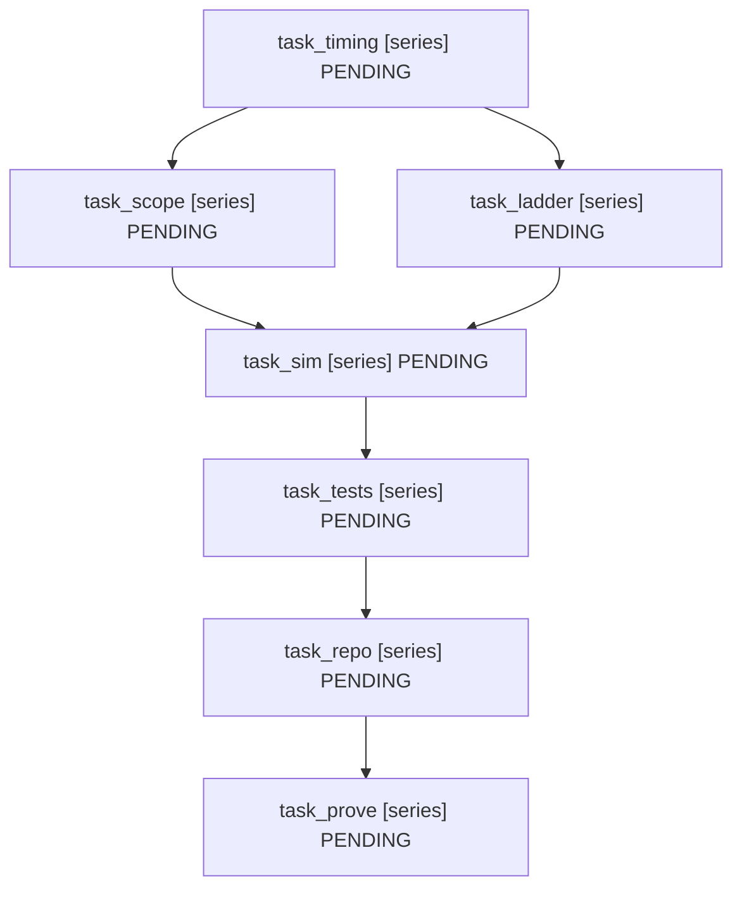

# iFocus Plan A (Round 3): quiet-then-dwell timing, universal window focus, public-repo readiness

Author: `planner-a` | Round: 3 (Wave 2) | Baseline: commit `ddc3550` (78/78 tests) | Input: coordinator brief, board #29
Scope: the three requested upgrades only. `DEF-01` is absorbed by upgrade 1. `DEF-02` to `DEF-04`, `TRG2-01` and `TRG2-03` stay out.

## 0. Summary

The design below was prototyped in a throwaway copy of the repository under `/tmp` and run through `scripts/sbx.sh test`, so the blast radius and the new timings are measured, not estimated. Nothing in the workspace was touched.

| # | Finding | Evidence | Consequence |
|---|---|---|---|
| F1 | Changing only the defaults and the `.typing` disposition makes 15 of 78 tests fail and one, T70, hang forever; adding `allApps` breaks 2 more and widens T26. | Experiment A and B, section 1 | Section 4.1 lists every one with its exact fix. |
| F1a | **T70 does not fail, it never returns.** It emits two gaze samples 0.35 s apart and then waits on the event stream for a switch (`CoordinatorTests.swift:485-494`); with a 1.2 s dwell none comes, so the whole test binary sits there. Three of my runs hung this way before I saw why. | Experiments A to C: T70 logged as started, never finished; with the fixture applied the run completes in 0.84 s | The builder will see a silent hang, not a red test, the moment the defaults change. Fix T70 in the same step as the defaults (4.1), and put a time limit on the suite so the next such change fails instead of hanging. |
| F2 | Eleven of those are mechanics tests (dwell thresholds, dropout, challenger, hit-test, reconnect) that only need their old numbers pinned. One fixture, `Config.v1Mechanics`, makes all eleven pass with 16 one-token swaps and no assertion edits. | Experiments C and D | The old mechanics coverage survives intact; new tests pin the new defaults. |
| F3 | With `.typing` moved to `.clear`, gaze never pre-charges: 0 of 295 locked steps carried a candidate, across 10 seeds, in the "type for 10 s while staring at another window" scenario. The switch lands at last key + 3.75 s. | Experiment C, probe X01 | No extra engine rule is needed for "no pre-charge"; one disposition change does it. |
| F4 | Skipping rung A for cross-PID targets with the ladder otherwise unchanged breaks T45, because the AX list can reorder inside rung B. A one-shot re-match on `.staleCandidate` fixes it. | Reasoned from `LadderTests.swift:55-66`, then run | Section 3.3 includes the re-match. T45, T31, T32, T46, T66, T68 pass unedited. |
| F5 | pr-guardian's scan job runs on Ubuntu with `--no-exec`; it never builds Swift. Its scanner set, run locally on the tree plus the draft workflows and licence, reports 0 leads. | `review.yml` scan job; `run_scanners.py` run, section 1 | Build and test proof must come from our own `ci.yml`; the scanners are already satisfied. |
| F6 | `scripts/sbx.sh` exits 2 on any non-Command-Line-Tools layout (`sbx.sh:25-26`), which is what a GitHub runner with Xcode selected has. | Read | `ci.yml` cannot call it as-is; section 3.5 adds a layout probe. |
| F7 | The original complaint case (look at a window and start typing within about a second) now sends those keys to the old window, and typing then holds focus there. | Follows from the requested model; pinned by T91 | Stated in the contract and README so it is a known trade-off, not a surprise. |

## 1. Facts verified for this round

| # | Fact | How verified |
|---|---|---|
| V1 | Experiment A (new timing defaults, new ranges, `.typing` to `.clear`): failing tests are T19, T22, T25, T26, T27, T33, T35, T36, T37, T39, T43, T51, T62, T67, T73, and T70 hangs (F1a). T35 fails only its latency bound; its switch sequence still matches on all 10 seeds. T38, T44 and T53 pass. | `sbx.sh test` on the copy |
| V2 | Experiment B (A plus `focusScope = allApps` default): additionally T16 and T76 fail, and T26 gains two failures because Safari as frontmost app is no longer a `.sourceNotAllowed` trigger. T17, T61 and T63 pass. | Same |
| V3 | Experiments C and D (B plus the fixture on eleven tests, re-timed scenarios and the section 3.3 ladder): the run completes, 79 tests (78 plus one probe) in 0.84 s with no compiler warnings, and only T26, T27, T33, T58 and T72 fail, each a deliberate contract change. | Same |
| V4 | Measured timings under the new defaults: T35 switch latency 1.20 to 1.55 s over 70 switches; re-timed T36 switches at 1.20 s; re-timed T37 switches at 5.05 s (last key 1.35 s + 2.5 + 1.2); probe X01 switches at 16.15 s for a last key at 12.40 s on every seed. | Printed from the test run |
| V5 | Bundle identifiers read from the installed apps' `Info.plist`: Spotify `com.spotify.client`; Chrome `com.google.Chrome`; 1Password `com.1password.1password`; Passwords `com.apple.Passwords`; Keychain Access `com.apple.keychainaccess`; Screen Sharing `com.apple.ScreenSharing`; Spotlight `com.apple.Spotlight`; SystemUIServer `com.apple.systemuiserver`; Touch ID agent (`coreautha.bundle`) `com.apple.LocalAuthentication.UIAgent`; VS Code `com.microsoft.VSCode`; Finder `com.apple.finder`. | `PlistBuddy` on each bundle |
| V6 | Bitwarden and 1Password 7 are not installed here. Their identifiers in section 3.2 are from memory and unverified. | Paths absent |
| V7 | `CGEventSource.flagsState(.combinedSessionState)` and `secondsSinceLastEventType(..., .keyUp)` compile under Swift 6 and return values with no permission. | Spike |
| V8 | `ConfigStore.save` is never called, so no default config file is written to disk. Existing users only have values they typed themselves. | `grep` over `Sources` |
| V9 | The draft `ci.yml` in section 3.5 passes `actionlint` 1.7.12 and `zizmor` 1.31.1 offline, default and pedantic personas, with no findings. `pr-guardian.yml` passes both as well. | Ran both |
| V10 | The reference `pr-guardian.yml` is 4732 bytes, SHA-256 `f895264c8c614957ab2e904d006727b9df8384f7aafd73ee0b03356cacf8ae1d`. | `shasum` |
| V11 | A canonical Apache-2.0 text (202 lines, SHA-256 `cfc7749b96f63bd31c3c42b5c471bf756814053e847c10f3eb003417bc523d30`) exists locally at `~/code/github/skills/LICENSE`. The `LICENSE` in `agent-skill-forge` is a 17-line short form, not the full text. | `shasum`, `wc -l` |
| V12 | `actions/checkout@3d3c42e5aac5ba805825da76410c181273ba90b1` is the pin used by pr-guardian's own `review.yml`, labelled v7.0.1. | Read |
| V13 | pr-guardian scanner set (`run_scanners.py`, the script its scan job calls) on HEAD plus draft workflows plus licence: status `clean`, 0 leads; gitleaks, actionlint and zizmor ran; osv-scanner and trivy skipped as not relevant (no lockfiles, no IaC). | Ran in a `/tmp` git repo |
| V14 | `iFocusCore`, `iFocusMac` and the `ifocus` executable compile and link against the macOS 15.2 SDK with the local compiler. | `SDKROOT=...MacOSX15.2.sdk scripts/sbx.sh` |
| V15 | Home-directory paths in the tree today: 30 in `docs/FINAL_REPORT.md` (all `file:` links), 1 in `docs/plans/plan-b-r1.md`. None in `Sources`, `Tests`, `scripts` or `README.md`. | `grep` |

Not verified, and why:

- **semgrep.** The runner reported it as run with 0 leads but its exit code was 1, and its rule packs come from the registry, which the sandbox cannot reach. Treat semgrep as unchecked until the first pull request.
- **The GitHub runner.** Its compiler version, and whether its toolchain layout matches either branch of the `sbx.sh` probe, cannot be checked offline. V14 retires the SDK half of that risk only.
- **Test target against the macOS 15 SDK.** The local `Testing.framework` cannot be imported with the older SDK, so only the three product modules were checked there.
- **Live AX behaviour for cross-app activation**, as in earlier rounds: no Accessibility grant in the sandbox.

## 2. Behaviour contract

| Situation | Result |
|---|---|
| Hands idle; look at a window on another display | Focus moves after 1.2 s of steady gaze. |
| Hands idle; look at another window on the same display | Focus moves after 1.5 s of steady gaze. |
| Typing, clicking, dragging, scrolling or holding a modifier or mouse button while looking anywhere | Nothing. No candidate is kept and dwell progress stays at 0. |
| Activity stops | 2.5 s of no input (2.0 s after plain pointer movement) must pass first. Only then does a dwell start, from zero. Total 3.7 to 4.0 s after the last key. |
| Any input during that wait or during the dwell | Back to the start: full quiet period, then a full fresh dwell. |
| Look at a window and start typing within about a second | Keys go to the old window and focus stays there (F7). The switch flash is the cue that focus has moved. |
| Target is any normal app window (browser, music player, editor, terminal) | Eligible by default. |
| Target or frontmost app is a password manager, authentication prompt, screen sharing, System Settings, system chrome or iFocus | Never a target; never switched away from. |

Config changes (all clamped on load):

| Key | Old default | New default | New range |
|---|---|---|---|
| `dwellCrossDisplaySeconds` | 0.30 | 1.2 | 0.15 to 5.0 |
| `dwellSameDisplaySeconds` | 0.45 | 1.5 | 0.15 to 5.0 |
| `typingLockSeconds` | 1.0 | 2.5 | 0.3 to 10.0 |
| `pointerMoveLockSeconds` | 0.8 | 2.0 | 0 to 10.0 |
| `pointerClickLockSeconds` | 1.5 | 2.5 | 0 to 10.0 |
| `focusScope` | (absent) | `"allApps"` | `"allApps"` or `"allowlist"`; any other value loads as `"allowlist"` |
| `excludedBundleIDs` | (absent) | `[]` | up to 64 valid IDs; applies in both scopes |
| `mismatchAlert`, `mismatchBeep`, `mismatchAlertIntervalSeconds` | present | removed | ignored if found in a file (T33 already proves unknown keys are ignored) |

`schemaVersion` stays 1: old files still load, removed keys are ignored, and V8 means nobody has stale defaults on disk unless they wrote them.

## 3. Changes

### 3.1 Timing and engine

| File | Change |
|---|---|
| `Sources/iFocusCore/Model/Config.swift` | Defaults, fallbacks and ranges per section 2. Remove the three mismatch keys. |
| `Sources/iFocusCore/Model/FocusTypes.swift` | `SafetyVeto.typing.disposition` becomes `.clear`; `.cooldown` stays `.hold` (the 0.6 s cooldown is shorter than any dwell, and T42 depends on it). Remove `EngineAction.mismatchAlert` and `CoordinatorEvent.mismatch`. The enum keeps 14 cases. |
| `Sources/iFocusCore/Model/InputTypes.swift` | Add `isModifierHeld: Bool = false`. |
| `Sources/iFocusCore/Engine/SafetyPolicy.swift` | `.typing` also fires while `isModifierHeld` is true. Nothing else changes; the order of the 14 checks is the same. |
| `Sources/iFocusCore/Engine/FocusDecisionEngine.swift` | Delete `lastAlertAt` and the `.typing` branch of `evaluatePendingCommit` (it is unreachable once `.typing` clears). The remaining hold branch serves `.cooldown` only. |
| `Sources/iFocusMac/Input/SystemInputActivityProvider.swift` | Keyboard time is the minimum of key-down, key-up and flags-changed. `isModifierHeld` is true when `flagsState` contains shift, control, option, command or fn (caps lock excluded, since it is a toggle). Drag and scroll move from the pointer-move class to the pointer-click class so they get the 2.5 s window the brief asks for; plain `mouseMoved` alone stays in the 2.0 s class. Still timestamps and flags only: no key codes, no tap. |
| `Sources/iFocusCore/Engine/FocusCoordinator.swift`, `Sources/iFocusCore/Simulation/ScenarioRunner.swift`, `Sources/iFocusApp/IFocusCLI.swift`, `Sources/iFocusMac/App/AppController.swift`, `Sources/iFocusMac/UI/HUDController.swift` | Remove the mismatch event, its log entries, `ScenarioResult.mismatchAlerts`, the CLI print and the amber flash. |

Why retire the mismatch alert instead of keeping it: it fired when a dwell completed during typing. Under the new model a dwell cannot complete, or even start, during typing, so the code path is dead; and typing in one window while reading another is now the supported workflow, so an alert on it would be noise.

### 3.2 Universal window focus

`Config.isBundleAllowed(_:)` stays the single eligibility rule, used unchanged by `WindowHitTester.isEligible`, the engine's MRU logic and the `requireAllowedSource` check:

```swift
public func isBundleAllowed(_ bundleID: String?) -> Bool {
    guard let bundleID, !bundleID.isEmpty else { return false }      // unidentified owner: fail closed
    guard !Self.isHardBlocked(bundleID) else { return false }
    guard !excludedBundleIDs.contains(bundleID) else { return false }
    switch focusScope {
    case .allApps:   return true
    case .allowlist: return allowedBundleIDs.contains(bundleID)
    }
}
```

`isHardBlocked` is `hardBlocklist.contains(id)` or a match on `hardBlockPrefixes`. `DefaultSafetyGuardPolicy` switches its frontmost-app check from `hardBlocklist.contains` to `isHardBlocked`.

Additions to `Config.hardBlocklist` (existing entries stay):

| Identifier | Why | Verified |
|---|---|---|
| `com.1password.1password` | Password manager | V5 |
| `com.apple.Passwords` | Password manager | V5 |
| `com.apple.keychainaccess` | Credential store | V5 |
| `com.apple.Spotlight` | System chrome | V5 |
| `com.apple.systemuiserver` | System chrome | V5 |
| `dev.ifocus.app` | iFocus itself (`Resources/Info.plist`); own-PID windows are also dropped by the classifier | Read |

`Config.hardBlockPrefixes`: `com.1password.`, `com.agilebits.onepassword`, `com.bitwarden.` (the last two unverified, V6). Prefixes cover helper processes that exact IDs miss. `--doctor` prints every on-screen window's bundle ID and eligibility so the user can confirm their own password manager is caught, and `excludedBundleIDs` is the remedy if it is not.

Three points the brief does not spell out:

1. **Spotlight goes on the blocklist but not into `chromeBundleIDs`.** That set means "look through this" for layer > 0 windows. Looking through the Spotlight panel would let 1.2 s of reading search results focus the window behind it and dismiss the panel. Left out of that set, the panel is an occluder and gaze on it resolves to `.blocked`.
2. **A window whose owner has no bundle ID is not eligible.** The blocklist cannot be applied to an unidentified owner.
3. **Password fields in any app are already covered.** `IsSecureEventInputEnabled()` raises `.secureInput` before any targeting; no change needed, but README should say so now that browsers are targets.

Other files: `Sources/iFocusMac/App/Doctor.swift` prints `focusScope`, lists eligible windows of any app, and caps `--focus-test` at six windows, preferring distinct PIDs. User-facing strings in `StatusMenuController`, `Doctor` and `README.md` change "terminal" to "window" where they describe targets.

Known limit to document, not fix: a layer-0 window that AX does not list as a window (some sheets and helper panels) fails with `.windowNotFound`, then waits out the existing 2 s failure backoff before the next attempt.

### 3.3 Cross-PID focus ladder

File: `Sources/iFocusCore/Engine/LadderFocusSwitcher.swift`. `AXActuator` needs no change.

```swift
let crossPID = initial.frontmostPID != target.pid
let rungs: [(FocusStrategy, [FocusStep])] = crossPID
    ? [(.rungB, [.raiseAndMakeMain, .setAppFrontmost, .raiseAndMakeMain]),
       (.rungC, [.raiseAndMakeMain, .activateApp,     .raiseAndMakeMain])]
    : [(.rungA, [.raiseAndMakeMain]),
       (.rungB, [.raiseAndMakeMain, .setAppFrontmost]),
       (.rungC, [.raiseAndMakeMain, .activateApp])]
```

| Change | Reason |
|---|---|
| Cross-PID starts at rung B | Rung A cannot give a background app the keyboard; today it raises the window, fails three verification polls (about 100 ms), then escalates. |
| Raise, activate, raise again | The first raise makes the target the app's main window before the app comes forward, so the wrong window never takes keys. The second covers apps that ignore a raise while in the background or re-order on activation: without it, Chrome window 1 could come forward when window 2 was the target, and only a failed verification plus rung C would correct it. |
| One re-match per step on `.staleCandidate` | Re-enumerate, re-match by `CGWindowID`, retry that step once (F4). No extra AX traffic unless a step reports stale. |
| Verification also requires `snapshot.frontmostPID == target.pid` | Makes "the app has the keyboard" explicit instead of implied by how `focusedWindowID` is derived. `keyWindowCheck != .differs` stays. |
| Roll back before returning `.failed(.staleCandidate)` | This is `TRG2-02`. It is one line in the function being edited, and a half-completed cross-app switch is exactly when it matters. |

Same-PID behaviour is byte-for-byte what it is today, so Ghostty-to-Ghostty and Chrome-to-Chrome still take rung A with one AX step.

### 3.4 Simulation

| File | Change |
|---|---|
| `Sources/iFocusCore/Simulation/Presets.swift` | New `Rig.mixedApps` on the `deskThree` displays, one or two windows per display: Ghostty (pid 1001) filling the portrait panel; Chrome windows 1 and 2 (pid 3001, `com.google.Chrome`) as left and right halves of the main panel; Spotify (pid 3002, `com.spotify.client`) on the built-in panel. |
| `Sources/iFocusCore/Simulation/SimServices.swift` | `SimFocusActuator.ignoreRaiseWhileAppInBackground: Bool = false`. `keyWindowCheck` without an override returns `.matches` when the catalog's focused window is the expected one and `.differs` otherwise (T68 sets its override explicitly, so it is unaffected). |
| `Sources/iFocusCore/Simulation/Scenario.swift` | `ScenarioInputEvent` gains `.scroll(at:)` (click class) and `.modifierHeld(Bool, at:)`. Re-time `dualExternalSwitchBeforeTyping` (keys at 2.00, 2.15, 2.30; duration 3.0) and `dualExternalMismatchDuringTyping` (duration 7.0; renamed `dualExternalTypingThenQuiet`). New `mixedAppsTour`, `mixedAppsTypingWhileReading`, `dualExternalTypeTooSoon`. |
| `Sources/iFocusApp/IFocusCLI.swift` | `--simulate mixed-apps`, included in `all`. |

### 3.5 Repository readiness

| Item | Specification |
|---|---|
| `LICENSE` | Canonical Apache-2.0 text, unmodified. Gate: SHA-256 equals the V11 value. No copyright line is added to it; see D6. |
| `.github/workflows/pr-guardian.yml` | Byte-for-byte copy of `~/code/github/agent-skill-forge/.github/workflows/pr-guardian.yml`. Gate: SHA-256 equals the V10 value. |
| `.github/workflows/ci.yml` | The file below, verbatim (V9). |
| `scripts/sbx.sh` | Replace the hard exit at lines 25-26 with a probe: use `$DEV/usr/bin/swiftc` and `$DEV/Library/Developer/Frameworks` when present (Command Line Tools, verified locally); otherwise `xcrun --find swiftc`, `xcrun --sdk macosx --show-sdk-path`, and the platform's `Developer/Library/Frameworks` under `$DEV/Platforms/MacOSX.platform` (Xcode; these paths are from memory and unverified). Print which layout was chosen. Exit 2 with a clear message if no `Testing.framework` is found. Never skip silently. |
| `scripts/check-invariants.sh` | New I8: no home-directory path and no `file:` URL with three slashes in any tracked or untracked-but-not-ignored text file. Build the pattern from split strings, as I7 already does for its forbidden commands, so the script does not match itself: `"/Us""ers/[A-Za-z0-9._-]+"`, `"/ho""me/[A-Za-z0-9._-]+/"`, `"fi""le:///"`. File list from `git ls-files` plus `git ls-files --others --exclude-standard`, falling back to `find` outside a git checkout. |
| Path scrub | `docs/FINAL_REPORT.md`: rewrite the 30 `file:` links as relative links (`../Sources/...`, `plans/...`, `reviews/...`). `docs/plans/plan-b-r1.md`: replace the one absolute workspace path with "the repository root". Then let I8 find anything this round's documents added. |
| `SECURITY.md` | Supported version (main); report through GitHub private vulnerability reporting, no e-mail address invented; what is in scope; a short data-handling statement (frames in memory only, no key codes, two permissions, files at `0600`). |
| `CONTRIBUTING.md` | The gate commands from section 5, the I1 to I8 invariants in one line each, the test ID convention, "no external dependencies", and "never loosen an existing test without a contract note". |
| `DESIGN.md` | Sections: purpose and non-goals; module map; coordinate spaces; gaze features and One-Euro filtering; per-display ridge calibration; window census and the nine classifier rules; eligibility and `focusScope`; decision engine (quiet period, dwell, challenger, hysteresis); the 14 vetoes in order with dispositions; focus ladder (same-PID and cross-PID); concurrency model; threat model (assets, trust boundaries, the STRIDE rows from the two security reviews, residual risks); testing strategy. Every claim links to a repo-relative `path:line`. |
| `README.md` | New one-line description (any window, not only terminals); the section 2 config table; `focusScope` and `excludedBundleIDs`; the F7 trade-off under known limits; remove mismatch rows; desk checklist gains "Ghostty to Spotify, press Space" and "Ghostty to the second of two Chrome windows". |
| Commit | Everything, including the review and report files that are currently untracked. No push, no `gh` calls. |

```yaml
name: ci
on:
  push:
    branches: [main]
  pull_request:
permissions:
  contents: read
concurrency:
  group: ci-${{ github.ref }}
  cancel-in-progress: true
jobs:
  macos:
    name: Build and test (macOS)
    runs-on: macos-15
    timeout-minutes: 30
    steps:
      - name: Check out
        uses: actions/checkout@3d3c42e5aac5ba805825da76410c181273ba90b1 # v7.0.1
        with:
          persist-credentials: false
      - name: Show toolchain
        run: |
          xcode-select -p
          swift --version
      - name: swift build
        run: swift build
      - name: swift test
        run: swift test
      - name: Direct swiftc build and test (sbx.sh)
        run: ./scripts/sbx.sh test
      - name: Architecture and security invariants
        run: ./scripts/check-invariants.sh
      - name: Script hardening
        run: ./scripts/check-scripts.sh
```

Handoff note for the reporter: `docs/FINAL_REPORT.md` must use repo-relative links from now on, or I8 fails.

## 4. Tests

### 4.1 Existing tests that change

Add to `Tests/iFocusCoreTests/TestDoubles.swift`:

```swift
extension Config {
    /// Round 1 and 2 mechanics fixture: allowlist scope and the short v1 timings.
    static var v1Mechanics: Config {
        Config(dwellCrossDisplaySeconds: 0.30, dwellSameDisplaySeconds: 0.45, typingLockSeconds: 1.0,
               pointerMoveLockSeconds: 0.8, pointerClickLockSeconds: 1.5, focusScope: .allowlist)
    }
}
```

| Tests | Change | Assertions edited |
|---|---|---|
| T16, T19, T22, T25, T39, T43, T51, T62, T67, T70, T76 | Replace `Config()` with `Config.v1Mechanics` inside these eleven tests (16 occurrences). Do T70 before running anything (F1a). | None |
| Coordinator suite | Add a time limit: `@Suite("Coordinator", .timeLimit(.minutes(1)))`. Checked: with T70 left on the new defaults, the run now ends after 64 s with "Time limit was exceeded" instead of hanging. | None |
| T26 | Disposition table: `.typing` is `.clear`. The `.sourceNotAllowed` trigger becomes a blocklisted frontmost app (`com.apple.systempreferences`). Still 14 vetoes, same order. | 2 lines |
| T27 | Rewritten and retitled "typing burst clears the candidate and a fresh dwell follows the quiet period": no candidate on any step while locked; no switch before last key + 2.5 + 1.2; exactly one switch after. | Whole test |
| T33 | Clamped `dwellCrossDisplaySeconds` expectation 2.0 becomes 5.0. | 1 line |
| T35 | Latency bound 1.0 s becomes 2.0 s (measured 1.20 to 1.55, V4). The switch-sequence assertion is unchanged. | 1 line |
| T36 | Uses the re-timed scenario; asserts the switch precedes the first key at 2.00 s. | 1 line |
| T37 | Uses the renamed scenario; drops the mismatch assertions; asserts one switch at or after 5.05 s. | 4 lines |
| T58 | Cross-PID call count with no clock: 5 becomes 6. | 1 line |
| T72 | Cross-PID call count 5 becomes 6; the tail is `[.raiseAndMakeMain, .activateApp, .raiseAndMakeMain]`. | 2 lines |

Every other test, including T38, T44, T45, T53 and T73, passes unedited (V3). `docs/build-r3.md` must carry this table as its "contract changes" section.

### 4.2 New tests

| ID | Suite | Asserts |
|---|---|---|
| T79 | Config | New defaults and ranges; `focusScope` decodes `allApps` and `allowlist`, and an unknown string loads as `allowlist`; a file containing the removed mismatch keys loads cleanly; `excludedBundleIDs` is sanitised and capped at 64. |
| T80 | Engine | Under `Config()`: while keys arrive every 150 ms and gaze rests on another window, every step reports no candidate and progress 0. After the last key there is no commit before +3.7 s and a commit on the first sample at or after it. One key at 0.8 s into the dwell restarts the full 2.5 + 1.2. |
| T81 | Safety | Table-driven, one row per input class: key-down, modifier change, modifier held, click, drag or scroll (2.5 s); pointer move (2.0 s); button held. Each clears the candidate and each needs its own full quiet period. |
| T82 | Engine | A dropout veto interleaved with typing (looking down at the keyboard, then back) cannot keep a candidate alive across the lock. |
| T83 | Engine | Idle hands under `Config()`: no commit at dwell minus one frame; commit at 1.2 s across displays and 1.5 s on the same display. |
| T84 | HitTest | Eligibility table in `allApps`: Chrome, Spotify, Ghostty, VS Code, Finder eligible; every blocklist entry, each prefix family, a nil and an empty bundle ID, an excluded ID, a layer-3 window and a 100x60 window not eligible. In `allowlist`: Safari blocked, Ghostty eligible. |
| T85 | Safety | A 1Password window in front of Chrome gives `.blocked`, never Chrome. A Spotlight panel at layer > 0 gives `.blocked`. A password manager as frontmost app gives `.sourceNotAllowed` even with `requireAllowedSource == false`. |
| T86 | Ladder | Ghostty to Spotify on `Rig.mixedApps`: `.switched(.rungB)`; steps exactly raise, set-frontmost, raise; no single-step rung A. Afterwards frontmost PID is Spotify's, the focused window is Spotify's, and `keyWindowCheck` is `.matches`. |
| T87 | Ladder | Ghostty to Chrome window 2 while Chrome's own front window is window 1: lands on window 2, including with `ignoreRaiseWhileAppInBackground`. Then window 2 to window 1: `.switched(.rungA)` with one step. Repeated with window IDs hidden. |
| T88 | Ladder | An actuator that raises the window but never brings the app forward is never reported as `.switched`; outcome `.failed(.unverified)` and focus is back on the initial window. A stale result after a wrong raise also rolls back (`TRG2-02`). |
| T89 | Scenario | `mixedAppsTour` through `runWithLadder`, 10 seeds: Ghostty, Spotify, Chrome 2, Chrome 1, Ghostty. Switch sequence exact; strategies are rung B for each app change and rung A for Chrome to Chrome; latency at most dwell + 0.5 s. |
| T90 | Scenario | `mixedAppsTypingWhileReading`, 10 seeds: 10 s of typing in Ghostty while looking at Chrome, a 1.5 s pause, 0.9 s more typing, then idle. Zero switches and zero candidate entries up to last key + 2.5 s; exactly one switch, between last key + 3.7 s and + 4.2 s. |
| T91 | Scenario | `dualExternalTypeTooSoon`: typing starts 0.6 s after the gaze lands and continues for 5 s. Zero switches. Pins the F7 trade-off. |

Expected total: 78 existing plus 13 new, 91 tests.

## 5. Gates

| Gate | Command | Pass condition |
|---|---|---|
| G1b | `swift package --disable-sandbox describe` | Exit 0. |
| G2 | `IFOCUS_SBX_OUT=<own dir> scripts/sbx.sh test` | 91 passed, no `warning:` lines. |
| G3 | `scripts/check-invariants.sh` | Exit 0 including I8. |
| G4 | `<out>/ifocus --simulate all` | Exit 0, including `mixed-apps`. |
| G5 | `scripts/bundle-app.sh` | Exit 0. |
| G6 | `scripts/check-scripts.sh` | Exit 0. |
| G7 | `<out>/ifocus --help`, `--version`, `--doctor` | Exit 0 each. |
| G8 | `actionlint .github/workflows/*.yml` and `zizmor --offline .github/workflows/` | No findings. |
| G9 | `shasum -a 256 LICENSE .github/workflows/pr-guardian.yml` | Equal to V11 and V10. |
| G10 | `python3 ~/code/github/agent-skill-forge/skills/security-review/scripts/run_scanners.py --repo-root .` | Status `clean`, 0 leads; report semgrep's exit code as observed. |

`swift build` and `swift test` remain impossible in the sandbox (Round 1 finding); their first proof is the `ci.yml` run on the pull request.

## 6. Task graph

Topology: single-agent | Integrity Mode: development

| ID | Task Name | Mode | Depends On | Inputs | Outputs | Gate | Status |
|---|---|---|---|---|---|---|---|
| task_timing | Config defaults, typing clears, input classes, mismatch removal (3.1) | series | none | docs/plans/final-plan-r3.md | Sources/iFocusCore/Model/Config.swift, Sources/iFocusCore/Engine/FocusDecisionEngine.swift, Sources/iFocusMac/Input/SystemInputActivityProvider.swift | scripts/sbx.sh build | PENDING |
| task_scope | focusScope, blocklists, doctor and wording (3.2) | series | task_timing | Sources/iFocusCore/Model/Config.swift | Sources/iFocusCore/Engine/SafetyPolicy.swift, Sources/iFocusMac/App/Doctor.swift | scripts/sbx.sh build | PENDING |
| task_ladder | Cross-PID rungs, re-match, verification, rollback (3.3) | series | task_timing | Sources/iFocusCore/Model/Config.swift | Sources/iFocusCore/Engine/LadderFocusSwitcher.swift | scripts/sbx.sh build | PENDING |
| task_sim | Mixed-apps rig, sim flags, scenarios, CLI (3.4) | series | task_scope, task_ladder | Sources/iFocusCore/Engine/LadderFocusSwitcher.swift, Sources/iFocusCore/Engine/SafetyPolicy.swift | Sources/iFocusCore/Simulation/Presets.swift, Sources/iFocusCore/Simulation/Scenario.swift | scripts/sbx.sh build | PENDING |
| task_tests | Fixture, contract changes, T79 to T91 (4) | series | task_sim | Sources/iFocusCore/Simulation/Scenario.swift | Tests/iFocusCoreTests/TestDoubles.swift, Tests/iFocusCoreTests/ScenarioTests.swift | scripts/sbx.sh test | PENDING |
| task_repo | Licence, policies, design doc, workflows, sbx probe, I8, scrub, README (3.5) | series | task_tests | Tests/iFocusCoreTests/ScenarioTests.swift | LICENSE, SECURITY.md, CONTRIBUTING.md, DESIGN.md, .github/workflows/ci.yml, .github/workflows/pr-guardian.yml | scripts/check-invariants.sh | PENDING |
| task_prove | All gates, build report, commit | series | task_repo | LICENSE, .github/workflows/ci.yml | docs/build-r3.md | scripts/sbx.sh test | PENDING |



## 7. Not in this round

- `DEF-02` (native-tab disambiguation), `DEF-03` (majority-share dwell), `DEF-04` (Dock and banner sub-rects), `TRG2-01`, `TRG2-03`.
- AX subrole filtering of targets, a quarantine for windows AX cannot focus, a veto while a menu is open, per-app dwell, a settings window. Each was considered for the `allApps` default and left out as beyond the brief.
- Creating the GitHub repository, pushing, or opening the pull request: the coordinator's step.

## 8. Decisions for the arbiter

| # | Question | Recommendation | Alternative and its cost |
|---|---|---|---|
| D1 | Retire the mismatch alert? | Yes, completely. It is unreachable under the new model and would alert on the workflow the user asked for. | Keep it behind a default-off flag with its own gaze tracker: new code nobody requested. |
| D2 | How to keep the eleven mechanics tests? | Pin them with `Config.v1Mechanics` (F2, measured) and add T80, T83 on the real defaults. | Re-time each test by hand: eleven rewrites with new magic numbers and no added coverage. |
| D3 | Cross-PID rung shape. | Raise, activate, raise. One extra AX call buys the right Chrome window on the first attempt. | Raise, activate only: correct eventually through rung C, after a visible wrong-window moment and about 100 ms. |
| D4 | Small additions beyond the literal brief: `excludedBundleIDs`, modifier-held and key-up in the quiet test, blocklist prefixes, `TRG2-02`. | Keep all four. Each is a few lines, each closes a gap the `allApps` default opens. | Cut any of them; the first to cut is key-up, the last is `excludedBundleIDs` (users need a way to opt an app out). |
| D5 | Spotlight. | Blocklist it, keep it an occluder (3.2 point 1). | Add it to `chromeBundleIDs` as the brief's wording suggests: gaze then passes through the panel. |
| D6 | Copyright line. | Ship the licence text unmodified and add no `NOTICE`; the coordinator supplies the holder's name if one is wanted. | Invent a holder name in the plan. |
| D7 | `sbx.sh` on the runner. | The layout probe in 3.5. | Force `DEVELOPER_DIR` to the Command Line Tools in that one CI step: simpler, but fails if the runner image lacks them. |

Residual risks, all needing either the first pull-request run or the unlocked desk: the runner's compiler accepting code written against 6.4; the Xcode branch of the `sbx.sh` probe; semgrep's registry rules; and real cross-app activation through AX (`--doctor --focus-test` now exercises it across distinct apps).
